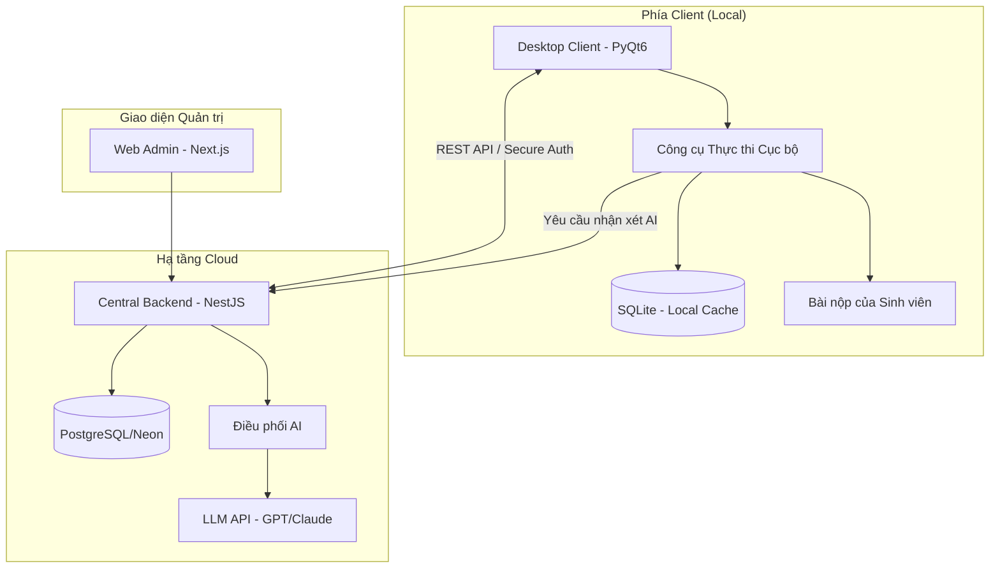

# 🎓 AITA — Hệ Thống Chấm Bài Tự Động Thông Minh

[](https://www.python.org/)
[](https://nestjs.com/)
[](https://nextjs.org/)
[](https://www.postgresql.org/)
[](https://tailwindcss.com/)

**AITA** là một hệ sinh thái chấm bài tự động chuyên nghiệp dành cho giảng viên. Bằng cách kết hợp công cụ thực thi cục bộ hiệu suất cao với hệ thống điều phối AI tập trung, AITA biến quá trình chấm bài lập trình tedious trở thành một trải nghiệm mượt mà, được hỗ trợ bởi trí tuệ nhân tạo.

[Tính năng](#-tính-năng-cốt-lõi) • [Kiến trúc](#-kiến-trúc-hệ-thống) • [Cài đặt](#-hướng-dẫn-cài-đặt) • [Kiến thức Domain](#-kiến-thức-chấm-bài)

---

## 🚀 Tính năng cốt lõi

### 🤖 Trí tuệ nhân tạo (AI)
*   **Tự động tạo Testcase**: Tạo các bộ dữ liệu kiểm thử (edge-case) dựa trên mô tả bài toán.
*   **Nhận xét mã nguồn thông minh**: AI phân tích và giải thích *tại sao* bài làm của sinh viên sai, thay vì chỉ thông báo kết quả.
*   **Phát hiện đạo văn**: Xác minh nâng cao để đảm bảo tính chính trực trong học thuật.
*   **Quản lý khóa API tập trung**: Quản lý an toàn các API key của AI tại server, tránh lộ lọt ở phía client.

### ⚙️ Chấm bài hiệu suất cao
*   **Hỗ trợ đa ngôn ngữ**: Chấm bài native cho **C, Java, Python** và các **đồ án Web**.
*   **Kiểm thử hộp đen (Black-box)**: Xác thực nghiêm ngặt dựa trên Input/Output để đảm bảo tính công bằng.
*   **Xử lý hàng loạt**: Chấm hàng trăm bài nộp trong vài phút với cơ chế lưu trữ cục bộ qua SQLite.
*   **Báo cáo chi tiết**: Xuất file `results.csv` chuyên nghiệp bao gồm điểm số, thời gian chạy và nhận xét từ AI.

### 🌐 Hệ sinh thái 3 tầng
1.  **Desktop Client**: "Đầu máy" — xử lý đọc/ghi file cục bộ và thực thi mã nguồn.
2.  **Central Backend**: "Bộ não" — quản lý người dùng, logic AI và dữ liệu quản trị.
3.  **Web Admin**: "Trung tâm điều khiển" — Dashboard hiện đại để quản lý tổng thể.

---

## 🏗 Kiến trúc hệ thống

AITA áp dụng kiến trúc tách rời để đảm bảo hiệu suất chấm bài không bị phụ thuộc vào đường truyền mạng, trong khi các tính năng AI vẫn được quản lý tập trung và bảo mật.



---

## 🛠 Hướng dẫn cài đặt

### 🖥️ Desktop Client (Công cụ chấm bài)
```bash
# Clone repo và di chuyển vào thư mục client
cd apps/desktop-client

# Cài đặt thư viện
pip install -r requirements.txt

# Khởi chạy ứng dụng
python main.py
```

### ⚙️ Central Backend (AI & Quản lý)
```bash
# Di chuyển vào thư mục backend
cd apps/central-backend

# Cài đặt thư viện
npm install

# Cấu hình biến môi trường
cp .env.example .env # Thêm DATABASE_URL và AI_API_KEY

# Thiết lập Database
npm run db:generate
npm run db:deploy
npm run db:seed

# Khởi chạy server
npm run start:dev
```

### 🌐 Web Admin (Dashboard)
```bash
# Di chuyển vào thư mục web app
cd apps/web-admin

# Cài đặt thư viện
npm install

# Cấu hình biến môi trường
cp .env.example .env # Thêm NEXT_PUBLIC_API_URL

# Khởi chạy server phát triển
npm run dev
```

---

## 📖 Kiến thức chấm bài

### 🏁 Kết quả chấm bài (Verdicts)
AITA sử dụng các kết quả chuẩn trong lập trình thi đấu:

| Kết quả | Ý nghĩa | Mô tả |
| :--- | :--- | :--- |
| **AC** | Accepted | Kết quả khớp hoàn toàn với đáp án. |
| **WA** | Wrong Answer | Kết quả sai so với đáp án. |
| **TLE** | Time Limit Exceeded | Chương trình chạy quá thời gian quy định. |
| **MLE** | Memory Limit Exceeded | Chương trình sử dụng quá bộ nhớ cho phép. |
| **CE** | Compilation Error | Mã nguồn bị lỗi biên dịch/thông dịch. |
| **RE** | Runtime Error | Chương trình bị crash khi đang chạy (ví dụ: Segfault). |

### 📊 Định dạng dữ liệu
**Đầu vào (`students.csv`)**:
`MSSV, Đường-dẫn-file` — Ánh xạ mã số sinh viên với file bài nộp.

**Đầu ra (`results.csv`)**:
`MSSV, Điểm, Bài-vượt-qua, Kết-quả, Thời-gian, Nhận-xét-AI` — Báo cáo điểm cuối cùng.

---

## 📂 Cấu trúc dự án

```text
AITA/
├── apps/
│   ├── desktop-client/   # App chấm bài (Python/PyQt6)
│   ├── central-backend/  # API & Logic AI (NestJS)
│   └── web-admin/        # Dashboard quản trị (Next.js)
├── docs/                 # Tài liệu kỹ thuật & Spec
├── rules/                # Quy định chấm bài & Ràng buộc
└── tests/                # Kiểm thử Integration & Unit
```

---

## 🤝 Đóng góp

Chúng tôi hoan nghênh mọi đóng góp để AITA trở nên tốt hơn cho cộng đồng giáo dục!

*   **Quy trình Git**: Vui lòng tạo nhánh tính năng (feature branch) cho mọi thay đổi (ví dụ: `code-feature-name`).
*   **Testcase**: Khi thêm testcase mới, hãy tuân thủ định dạng `<UT|IT|ST|AT><NN>_<ModulePascalCase>_TC<nnn>`.
*   **Tiêu chuẩn**: Đảm bảo mọi endpoint backend mới đều được cập nhật trong Swagger.

---
<p align="center">Được xây dựng với ❤️ dành cho cộng đồng giáo dục.</p>
