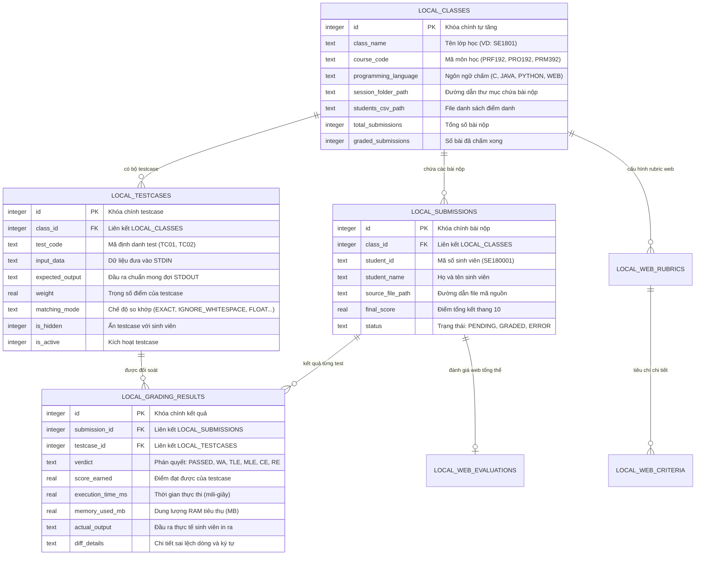
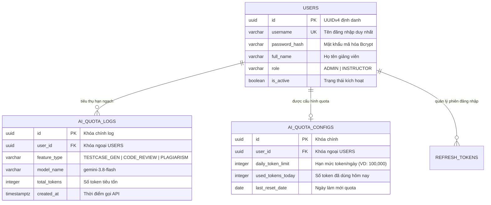

# CẨM NANG THUYẾT TRÌNH BẢO VỆ ĐỒ ÁN: DATABASE SCHEMA & DESIGN PATTERNS

> **Dự án**: AITA (Automated Grading & Assessment Tool for Instructors)  
> **Môn học**: SWD392 / SE Capstone Project  
> **Mục tiêu tài liệu**: Cung cấp toàn bộ kịch bản thuyết trình (Script), slide outline, kiến trúc dữ liệu và chỉ dẫn dòng mã nguồn cụ thể của 3 mẫu thiết kế (Design Patterns) cùng lược đồ cơ sở dữ liệu (Database Schema).

---

## MỤC LỤC
1. [Kế hoạch & Phân bổ thời gian Thuyết trình](#1-kế-hoạch--phân-bổ-thời-gian-thuyết-trình)
2. [Phần 1: Thiết kế Cơ sở Dữ liệu (Database Schema & ERD)](#2-phần-1-thiết-kế-cơ-sở-dữ-liệu-database-schema--erd)
   - 2.1. Triết lý kiến trúc Dữ liệu Lai (Hybrid Storage Architecture)
   - 2.2. Sơ đồ quan hệ ERD (PostgreSQL Cloud & SQLite Local)
   - 2.3. Lời thoại thuyết trình mẫu (Script) về Cơ sở Dữ liệu
3. [Phần 2: Áp dụng 3 Mẫu thiết kế (Design Patterns) trong Mã nguồn](#3-phần-2-áp-dụng-3-mẫu-thiết-kế-design-patterns-trong-mã-nguồn)
   - 3.1. Creational Pattern: Factory Method (`RunnerFactory`)
   - 3.2. Structural Pattern: Adapter Pattern & Facade Pattern (`CompilerAdapter` & `DatabaseManager`)
   - 3.3. Behavioral Pattern: Strategy Pattern (`MatchingContext` & 7 Concrete Strategies)
4. [Phần 3: Bảng tra cứu Mã nguồn phục vụ Demo (Code Navigation Cheat Sheet)](#4-phần-3-bảng-tra-cứu-mã-nguồn-phục-vụ-demo-code-navigation-cheat-sheet)

---

## 1. Kế hoạch & Phân bổ thời gian Thuyết trình

Khi bảo vệ trước Hội đồng Giảng viên (thời lượng **10 - 15 phút**), nhóm nên phân chia thời gian theo cấu trúc:

| STT | Nội dung trình bày | Thời lượng | Trọng tâm cần nhấn mạnh |
| :--- | :--- | :---: | :--- |
| 1 | **Database Schema & ERD** | 4 - 5 phút | Kiến trúc Hybrid (Local SQLite offline-first + Cloud PostgreSQL quản lý Quota AI). Tính toàn vẹn dữ liệu, chế độ WAL và bảo mật bài thi. |
| 2 | **3 Mẫu thiết kế (Design Patterns)** | 6 - 8 phút | Vấn đề thực tế $\rightarrow$ Giải pháp thiết kế $\rightarrow$ Mở mã nguồn trực tiếp minh chứng tính tuân thủ nguyên lý SOLID. |
| 3 | **Tổng kết & Demo nhanh** | 2 - 3 phút | Chạy demo chấm bài thực tế và đối soát kết quả trên IDE. |

---

## 2. Phần 1: Thiết kế Cơ sở Dữ liệu (Database Schema & ERD)

### 2.1. Triết lý kiến trúc Dữ liệu Lai (Hybrid Storage Architecture)

Hệ thống AITA không sử dụng mô hình cơ sở dữ liệu tập trung truyền thống thuần Cloud mà sử dụng kiến trúc **Dữ liệu Lai (Hybrid Offline-First)**:

1. **Local SQLite (`local_grading.db`) trên máy Giảng viên**:
   - **Mục đích**: Lưu trữ thông tin sinh viên, mã nguồn bài nộp, file đề thi, testcase mật và toàn bộ kết quả chấm điểm.
   - **Ưu điểm**:
     - *Bảo mật & Quyền riêng tư (Privacy-by-Design)*: Dữ liệu bài thi của sinh viên không bao giờ bị rò rỉ ra ngoài môi trường mạng internet.
     - *Tốc độ siêu nhanh*: Chấm hàng trăm bài nộp tức thì không có độ trễ mạng (Network Latency = 0ms).
     - *Chế độ WAL (Write-Ahead Logging)*: Đảm bảo khả năng ghi đồng thời và chống hỏng cơ sở dữ liệu khi máy tính đột ngột mất điện.
2. **Central PostgreSQL trên Neon Cloud**:
   - **Mục đích**: Quản lý tài khoản Giảng viên, phân quyền Quản trị viên (RBAC) và kiểm soát hạn mức Token sử dụng mô hình AI Hub (AI Quota Management).
   - **Ưu điểm**: Đồng bộ quota đa thiết bị, bảo vệ khóa API AI Hub không bị lộ ra phía Client.

---

### 2.2. Sơ đồ quan hệ ERD

#### A. Sơ đồ ERD Cơ sở Dữ liệu Cục bộ (Local SQLite - `local_grading.db`)
- Tệp triển khai mã nguồn: [db_manager.py](file:///e:/AITA/apps/desktop-client/src/database/db_manager.py#L46-L160)  
- Tài liệu thiết kế chi tiết: [database_schema.md](file:///e:/AITA/docs/architecture/database_schema.md#L62-L135)



#### B. Sơ đồ ERD Cơ sở Dữ liệu Trung tâm (Central PostgreSQL - Neon Cloud)



---

### 2.3. Lời thoại thuyết trình mẫu (Script) về Cơ sở Dữ liệu

> *"Kính thưa Hội đồng Giảng viên, về mặt thiết kế dữ liệu, nhóm chúng em lựa chọn mô hình **Kiến trúc Dữ liệu Lai (Hybrid Storage Architecture)** nhằm giải quyết trọn vẹn hai yêu cầu lớn trong môi trường khảo thí:*
> 
> *Thứ nhất là **Bảo mật và Tốc độ**: Toàn bộ bài nộp của sinh viên, danh sách mã sinh viên và kết quả chấm thi được lưu trữ trực tiếp vào cơ sở dữ liệu **SQLite cục bộ** trên máy Giảng viên. Chúng em kích hoạt chế độ **WAL (Write-Ahead Logging)** và bật chế độ **Foreign Key Constraints** chặt chẽ trong file `db_manager.py`. Nhờ vậy, quá trình chấm bài diễn ra tức thì với độ trễ bằng 0ms, không phụ thuộc vào internet và bài thi tuyệt đối an toàn trên máy trạm.*
> 
> *Thứ hai là **Quản lý Hạn ngạch AI**: Cơ sở dữ liệu **PostgreSQL trung tâm** đặt trên nền tảng Neon Cloud chỉ lưu trữ danh tính Giảng viên và nhật ký sử dụng Token của mô hình AI Hub. Mô hình này giúp Nhà trường kiểm soát chi phí gọi AI tập trung và cấp phát hạn ngạch theo từng ngày cho mỗi Giảng viên."*

---

## 3. Phần 2: Áp dụng 3 Mẫu thiết kế (Design Patterns) trong Mã nguồn

Hệ thống AITA triển khai đầy đủ **3 nhóm mẫu thiết kế chuẩn GoF (Gang of Four)**:

```
┌────────────────────────────────────────────────────────────────────────┐
│                      3 NHÓM MẪU THIẾT KẾ TRONG AITA                     │
├─────────────────────┬──────────────────────────┬───────────────────────┤
│ Nhóm Khởi tạo       │ Nhóm Cấu trúc            │ Nhóm Hành vi          │
│ (Creational)        │ (Structural)             │ (Behavioral)          │
├─────────────────────┼──────────────────────────┼───────────────────────┤
│ **Factory Method**  │ **Adapter & Facade**     │ **Strategy Pattern**  │
│ File: runner_factory│ File: db_manager,        │ File: context.py,     │
│                     │       design-patterns.md │       builtins.py     │
└─────────────────────┴──────────────────────────┴───────────────────────┘
```

---

### 3.1. Creational Pattern: Factory Method (`RunnerFactory`)

#### A. Vị trí mã nguồn trong dự án:
- [runner_factory.py](file:///e:/AITA/apps/desktop-client/src/core/factories/runner_factory.py#L13-L43)
- [base_runner.py](file:///e:/AITA/apps/desktop-client/src/core/runners/base_runner.py#L12-L36)

#### B. Vấn đề thực tế gặp phải:
Mỗi môn học ở trường yêu cầu một ngôn ngữ nộp bài khác nhau: C (`.c`), Java (`.java`), Python (`.py`), Web (`.html`). Nếu viết mã cứng (Hard-coded) lồng ghép `if/else` hoặc `switch/case` trong giao diện chấm:
```python
# ANTI-PATTERN: Vi phạm nguyên lý Open/Closed Principle (OCP)
if file.endswith(".c"):
    runner = CRunner()
elif file.endswith(".java"):
    runner = JavaRunner()
```
Khi muốn thêm ngôn ngữ mới (ví dụ C++ `.cpp`), lập trình viên buộc phải can thiệp trực tiếp vào mã nguồn của màn hình chấm điểm, rất dễ gây lỗi hồi quy (Regression Bugs).

#### C. Giải pháp & Cách mã nguồn AITA thực thi:
AITA áp dụng **Factory Method Pattern kết hợp Cơ chế Đăng ký động (Dynamic Registry)**:
- `BaseRunner`: Lớp trừu tượng (Abstract Product).
- `CRunner`, `JavaRunner`, `PythonRunner`: Các lớp cụ thể (Concrete Products).
- `RunnerFactory`: Lớp nhà máy (Creator) cung cấp phương thức `get_runner(language)` và `register_runner(language_key, runner_cls)`.

```python
# Trích dẫn từ: apps/desktop-client/src/core/factories/runner_factory.py
class RunnerFactory:
    _REGISTRY: Dict[str, Type[BaseRunner]] = {
        "C": CRunner,
        "JAVA": JavaRunner,
        "PYTHON": PythonRunner
    }

    @classmethod
    def register_runner(cls, language_key: str, runner_cls: Type[BaseRunner]):
        """Tuân thủ nguyên lý OCP: Cho phép mở rộng ngôn ngữ mới tại thời điểm chạy."""
        cls._REGISTRY[language_key.upper()] = runner_cls

    @classmethod
    def get_runner(cls, language: str) -> BaseRunner:
        lang_upper = language.upper()
        if "JAVA" in lang_upper:
            return cls._REGISTRY["JAVA"]()
        elif "PYTHON" in lang_upper or "PY" in lang_upper:
            return cls._REGISTRY["PYTHON"]()
        else:
            return cls._REGISTRY["C"]()
```

#### 🎙️ Lời thoại thuyết trình mẫu:
> *"Về mẫu Khởi tạo, nhóm áp dụng **Factory Method** thông qua lớp `RunnerFactory`. Điểm đặc biệt trong thiết kế của nhóm là chúng em không chỉ dùng `if/else` thông thường trong factory, mà sử dụng một biến từ điển `_REGISTRY`. Điều này tuân thủ 100% nguyên lý **Open/Closed (Mở để mở rộng, Đóng để sửa đổi)**. Khi nhà trường cần mở thêm môn học lập trình C#, chúng em chỉ cần viết thêm lớp `CSharpRunner` kế thừa `BaseRunner` và gọi lệnh `register_runner('CSHARP', CSharpRunner)` mà không cần sửa bất kỳ dòng mã nào đang chạy ổn định của hệ thống."*

---

### 3.2. Structural Pattern: Adapter Pattern & Facade Pattern

#### A. Vị trí mã nguồn & đặc tả trong dự án:
- [design-patterns.md (Mục 3: CompilerAdapter)](file:///e:/AITA/docs/architecture/design-patterns.md#L169-L225)
- [db_manager.py (DatabaseManager Facade)](file:///e:/AITA/apps/desktop-client/src/database/db_manager.py#L16-L50)
- [grading_service.py (GradingService Facade)](file:///e:/AITA/apps/desktop-client/src/services/grading_service.py#L22-L75)

#### B. Phân tích Mẫu thiết kế Cấu trúc:

##### 1. Mẫu Adapter Pattern (`CompilerAdapter`)
- **Vấn đề kỹ thuật**: Mỗi trình biên dịch trên hệ điều hành có cú pháp CLI và định dạng trả về khác nhau:
  - `gcc`: Nhận file `.c`, xuất file nhị phân `.exe`, in lỗi cú pháp qua `stderr` dạng `file.c:line:col: error: ...`
  - `javac`: Nhận file `.java`, xuất Bytecode `.class`, in lỗi qua `stderr` dạng `file.java:line: error: ...`
  - `python`: Không sinh file thực thi, kiểm tra cú pháp bằng module `py_compile`.
- **Giải pháp**: Thiết kế `CompilerAdapter` (Target Interface). Các lớp `GccAdapter`, `JavacAdapter` (Adapters) bao bọc lấy các chương trình dòng lệnh của hệ điều hành (Adaptees) để biến đổi các giao diện bất đồng nhất này về một dạng phương thức chung duy nhất: `compile(source_path) -> CompileResult`.

##### 2. Mẫu Facade Pattern (`DatabaseManager` & `GradingService`)
- Trong mã nguồn thực tế, `DatabaseManager` đóng vai trò là một **Facade** che giấu toàn bộ sự phức tạp của hệ thống lưu trữ bên dưới: mở kết nối SQLite, cấu hình WAL Mode, kiểm tra PRAGMA foreign keys, tạo bảng tự động, xử lý giao dịch (Transactions). Các lớp Controller bên ngoài chỉ cần gọi các phương thức ngữ nghĩa cấp cao như `get_all_classes()`, `save_grading_result()`.

#### 🎙️ Lời thoại thuyết trình mẫu:
> *"Về mẫu Cấu trúc, nhóm áp dụng **Adapter Pattern** và **Facade Pattern**:  
> - Với **Adapter Pattern**, chúng em giải quyết bài toán xung đột giao diện dòng lệnh giữa các trình biên dịch khác nhau như MinGW GCC và Oracle JDK javac. `CompilerAdapter` chuẩn hóa việc gọi thực thi và chuyển đổi mã lỗi phân mảnh của hệ điều hành về mã lỗi thống nhất `CompileResult` cho hệ thống chấm bài.  
> - Đồng thời, chúng em áp dụng **Facade Pattern** tại lớp `DatabaseManager`. Thay vì để giao diện GUI phải trực tiếp quản lý các câu lệnh kết nối SQLite, cấu hình WAL mode và xử lý khóa ngoại, `DatabaseManager` cung cấp một giao diện tối giản để tầng trên lưu và đọc điểm bài thi một cách an toàn và tiện lợi."*

---

### 3.3. Behavioral Pattern: Strategy Pattern (`MatchingContext` & 7 Concrete Strategies)

#### A. Vị trí mã nguồn trong dự án:
- [context.py](file:///e:/AITA/apps/desktop-client/src/core/strategies/context.py#L20-L69)
- [builtins.py](file:///e:/AITA/apps/desktop-client/src/core/strategies/builtins.py#L1-L150)
- [base_strategy.py](file:///e:/AITA/apps/desktop-client/src/core/strategies/base_strategy.py#L10-L30)

#### B. Vấn đề thực tế gặp phải:
Trong chấm thi thực hành, đáp án của sinh viên và kỳ vọng của đề bài có thể có nhiều tiêu chí so khớp khác nhau:
1. Có môn yêu cầu so khớp chính xác từng ký tự (`Exact Match`).
2. Có môn sinh viên thừa dấu cách cuối dòng hoặc dòng trống nhưng kết quả số vẫn đúng $\rightarrow$ Giảng viên muốn bỏ qua khoảng trắng (`Ignore Whitespace`).
3. Có môn tính toán số thực, sai số do làm tròn số học $\rightarrow$ Cần cho phép dung sai epsilon $10^{-4}$ (`Floating Point Tolerance`).
4. Có môn xuất kết quả là tập hợp các từ không quan trọng thứ tự (`Unordered Tokens`).
5. Có bài kiểm tra định dạng email hoặc số điện thoại bằng biểu thức chính quy (`Regex Pattern`).
6. Có bài toán đồ thị nhiều nghiệm đúng $\rightarrow$ Cần mã chấm đặc biệt (`Special Judge`).

Nếu không có Strategy Pattern, toàn bộ các logic kiểm tra này sẽ bị nhồi nhét vào một hàm `grade()` khổng lồ chứa hàng chục câu lệnh `if/else` lồng nhau, cực kỳ khó bảo trì và không thể tái sử dụng.

#### C. Giải pháp & Cách mã nguồn AITA thực thi:
AITA xây dựng giao diện `IMatchingStrategy` và 7 lớp thuật toán cụ thể:
- `ExactMatchStrategy`
- `IgnoreWhitespaceStrategy`
- `CaseInsensitiveStrategy`
- `FloatingPointToleranceStrategy`
- `UnorderedTokensStrategy`
- `RegexPatternStrategy`
- `SpecialJudgeStrategy`
- `FlexibleMatchingStrategy` (Cho phép kết hợp đa cờ kiểm tra)

Lớp `MatchingContext` nắm giữ chiến lược đang hoạt động và cho phép hoán đổi chiến lược tại thời điểm chạy (Runtime):

```python
# Trích dẫn từ: apps/desktop-client/src/core/strategies/context.py
class MatchingContext:
    STRATEGY_REGISTRY: Dict[str, Type[IMatchingStrategy]] = {
        "EXACT_MATCH": ExactMatchStrategy,
        "IGNORE_WHITESPACE": IgnoreWhitespaceStrategy,
        "CASE_INSENSITIVE": CaseInsensitiveStrategy,
        "FLOAT_TOLERANCE": FloatingPointToleranceStrategy,
        "UNORDERED_TOKENS": UnorderedTokensStrategy,
        "REGEX_PATTERN": RegexPatternStrategy,
        "SPECIAL_JUDGE": SpecialJudgeStrategy,
        "FLEXIBLE": FlexibleMatchingStrategy
    }

    def __init__(self, strategy: Optional[IMatchingStrategy] = None):
        self._strategy = strategy or ExactMatchStrategy()

    def set_strategy(self, strategy: IMatchingStrategy):
        """Hoán đổi thuật toán linh hoạt tại thời điểm chạy (Runtime)."""
        self._strategy = strategy

    def compare(self, actual: str, expected: str) -> MatchResult:
        """Thực thi thuật toán so khớp đã được kích hoạt."""
        return self._strategy.compare(actual, expected)
```

#### 🎙️ Lời thoại thuyết trình mẫu:
> *"Về mẫu Hành vi, nhóm áp dụng **Strategy Pattern** cho phân hệ so khớp kết quả chấm điểm. Thay vì lồng ghép hàng loạt cấu trúc `if-else` phức tạp trong vòng lặp chấm bài, chúng em tạo ra một họ thuật toán bao gồm 7 Strategy chuyên biệt kế thừa từ `IMatchingStrategy`.  
> Tại giao diện chấm bài của Giảng viên, khi Giảng viên chọn cấu hình testcase là 'So khớp bỏ qua khoảng trắng' hay 'Cho phép sai số số thực $10^{-4}$', lớp `MatchingContext` sẽ ngay lập tức hoán đổi thuật toán bên dưới tại thời điểm chạy (runtime) thông qua hàm `set_strategy_by_name()`. Mã nguồn chấm bài hoàn toàn độc lập với chi tiết giải thuật của từng loại so khớp."*

---

## 4. Phần 3: Bảng tra cứu Mã nguồn phục vụ Demo (Code Navigation Cheat Sheet)

Bảng tổng hợp vị trí các file mã nguồn cốt lõi giúp nhóm mở nhanh trên IDE khi thuyết trình hoặc minh họa kỹ thuật:

| Mẫu thiết kế (Design Pattern) | Tệp mã nguồn (File Path) | Lớp / Phương thức quan trọng | Dòng mã minh họa |
| :--- | :--- | :--- | :--- |
| **1. Factory Method** *(Creational)* | [runner_factory.py](file:///e:/AITA/apps/desktop-client/src/core/factories/runner_factory.py) | `RunnerFactory.get_runner()` & `register_runner()` | Dòng 13 - 43 |
| **2. Abstract Product** | [base_runner.py](file:///e:/AITA/apps/desktop-client/src/core/runners/base_runner.py) | `BaseRunner.compile()` & `execute()` | Dòng 12 - 36 |
| **3. Strategy Pattern** *(Behavioral)* | [context.py](file:///e:/AITA/apps/desktop-client/src/core/strategies/context.py) | `MatchingContext.set_strategy()` & `compare()` | Dòng 20 - 69 |
| **4. Concrete Strategies** | [builtins.py](file:///e:/AITA/apps/desktop-client/src/core/strategies/builtins.py) | `ExactMatchStrategy`, `FloatingPointToleranceStrategy`... | Dòng 1 - 150 |
| **5. Facade Pattern** *(Structural)* | [db_manager.py](file:///e:/AITA/apps/desktop-client/src/database/db_manager.py) | `DatabaseManager.get_connection()`, `_init_db()` | Dòng 16 - 60 |
| **6. Adapter Pattern (Đặc tả)** | [design-patterns.md](file:///e:/AITA/docs/architecture/design-patterns.md) | `CompilerAdapter`, `GccAdapter`, `JavacAdapter` | Dòng 169 - 225 |
| **7. Database Schema DDL** | [db_manager.py](file:///e:/AITA/apps/desktop-client/src/database/db_manager.py) | Bảng `local_classes`, `local_testcases`, `local_submissions` | Dòng 50 - 150 |

---

> **LỜI KHUYÊN DÀNH CHO NHÓM KHI THUYẾT TRÌNH**:
> 1. Mở đầu bằng việc nêu bật triết lý bảo vệ dữ liệu sinh viên (Offline-first) và tốc độ chấm tức thì.
> 2. Khi nói về Design Patterns, nhấn mạnh: **"Nếu không có mẫu này, mã nguồn sẽ vi phạm nguyên lý OCP hoặc bị lồng ghép `if/else` cascade phức tạp, và khi áp dụng mẫu này, hệ thống dễ dàng mở rộng như thế nào"**.
> 3. Mở sẵn file `runner_factory.py` và `context.py` trên IDE để minh họa trực tiếp khi trình bày.
