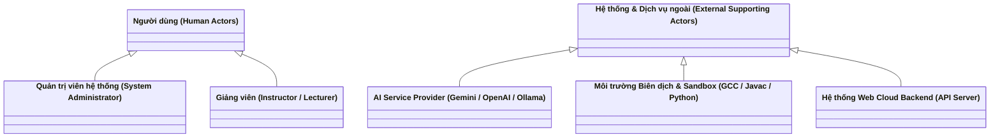

# Tài Liệu Đặc Tả Tác Nhân & Trường Hợp Sử Dụng (Actors & Use Cases Specification)

# Dự Án AITA: Automated Grading & Assessment Tool for Instructors

### Đề án Môn học SWD392: Thiết Kế Hệ Thống Có Hỗ Trợ Của AI (AI-Assisted System Design)

---

## 1. Giới Thiệu & Phạm Vi Hệ Thống (System Overview & Scope)

### 1.1. Mục đích tài liệu

Tài liệu này xác định và đặc tả toàn bộ các **Tác nhân (Actors)** cùng **Trường hợp sử dụng (Use Cases)** cho hệ thống **AITA (AI-Assisted Automated Grading & Assessment Tool)**. Đây là tài liệu cốt lõi thuộc phân kỳ **Đánh giá 1 (Evaluation 1: Requirement Analysis & Modeling)** của môn học SWD392, làm tiền đề trực tiếp để xây dựng các sơ đồ UML (Use Case Diagram, Activity Diagram, Sequence Diagram, Communication Diagram) và thiết kế kiến trúc chi tiết ở các giai đoạn tiếp theo.

### 1.2. Phạm vi hệ thống (System Boundary)

Hệ thống **AITA** được xây dựng nhằm phục vụ người dùng trung tâm là **Giảng viên** trực tiếp giảng dạy và chấm thi các môn lập trình. Đáp ứng đúng yêu cầu tích hợp toàn diện của môn học (Mục 4.1 trong [project-requirements.md](file:///c:/AITA/iata_project/docs/architecture/project-requirements.md)), hệ thống bao gồm:

1. **Phân hệ Desktop App (AITA Core Desktop Client)**: Ứng dụng trung tâm chạy trực tiếp trên máy tính cá nhân của Giảng viên, quản lý bài nộp cục bộ, điều khiển môi trường Sandbox Runner an toàn, so khớp kết quả và lưu trữ cơ sở dữ liệu SQLite ngoại tuyến.
2. **Phân hệ Dịch vụ Trí tuệ Nhân tạo (AI Service Integration)**: Tích hợp qua REST API / Local LLM (Google Gemini, OpenAI GPT, Ollama) để thực hiện các nghiệp vụ thông minh: tự động sinh testcase biên, phân tích mã nguồn lỗi, viết nhận xét sư phạm và quét đạo văn qua cây cú pháp AST.
3. **Phân hệ Web Backend & Admin (Cloud / Campus Server)**: Hỗ trợ xác thực tài khoản tập trung, quản lý cấu hình hệ thống và đồng bộ dữ liệu điểm số, danh sách sinh viên giữa máy trạm và máy chủ đào tạo.

---

## 2. Xác Định & Phân Tích Tác Nhân (Actors Identification & Analysis)

Hệ thống AITA tuân thủ chặt chẽ chuẩn mực **Kỹ nghệ phần mềm & Mô hình hóa UML**:

- **Tác nhân người dùng (Primary Human Actors)**: Những người trực tiếp tương tác với phần mềm qua giao diện người dùng.
- **Tác nhân ngoài hỗ trợ (External Supporting Actors)**: Các hệ thống, dịch vụ hoặc tiến trình nằm ngoài ranh giới phần mềm ứng dụng tương tác trao đổi thông tin.
- *(Lưu ý chuẩn UML)*: Cơ sở dữ liệu nội bộ (SQLite) và hệ thống tệp tin cục bộ là **thành phần kiến trúc nội bộ (Internal Data Layer)**, không được coi là External Actor.

### 2.1. Tác nhân Người dùng (Primary Actors)

| Tác nhân                                                                                       | Vai trò                                                                                                                             | Trách nhiệm chính trong hệ thống AITA                                                                                                                                                                                                                                                                                                                                                                                                                                                                                                                                                                                                                                                                                                                                                                                                                                                                                                                                                 |
| :----------------------------------------------------------------------------------------------- | :----------------------------------------------------------------------------------------------------------------------------------- | :----------------------------------------------------------------------------------------------------------------------------------------------------------------------------------------------------------------------------------------------------------------------------------------------------------------------------------------------------------------------------------------------------------------------------------------------------------------------------------------------------------------------------------------------------------------------------------------------------------------------------------------------------------------------------------------------------------------------------------------------------------------------------------------------------------------------------------------------------------------------------------------------------------------------------------------------------------------------------------------- |
| **Giảng viên (Instructor / Lecturer)** *(Tác nhân nghiệp vụ chính)*               | Người trực tiếp giảng dạy môn học, toàn quyền quản lý lớp và chịu trách nhiệm chấm điểm, đánh giá sinh viên. | - Quản lý danh sách lớp và môn học (PRF, DSA, PRO).  - Tạo đợt chấm bài, thiết lập tiêu chí chấm điểm và các giới hạn tài nguyên (Timeout, Memory Limit). - Nạp thư mục chứa bài nộp của sinh viên (`.c`, `.java`, `.py`, `.cpp` hoặc `.zip`). - Thiết lập bộ testcase chuẩn hoặc kích hoạt AI sinh testcase tự động. - Lựa chọn chiến lược so khớp đầu ra (`ExactMatch`, `IgnoreWhitespace`, `Regex`, `FloatTolerance`). - Kích hoạt quy trình chấm bài tự động hàng loạt. - Rà soát các bài bị lỗi (`WA`, `CE`, `RE`, `TLE`), điều chỉnh hoặc ghi đè điểm thủ công nếu cần. - Sử dụng AI để sinh nhận xét sư phạm tự động gửi cho sinh viên. - Kiểm tra mức độ trùng lặp mã nguồn (phát hiện đạo văn qua AST & ngữ nghĩa). - Xuất bảng điểm chi tiết (Excel/CSV/PDF) nộp cho phòng đào tạo. |
| **Quản trị viên (System Administrator - Admin)** *(Tác nhân quản trị hệ thống)* | Người phụ trách cài đặt kỹ thuật, hạ tầng và quản trị phân quyền hệ thống.                                         | - Quản lý tài khoản Giảng viên trên phân hệ Web/Desktop .- Cấu hình đường dẫn các trình biên dịch hệ thống (`gcc`, `javac`, `python runtime`). - Cấu hình API Key dịch vụ AI (Google Gemini, OpenAI) hoặc endpoint Local LLM (Ollama). - Giám sát logs hệ thống và duy trì hoạt động máy chủ Web API.                                                                                                                                                                                                                                                                                                                                                                                                                                                                                                                                                                                                                            |

### 2.2. Tác nhân Hệ thống & Dịch vụ Ngoài (External Supporting Actors)

| Tác nhân ngoài                                                   | Bản chất                                                                                                                                     | Vai trò tương tác đối với hệ thống AITA                                                                                                                                                                                                                                                               |
| :------------------------------------------------------------------ | :--------------------------------------------------------------------------------------------------------------------------------------------- | :------------------------------------------------------------------------------------------------------------------------------------------------------------------------------------------------------------------------------------------------------------------------------------------------------------- |
| **AI Service Provider (Google Gemini / OpenAI / Ollama)**     | Dịch vụ AI đám mây hoặc mô hình LLM chạy cục bộ.                                                                                    | - Nhận prompt đặc tả đề bài và sinh bộ testcase biên kèm input/output kỳ vọng.- Phân tích mã nguồn bị lỗi (WA, RE, CE), phát hiện lỗi logic và sinh nhận xét sư phạm.- Hỗ trợ phân tích ngữ nghĩa mã nguồn phục vụ việc phát hiện gian lận.                           |
| **Sandbox Execution Runner (OS Process Watcher & Compilers)** | Môi trường thực thi tiến trình cô lập của Hệ điều hành kết hợp trình biên dịch (`GCC`, `Javac`, `Python Interpreter`). | - Biên dịch mã nguồn sinh viên sang file thực thi trung gian.- Chạy bài nộp trong môi trường subprocess an toàn bị giới hạn tài nguyên.- Đo lường thời gian chạy (ms) và mức tiêu thụ RAM.- Trả về mã trạng thái thực thi (`AC`, `WA`, `TLE`, `MLE`, `CE`, `RE`). |
| **Web Cloud Backend (Campus API Server)**                     | Máy chủ đám mây cung cấp Web API trung tâm.                                                                                             | - Cung cấp cơ chế xác thực tập trung (JWT token).- Hỗ trợ đồng bộ dữ liệu lớp học, đồng bộ bảng điểm lên cơ sở dữ liệu trường học khi có kết nối mạng.                                                                                                                        |

---

## 3. Ma Trận Danh Mục Use Case (Use Case Matrix)

Hệ thống được tổ chức thành **6 phân hệ chức năng (Subsystems)** với tổng cộng **17 Use Cases**:

| Mã UC                                                                                                    | Tên Use Case (Vietnamese)                            | Tên tiếng Anh                               | Tác nhân chính (Primary Actor) | Tác nhân hỗ trợ ngoài (External Actor) |
| :-------------------------------------------------------------------------------------------------------- | :---------------------------------------------------- | :-------------------------------------------- | :-------------------------------- | :------------------------------------------ |
| **Phân hệ 1: Quản lý Xác thực & Cấu hình Hệ thống (Auth & System Configuration)**         |                                                       |                                               |                                   |                                             |
| **UC-01**                                                                                           | Đăng nhập & Xác thực người dùng               | Login & User Authentication                   | Giảng viên, Admin               | Web Cloud Backend                           |
| **UC-02**                                                                                           | Cấu hình Môi trường Biên dịch & Sandbox        | Configure Compilers & Sandbox Settings        | Admin, Giảng viên               | Sandbox Execution Runner                    |
| **UC-03**                                                                                           | Cấu hình Kết nối Dịch vụ AI                     | Configure AI Provider Settings                | Admin, Giảng viên               | AI Service Provider                         |
| **Phân hệ 2: Quản lý Lớp học & Bài nộp (Class & Submission Management)**                    |                                                       |                                               |                                   |                                             |
| **UC-04**                                                                                           | Quản lý Lớp học & Danh sách Sinh viên           | Manage Classes & Student Rosters              | Giảng viên                      | *(Tương tác Local DB nội bộ)*        |
| **UC-05**                                                                                           | Tạo & Quản lý Đợt chấm bài                     | Manage Grading Sessions & Assignments         | Giảng viên                      | *(Tương tác Local DB nội bộ)*        |
| **UC-06**                                                                                           | Nạp Danh sách Bài nộp Sinh viên                  | Import Student Submissions (Batch Folder/Zip) | Giảng viên                      | *(Tương tác File System)*              |
| **Phân hệ 3: Quản lý Bộ Kiểm thử & Chiến lược So khớp (Testcase Management & Matching)** |                                                       |                                               |                                   |                                             |
| **UC-07**                                                                                           | Tạo & Chỉnh sửa Bộ Testcase thủ công            | Create & Manage Testcases Manually            | Giảng viên                      | *(Tương tác Local DB nội bộ)*        |
| **UC-08**                                                                                           | Tự động Sinh Testcase bằng AI                     | Auto-Generate Testcases with AI               | Giảng viên                      | AI Service Provider                         |
| **UC-09**                                                                                           | Thiết lập Chiến lược So khớp Kết quả          | Configure Output Matching Strategy            | Giảng viên                      | *(Tương tác Local DB nội bộ)*        |
| **Phân hệ 4: Tự động Thực thi & Chấm điểm (Execution & Automated Grading Pipeline)**       |                                                       |                                               |                                   |                                             |
| **UC-10**                                                                                           | Thực thi Chấm điểm Tự động Hàng loạt         | Execute Batch Automated Grading               | Giảng viên                      | Sandbox Execution Runner                    |
| **UC-11**                                                                                           | Giám sát Tiến độ Chấm thời gian thực          | Monitor Real-Time Grading Progress            | Giảng viên                      | Sandbox Execution Runner                    |
| **UC-12**                                                                                           | Xem Chi tiết Kết quả & Nhật ký Bài nộp         | View Submission Result & Execution Logs       | Giảng viên                      | *(Tương tác Local DB nội bộ)*        |
| **UC-13**                                                                                           | Chấm lại & Điều chỉnh Điểm thủ công          | Re-grade & Override Scores                    | Giảng viên                      | Sandbox Execution Runner                    |
| **Phân hệ 5: Tính năng Thông minh có AI Hỗ trợ (AI-Assisted Features)**                     |                                                       |                                               |                                   |                                             |
| **UC-14**                                                                                           | Tự động Sinh Nhận xét Mã nguồn bằng AI        | Generate AI Code Review & Feedback            | Giảng viên                      | AI Service Provider                         |
| **UC-15**                                                                                           | Kiểm tra Đạo văn & Độ tương đồng Mã nguồn | Analyze Code Plagiarism & AST Similarity      | Giảng viên                      | AI Service Provider                         |
| **Phân hệ 6: Báo cáo, Đánh giá & Đồng bộ (Reporting, Export & Sync)**                     |                                                       |                                               |                                   |                                             |
| **UC-16**                                                                                           | Xuất Báo cáo Bảng điểm                          | Export Gradebook (Excel / CSV / PDF)          | Giảng viên                      | *(Tương tác File System)*              |
| **UC-17**                                                                                           | Đồng bộ Dữ liệu với Web Cloud Backend           | Synchronize Grading Data with Cloud           | Giảng viên, Admin               | Web Cloud Backend                           |

---

## 4. Mối Quan Hệ Giữa Các Use Case (Use Case Relationships)

### 4.1. Quan hệ bao hàm (`<<include>>`)

- **UC-10 (Thực thi Chấm điểm Hàng loạt)** bắt buộc bao hàm:
  - `<<include>>` **UC-09 (Thiết lập Chiến lược So khớp Kết quả)**: Mỗi lần chấm phải áp dụng một chiến lược kiểm thử cụ thể (`Exact`, `Whitespace`, `Regex`, hoặc `Float`).
  - `<<include>>` **UC-11 (Giám sát Tiến độ Chấm thời gian thực)**: Giao diện luôn cập nhật trạng thái các bài đang chạy song song.
- **UC-08 (Tự động Sinh Testcase bằng AI)**:
  - `<<include>>` **UC-03 (Cấu hình Kết nối Dịch vụ AI)**: Cần có kết nối và API Key hợp lệ để gửi prompt tạo testcase.
- **UC-15 (Kiểm tra Đạo văn)** và **UC-14 (Sinh Nhận xét AI)**:
  - `<<include>>` **UC-03 (Cấu hình Kết nối Dịch vụ AI)**.

### 4.2. Quan hệ mở rộng (`<<extend>>`)

- **UC-14 (Tự động Sinh Nhận xét Mã nguồn bằng AI)** mở rộng từ **UC-12 (Xem Chi tiết Kết quả Bài nộp)**:
  - Điểm mở rộng (*Extension Point: Error Detected*): Khi Giảng viên xem xét một bài nộp bị phán quyết `WA`, `CE` hoặc `RE`, Giảng viên có thể kích hoạt tùy chọn yêu cầu AI giải thích và đề xuất nhận xét sư phạm.
- **UC-13 (Chấm lại & Điều chỉnh Điểm thủ công)** mở rộng từ **UC-12 (Xem Chi tiết Kết quả Bài nộp)**:
  - Điểm mở rộng (*Extension Point: Score Revision*): Khi phát hiện testcase có vấn đề hoặc sinh viên có lý do chính đáng, Giảng viên có thể chỉnh sửa điểm trực tiếp.

### 4.3. Mô hình phân quyền tinh gọn (Role Simplification)

- Hệ thống áp dụng mô hình phân quyền tinh giản: **Giảng viên (Instructor)** là người dùng nghiệp vụ duy nhất phụ trách xuyên suốt từ khâu tạo đề, cấu hình testcase, chấm điểm, nhận xét cho đến nộp điểm cuối kỳ. Điều này giúp tối ưu hóa trải nghiệm người dùng trên ứng dụng Desktop, loại bỏ sự phức tạp không cần thiết về phân quyền nhiều cấp độ trợ giảng.

---

## 5. Đặc Tả Chi Tiết Các Use Case Trọng Tâm (Use Case Specifications)

Dưới đây là bản đặc tả chi tiết theo chuẩn Kỹ nghệ Phần mềm cho các Use Case quan trọng nhất của hệ thống AITA.

---

### 5.1. UC-08: Tự Động Sinh Testcase Bằng AI (Auto-Generate Testcases with AI)

* **Mã Use Case**: `UC-08`
* **Tên Use Case**: Tự động sinh Testcase bằng AI (AI Testcase Generator)
* **Tác nhân chính**: Giảng viên (Instructor)
* **Tác nhân hỗ trợ ngoài**: Dịch vụ AI (Google Gemini / OpenAI / Ollama)
* **Mô tả tóm tắt**: Giảng viên cung cấp văn bản mô tả đề bài (Problem Description), ràng buộc input/output và các trường hợp đặc biệt. Hệ thống gửi yêu cầu đến mô hình AI để tự động phân tích và sinh ra danh sách các bộ testcase (bao gồm test cơ bản, test giá trị biên, test dữ liệu lớn), sau đó Giảng viên duyệt để nạp vào hệ thống.
* **Tiền điều kiện (Preconditions)**:
  1. Giảng viên đã đăng nhập và đang mở một đợt chấm bài hợp lệ.
  2. Dịch vụ AI đã được cấu hình API Key và kiểm tra kết nối thành công (`UC-03`).
* **Hậu điều kiện (Postconditions)**:
  1. Các testcase được Giảng viên phê duyệt sẽ được lưu trữ vào cơ sở dữ liệu SQLite cục bộ phục vụ cho quá trình chấm điểm.
* **Tác nhân kích hoạt (Trigger)**: Giảng viên nhấn nút **"Tạo Testcase bằng AI" (Generate with AI)** trên màn hình Quản lý Testcase.

#### Luồng sự kiện chính (Main Flow):

1. Giảng viên mở giao diện quản lý testcase của đợt chấm và chọn chức năng **"AI Testcase Generator"**.
2. Hệ thống hiển thị hộp thoại yêu cầu nhập thông tin bài toán:
   - Tên bài toán & Mục tiêu kiểm thử.
   - Nội dung mô tả đề bài (Problem Statement).
   - Định dạng đầu vào (Input Format) và Định dạng đầu ra (Output Format).
   - Các ràng buộc dữ liệu (Constraints) và số lượng testcase mong muốn.
3. Giảng viên điền thông tin hoặc nạp file đề bài dạng Markdown/Text và nhấn **"Bắt đầu sinh Testcase"**.
4. Hệ thống chuẩn hóa prompt theo mẫu chuyên biệt (Prompt Template), bổ sung quy chuẩn kiểm thử phần mềm (Boundary Value Analysis, Equivalence Partitioning).
5. Hệ thống gửi yêu cầu bất đồng bộ đến `AI Service Provider`.
6. `AI Service Provider` xử lý và trả về cấu trúc dữ liệu JSON chứa danh sách testcase:
   - Mô tả mục đích testcase (ví dụ: "Số âm", "Dữ liệu rỗng", "Tràn số nguyên").
   - Dữ liệu đầu vào (Standard Input - stdin).
   - Dữ liệu đầu ra kỳ vọng (Expected Output - stdout).
   - Điểm số đề xuất và trạng thái ẩn/hiện.
7. Hệ thống hiển thị bảng duyệt trước (Preview Table) cho Giảng viên.
8. Giảng viên xem lại, chỉnh sửa nội dung input/output nếu cần, tick chọn các testcase đạt yêu cầu.
9. Giảng viên bấm nút **"Lưu vào bộ Testcase"**.
10. Hệ thống lưu các testcase đã chọn vào SQLite và cập nhật lại danh sách hiển thị trên màn hình chính. Use Case kết thúc thành công.

#### Luồng rẽ nhánh & Ngoại lệ (Alternative & Exception Flows):

* **A1 - Chỉnh sửa trước khi lưu**: Tại bước 8, Giảng viên có thể nhấn trực tiếp vào ô input/output để sửa nhanh dữ liệu mẫu trước khi nhấn lưu.
* **E1 - Mất kết nối hoặc Lỗi API AI**: Tại bước 5, nếu API Key hết hạn, lỗi mạng hoặc vượt hạn mức (Rate Limit), hệ thống bắt ngoại lệ, hiển thị thông báo lỗi chi tiết ("Không thể kết nối đến máy chủ AI, vui lòng kiểm tra kết nối mạng hoặc API Key") và cho phép Giảng viên thử lại hoặc chuyển sang nhập tay.
* **E2 - AI trả về định dạng sai**: Tại bước 6, nếu kết quả trả về từ AI không khớp cấu trúc JSON chuẩn, hệ thống tự động kích hoạt prompt sửa lỗi một lần (Auto-retry with correction prompt). Nếu vẫn thất bại, hệ thống hiển thị mã thô từ AI để Giảng viên tự sao chép thủ công.

---

### 5.2. UC-10: Thực Thi Chấm Điểm Tự Động Hàng Loạt (Execute Batch Automated Grading)

* **Mã Use Case**: `UC-10`
* **Tên Use Case**: Thực thi Chấm điểm Tự động Hàng loạt (Batch Automated Grading Pipeline)
* **Tác nhân chính**: Giảng viên (Instructor)
* **Tác nhân hỗ trợ ngoài**: Sandbox Execution Runner (GCC/Javac/Python)
* **Mô tả tóm tắt**: Hệ thống tự động duyệt qua tất cả bài nộp của sinh viên, kích hoạt bộ Runner tương ứng dựa trên Factory Pattern để biên dịch và chạy từng bài qua toàn bộ các testcase trong môi trường Sandbox cô lập, sau đó so khớp kết quả và lưu bảng điểm.
* **Tiền điều kiện (Preconditions)**:
  1. Đợt chấm đã được nạp ít nhất một bài nộp của sinh viên (`UC-06`).
  2. Đợt chấm đã có ít nhất một testcase chuẩn (`UC-07` hoặc `UC-08`).
  3. Đường dẫn trình biên dịch môi trường đã được cấu hình sẵn sàng (`UC-02`).
* **Hậu điều kiện (Postconditions)**:
  1. Toàn bộ bài nộp được gán điểm số tổng kết và trạng thái chi tiết cho từng testcase.
  2. Toàn bộ nhật ký thực thi (stdout, stderr, runtime logs) được lưu trữ trên tệp tin cục bộ.
* **Tác nhân kích hoạt (Trigger)**: Giảng viên bấm nút **"Bắt đầu chấm bài" (Start Batch Grading)**.

#### Luồng sự kiện chính (Main Flow):

1. Giảng viên kiểm tra danh sách bài nộp và cấu hình chiến lược so khớp, sau đó nhấn **"Bắt đầu chấm bài"**.
2. Hệ thống kiểm tra tính hợp lệ của môi trường (kiểm tra `gcc`, `javac`, `python` có khả dụng hay không).
3. Hệ thống khởi tạo hàng đợi chấm (Grading Queue) và kích hoạt nhóm luồng xử lý nền đa luồng (Worker Pool) để không gây đóng băng giao diện Desktop UI.
4. Với mỗi bài nộp trong hàng đợi:
   - **Bước 4.1**: `RunnerFactory` xác định đuôi mở rộng của tệp (`.c`, `.java`, `.py`, `.cpp`) và khởi tạo `Runner` tương ứng (`CRunner`, `JavaRunner`, `PythonRunner`).
   - **Bước 4.2**: `CompilerAdapter` thực hiện biên dịch mã nguồn (với C, C++, Java). Nếu gặp lỗi cú pháp, hệ thống ghi nhận mã phán quyết `CE (Compile Error)` kèm nội dung `stderr`, cho điểm 0 và chuyển sang bài tiếp theo.
   - **Bước 4.3**: Với mỗi testcase trong bộ kiểm thử:
     - Sandbox Runner khởi chạy tiến trình con (subprocess), truyền dữ liệu Input (`stdin`) và bắt đầu bộ đếm giờ/bộ giám sát bộ nhớ (`Process Watcher`).
     - Nếu thời gian chạy vượt quá `Time Limit`, hệ thống cưỡng chế ngắt tiến trình (kill process) và gán trạng thái `TLE (Time Limit Exceeded)`.
     - Nếu bộ nhớ vượt quá `Memory Limit`, hệ thống ngắt tiến trình và gán trạng thái `MLE (Memory Limit Exceeded)`.
     - Nếu tiến trình kết thúc bất thường (Crash, Exit Code $\neq$ 0), hệ thống gán trạng thái `RE (Runtime Error)`.
     - Nếu tiến trình hoàn tất thành công trong hạn mức: Động cơ so khớp (`MatchingStrategy`) so sánh kết quả thực tế (`stdout`) với kết quả kỳ vọng:
       - Nếu khớp: Gán `AC (Accepted)` và cộng điểm của testcase đó.
       - Nếu không khớp: Gán `WA (Wrong Answer)`.
5. Trong suốt quá trình chạy, hệ thống phát tín hiệu IPC/Event để cập nhật thanh tiến độ thực tế (Progress Bar), số bài đã hoàn thành, số bài bị lỗi trên màn hình (`UC-11`).
6. Sau khi tất cả bài nộp trong hàng đợi được xử lý xong, hệ thống tính toán điểm số tổng hợp, lưu vào cơ sở dữ liệu SQLite và hiển thị thông báo "Hoàn tất đợt chấm". Bảng điểm được tự động làm mới. Use Case kết thúc.

#### Luồng rẽ nhánh & Ngoại lệ (Alternative & Exception Flows):

* **A1 - Tạm dừng hoặc Hủy đợt chấm**: Giảng viên có thể bấm nút **"Dừng chấm" (Cancel/Pause)**. Hệ thống gửi tín hiệu kết thúc an toàn đến các Worker Thread, lưu lại kết quả của các bài đã hoàn tất và đánh dấu các bài chưa chạy là `Pending`.
* **E1 - Thiếu trình biên dịch**: Tại bước 2, nếu máy trạm chưa cài GCC hoặc JDK, hệ thống bật thông báo cảnh báo và mở ngay cửa sổ **Cấu hình Môi trường** (`UC-02`) để Giảng viên định cấu hình lại.

---

### 5.3. UC-14: Tự Động Sinh Nhận Xét Mã Nguồn Bằng AI (Generate AI Code Review & Feedback)

* **Mã Use Case**: `UC-14`
* **Tên Use Case**: Tự động sinh Nhận xét Mã nguồn bằng AI (AI Code Review & Pedagogical Feedback)
* **Tác nhân chính**: Giảng viên (Instructor)
* **Tác nhân hỗ trợ ngoài**: Dịch vụ AI (Google Gemini / OpenAI)
* **Mô tả tóm tắt**: Khi xem xét một bài nộp của sinh viên không đạt điểm tối đa hoặc gặp lỗi (`WA`, `CE`, `RE`, `TLE`), Giảng viên có thể yêu cầu AI đọc mã nguồn, đối chiếu với log lỗi và tự động sinh một bản nhận xét sư phạm ngắn gọn, chỉ ra nguyên nhân và gợi ý cách khắc phục để gửi cho sinh viên.
* **Tiền điều kiện (Preconditions)**:
  1. Bài nộp của sinh viên đã được chấm và có kết quả chi tiết.
  2. Dịch vụ AI đang sẵn sàng hoạt động.
* **Hậu điều kiện (Postconditions)**:
  1. Bản nhận xét sau khi được duyệt sẽ được lưu vào thuộc tính `teacher_feedback` của bài nộp trong cơ sở dữ liệu và có thể xuất kèm ra bảng điểm Excel.
* **Tác nhân kích hoạt (Trigger)**: Giảng viên nhấn nút **"Nhận xét bằng AI" (AI Review)** trong cửa sổ Chi tiết bài nộp.

#### Luồng sự kiện chính (Main Flow):

1. Giảng viên mở cửa sổ Chi tiết bài nộp của sinh viên (`UC-12`) và chọn bài nộp đang có lỗi hoặc điểm thấp.
2. Giảng viên nhấn nút **"Sinh nhận xét AI"**.
3. Hệ thống tổng hợp gói ngữ cảnh (Context Payload) bao gồm:
   - Mã nguồn bài nộp của sinh viên.
   - Ngôn ngữ lập trình và yêu cầu đề bài.
   - Danh sách các testcase bị lỗi (Input, Expected Output, Actual Output/Error Message).
4. Hệ thống định dạng prompt gửi tới AI Service Provider theo phong cách sư phạm chuẩn: yêu cầu chỉ ra dòng code lỗi, giải thích bản chất lỗi (ví dụ: truy cập mảng quá giới hạn, quên giải phóng bộ nhớ, sai điều kiện dừng đệ quy) và đưa ra gợi ý logic mà không đưa ra đáp án trực tiếp để sinh viên tự sửa.
5. AI Service Provider xử lý và phản hồi nội dung nhận xét.
6. Hệ thống hiển thị bản nháp nhận xét (Draft Feedback) lên ô soạn thảo trên giao diện.
7. Giảng viên đọc lại, có thể chỉnh sửa bổ sung nội dung bằng tay nếu muốn.
8. Giảng viên nhấn **"Xác nhận & Lưu nhận xét"**.
9. Hệ thống lưu nội dung phản hồi vào cơ sở dữ liệu SQLite. Use Case hoàn tất.

#### Luồng rẽ nhánh & Ngoại lệ (Alternative & Exception Flows):

* **A1 - Sinh nhận xét hàng loạt**: Giảng viên có thể chọn chức năng "Sinh nhận xét tự động cho tất cả bài có điểm < 5" tại màn hình kết quả chung. Hệ thống sẽ xếp hàng đợi và lần lượt gửi request đến AI, sau đó lưu hàng loạt vào cơ sở dữ liệu.

---

### 5.4. UC-15: Kiểm Tra Đạo Văn & Độ Tương Đồng Mã Nguồn (Analyze Code Plagiarism & AST Similarity)

* **Mã Use Case**: `UC-15`
* **Tên Use Case**: Kiểm tra Đạo văn và Độ tương đồng Mã nguồn (AI Plagiarism Detection)
* **Tác nhân chính**: Giảng viên (Instructor)
* **Tác nhân hỗ trợ ngoài**: Dịch vụ AI (AI Service)
* **Mô tả tóm tắt**: Giảng viên kích hoạt quét độ tương đồng giữa tất cả các bài nộp trong cùng một lớp hoặc cùng đợt thi. Hệ thống sử dụng phân tích cấu trúc cây cú pháp (AST) kết hợp AI Semantic Matching để phát hiện các trường hợp sao chép tinh vi như đổi tên biến, đảo hàm, thay đổi vòng lặp `for`/`while`.
* **Tiền điều kiện (Preconditions)**:
  1. Đợt chấm có từ hai bài nộp trở lên của cùng một bài tập.
* **Hậu điều kiện (Postconditions)**:
  1. Hệ thống tạo ra ma trận tương đồng (Similarity Matrix) và danh sách các cặp bài nộp nghi vấn kèm tỷ lệ phần trăm tương đồng.
* **Tác nhân kích hoạt (Trigger)**: Giảng viên nhấn nút **"Quét Đạo Văn" (Check Plagiarism)** trên thanh công cụ.

#### Luồng sự kiện chính (Main Flow):

1. Giảng viên chọn lớp học và bài tập cần kiểm tra đạo văn, thiết lập ngưỡng cảnh báo (ví dụ: tương đồng $\ge 75\%$).
2. Giảng viên nhấn **"Bắt đầu phân tích"**.
3. Hệ thống tiền xử lý mã nguồn của tất cả bài nộp:
   - Loại bỏ comment, chuẩn hóa khoảng trắng.
   - Phân tích cú pháp sinh ra cây cú pháp trừu tượng (Abstract Syntax Tree - AST Tokenization).
4. Hệ thống chạy thuật toán so khớp cấu trúc cây cú pháp cục bộ giữa từng cặp bài nộp ($O(N^2)$ có tối ưu hóa lọc nhanh).
5. Đối với các cặp bài có chỉ số tương đồng vượt ngưỡng nghi vấn, hệ thống gửi cấu trúc code tóm tắt đến mô hình AI để phân tích ngữ nghĩa chuyên sâu và kết luận xác suất sao chép logic.
6. Hệ thống kết xuất bảng danh sách các cặp bài nghi vấn, sắp xếp giảm dần theo mức độ tương đồng.
7. Giảng viên nhấp vào một cặp bài bất kỳ: hệ thống mở giao diện so sánh trực quan song song hai bên (Side-by-side Diff Viewer) với các đoạn code tương đồng được tô sáng màu đỏ.
8. Giảng viên có thể ghi chú đánh dấu bài vi phạm gian lận học thuật vào hệ thống.

---

### 5.5. UC-16: Xuất Báo Cáo Bảng Điểm (Export Gradebook)

* **Mã Use Case**: `UC-16`
* **Tên Use Case**: Xuất Báo cáo Bảng điểm (Export Gradebook)
* **Tác nhân chính**: Giảng viên (Instructor)
* **Tác nhân hỗ trợ ngoài**: Không *(Tương tác trực tiếp với File System của Hệ điều hành)*
* **Mô tả tóm tắt**: Cho phép Giảng viên xuất toàn bộ kết quả điểm số, trạng thái từng testcase, thời gian chạy và nhận xét của giảng viên/AI ra các định dạng chuẩn như Microsoft Excel (`.xlsx`), `.csv` để nộp cho phòng đào tạo hoặc lưu trữ lưu trữ định kỳ.
* **Tiền điều kiện (Preconditions)**:
  1. Đợt chấm đã có kết quả chấm điểm.
* **Hậu điều kiện (Postconditions)**:
  1. File báo cáo được tạo thành công trên thư mục máy tính của Giảng viên.
* **Tác nhân kích hoạt (Trigger)**: Giảng viên nhấn nút **"Xuất Báo Cáo" (Export Gradebook)**.

#### Luồng sự kiện chính (Main Flow):

1. Giảng viên nhấn nút **"Xuất Báo Cáo"** trên thanh công cụ của màn hình kết quả.
2. Hệ thống hiển thị hộp thoại tùy chọn xuất dữ liệu:
   - Định dạng xuất: Excel (`.xlsx`), CSV (`.csv`), hoặc PDF Báo cáo tổng kết.
   - Các trường dữ liệu muốn xuất: Mã sinh viên, Họ tên, Điểm số, Chi tiết điểm từng testcase, Verdict chung (AC/WA/CE/TLE), Nhận xét của giáo viên/AI, Chỉ số đạo văn.
3. Giảng viên chọn các tiêu chí mong muốn và nhấn **"Chọn nơi lưu"**.
4. Hộp thoại hệ điều hành (Native Save File Dialog) mở ra để Giảng viên chọn thư mục và đặt tên file.
5. Hệ thống truy xuất dữ liệu từ SQLite, sử dụng thư viện kết xuất định dạng (Report Exporter) để tạo file hoàn chỉnh theo mẫu chuẩn quy định.
6. Hệ thống hiển thị thông báo "Xuất báo cáo thành công" kèm nút bấm mở trực tiếp thư mục chứa file. Use Case kết thúc.

---

## 6. Sơ Đồ Use Case Toàn Hệ Thống (PlantUML Use Case Diagram)

```plantuml
@startuml
!theme plain
skinparam packageStyle rectangle
skinparam actorStyle awesome
skinparam usecase {
    BackgroundColor White
    BorderColor #1E88E5
    ArrowColor #333333
}

title Sơ Đồ Use Case Tổng Quan Hệ Thống AITA (Automated Grading & Assessment Tool)

' 1. Tác nhân người dùng (Primary Human Actors)
actor "Giảng viên\n(Instructor)" as Instructor
actor "Quản trị viên\n(System Admin)" as Admin

' 2. Tác nhân hệ thống & dịch vụ ngoài (External Supporting Actors)
actor "AI Service Provider\n(Gemini / OpenAI / Ollama)" as AIService <<System>>
actor "Sandbox Runner\n(GCC / Javac / Python)" as Sandbox <<System>>
actor "Web Cloud Backend\n(Campus API Server)" as Cloud <<System>>

rectangle "Hệ Thống Toàn Diện AITA (Desktop App & Web Services)" {
  
    ' Phân hệ 1: Xác thực & Cấu hình
    package "Phân hệ 1: Quản lý Xác thực & Cấu hình" {
        usecase "UC-01: Đăng nhập & Xác thực" as UC01
        usecase "UC-02: Cấu hình Trình biên dịch & Sandbox" as UC02
        usecase "UC-03: Cấu hình Kết nối Dịch vụ AI" as UC03
    }

    ' Phân hệ 2: Quản lý Lớp học & Bài nộp
    package "Phân hệ 2: Quản lý Lớp học & Bài nộp" {
        usecase "UC-04: Quản lý Lớp học & Danh sách Sinh viên" as UC04
        usecase "UC-05: Quản lý Đợt chấm bài" as UC05
        usecase "UC-06: Nạp Danh sách Bài nộp Sinh viên" as UC06
    }

    ' Phân hệ 3: Quản lý Bộ Testcase & So khớp
    package "Phân hệ 3: Quản lý Testcase & Chiến lược So khớp" {
        usecase "UC-07: Tạo Testcase thủ công" as UC07
        usecase "UC-08: Tự động Sinh Testcase bằng AI" as UC08
        usecase "UC-09: Thiết lập Chiến lược So khớp" as UC09
    }

    ' Phân hệ 4: Thực thi & Tự động Chấm điểm
    package "Phân hệ 4: Tự động Chấm điểm (Execution Pipeline)" {
        usecase "UC-10: Thực thi Chấm bài Hàng loạt" as UC10
        usecase "UC-11: Giám sát Tiến độ Chấm thời gian thực" as UC11
        usecase "UC-12: Xem Chi tiết Bài nộp & Logs" as UC12
        usecase "UC-13: Chấm lại & Ghi đè Điểm thủ công" as UC13
    }

    ' Phân hệ 5: Tính năng Thông minh có AI hỗ trợ
    package "Phân hệ 5: Tính năng Thông minh có AI Hỗ trợ" {
        usecase "UC-14: Sinh Nhận xét Mã nguồn bằng AI" as UC14
        usecase "UC-15: Quét Đạo văn & Tương đồng AST" as UC15
    }

    ' Phân hệ 6: Báo cáo & Đồng bộ
    package "Phân hệ 6: Báo cáo, Đánh giá & Đồng bộ" {
        usecase "UC-16: Xuất Báo cáo Bảng điểm" as UC16
        usecase "UC-17: Đồng bộ Dữ liệu với Web Cloud" as UC17
    }
}

' Tương tác của Quản trị viên (Admin)
Admin --> UC01
Admin --> UC02
Admin --> UC03

' Tương tác của Giảng viên (Instructor)
Instructor --> UC01
Instructor --> UC04
Instructor --> UC05
Instructor --> UC06
Instructor --> UC07
Instructor --> UC08
Instructor --> UC09
Instructor --> UC10
Instructor --> UC12
Instructor --> UC15
Instructor --> UC16
Instructor --> UC17

' Quan hệ nội bộ giữa các Use Case (Include / Extend)
UC10 .down.> UC09 : <<include>>
UC10 .down.> UC11 : <<include>>

UC14 .up.> UC12 : <<extend>>\n(khi bài có lỗi WA/RE/CE)
UC13 .up.> UC12 : <<extend>>\n(khi cần chấm lại/sửa điểm)

UC08 .down.> UC03 : <<include>>
UC14 .down.> UC03 : <<include>>
UC15 .down.> UC03 : <<include>>

' Kết nối với Tác nhân Hệ thống ngoài (External Actors)
UC01 --> Cloud : Xác thực tài khoản
UC17 --> Cloud : Đồng bộ REST API

UC08 --> AIService : Prompt sinh testcase
UC14 --> AIService : Phân tích lỗi & sinh nhận xét
UC15 --> AIService : Phân tích ngữ nghĩa mã nguồn

UC10 --> Sandbox : Biên dịch & chạy an toàn
UC13 --> Sandbox : Chạy lại bài nộp

@enduml
```

Dưới đây là mã nguồn PlantUML đặc tả toàn bộ các Tác nhân, Use Cases và quan hệ `<<include>>`, `<<extend>>` của hệ thống AITA theo chuẩn mực UML quốc tế (loại bỏ DB nội bộ khỏi vị trí Actor ngoài, mở rộng ranh giới hệ thống bao quát cả Desktop App và Web Services):

---

## 7. Nhật Ký Sử Dụng AI & Dấu Vết Minh Bạch (AI Traceability Log)

> Tuân thủ quy định tại **Mục 2: Quy định & Tiêu chí sử dụng AI** của môn học SWD392, bảng dưới đây lưu vết các Prompt và quá trình tiếp nhận/tinh chỉnh kết quả từ AI của nhóm:

|     STT     | Nhiệm vụ / Thành phần                           | Prompt đầu vào cho AI                                                                                                                                                                         | Output chính từ AI                                                                                                         | Đánh giá & Tinh chỉnh của Nhóm (Justification)                                                                                                                                                                                                                                                                                                              |
| :----------: | :-------------------------------------------------- | :----------------------------------------------------------------------------------------------------------------------------------------------------------------------------------------------- | :--------------------------------------------------------------------------------------------------------------------------- | :---------------------------------------------------------------------------------------------------------------------------------------------------------------------------------------------------------------------------------------------------------------------------------------------------------------------------------------------------------------- |
| **01** | Xác định danh sách Tác nhân (Actors)          | *"Dựa trên bài toán Desktop App chấm thi lập trình AITA cho giảng viên đại học, hãy xác định các Primary Actors và Supporting Actors phù hợp chuẩn UML."*                 | Đề xuất ban đầu: Giảng viên, Trợ giảng, Quản trị viên, Compiler/Sandbox, AI Service, Local Storage, Web Backend. | **Quyết định thiết kế của Nhóm**:1. *Lược bỏ Trợ giảng (TA)*: Giảng viên trực tiếp phụ trách lớp là người toàn quyền chấm điểm, tinh gọn phân quyền.2. *Chuẩn hóa UML*: Loại bỏ Local Storage (SQLite) khỏi danh sách External Actor vì SQLite là tầng dữ liệu nội bộ (Internal Data Layer) của phần mềm. |
| **02** | Xây dựng danh mục Use Case theo phân hệ        | *"Phân rã các tính năng của AITA (nạp bài, nạp testcase, sandbox đa ngôn ngữ C/Java/Python, 3 design pattern, AI testcase/feedback/plagiarism) thành danh mục Use Case chuẩn."* | Danh mục 17 Use Case chia thành 6 phân hệ nghiệp vụ.                                                                   | **Chấp nhận & Bổ sung**: Nhóm chuẩn hóa mã định danh `UC-01` đến `UC-17`, bổ sung các quan hệ `<<include>>` giữa Thực thi Chấm bài và Chiến lược So khớp nhằm gắn kết trực tiếp với mẫu thiết kế Strategy Pattern.                                                                                                    |
| **03** | Viết đặc tả Use Case chi tiết (Use Case Specs) | *"Viết Use Case Specification hoàn chỉnh theo chuẩn Kỹ nghệ phần mềm cho Use Case Tự động sinh Testcase bằng AI (UC-08) và Thực thi Chấm hàng loạt (UC-10)."*                 | Cung cấp khung mẫu: Actor, Preconditions, Trigger, Main Flow, Alternative Flows, Postconditions.                           | **Tùy biến sâu**: Bổ sung chi tiết kỹ thuật riêng của AITA: tích hợp `RunnerFactory` và `Process Watcher` để kiểm soát TLE/MLE, cơ chế bắt ngoại lệ khi API AI hết quota/lỗi mạng.                                                                                                                                              |
| **04** | Sinh mã nguồn PlantUML Sơ đồ Use Case          | *"Chuyển đổi toàn bộ danh mục 17 Use Case và các tác nhân của AITA thành mã nguồn sơ đồ PlantUML Use Case Diagram chuẩn cú pháp."*                                         | Đoạn mã PlantUML với các package và actor.                                                                             | **Tinh chỉnh layout**: Thêm các chỉ dẫn liên kết `<<include>>`, `<<extend>>` và phân nhóm trực quan theo 6 package phân hệ giúp sơ đồ dễ đọc khi render đồ họa.                                                                                                                                                                  |

---

## 8. Kết Luận & Các Bước Tiếp Theo (Next Steps)

Tài liệu Đặc tả Tác nhân & Use Cases này đã bao phủ toàn diện các yêu cầu nghiệp vụ của hệ thống AITA với mô hình người dùng tinh gọn, chuẩn mực lý thuyết UML và bám sát rubric đánh giá của môn học SWD392.

### Kế hoạch tiếp theo cho Đánh giá 1 (Evaluation 1):

1. **Render hình ảnh sơ đồ Use Case** thành file `.png` / `.svg` để chèn vào báo cáo đồ án.
2. **Xây dựng Sơ đồ Hoạt động (Activity Diagram)**: Đặc tả chi tiết luồng nghiệp vụ Chấm bài tự động hàng loạt (UC-10) và luồng Sinh testcase bằng AI (UC-08).
3. **Xây dựng Sơ đồ Tuần tự (Sequence Diagram)**: Đặc tả tương tác giữa UI, `RunnerFactory`, `SandboxRunner`, `ProcessWatcher`, và `MatchingStrategy`.
4. **Xây dựng Sơ đồ Giao tiếp (Communication Diagram)**: Mô hình hóa sự cộng tác giữa các đối tượng trong quy trình chấm bài.
