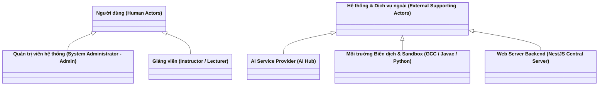

# Tài Liệu Đặc Tả Tác Nhân & Trường Hợp Sử Dụng (Actors & Use Cases Specification)

# Dự Án AITA: Automated Grading & Assessment Tool for Instructors

### Đề án Môn học SWD392: Thiết Kế Hệ Thống Có Hỗ Trợ Của AI (AI-Assisted System Design)

---

## 1. Giới Thiệu & Phạm Vi Hệ Thống (System Overview & Scope)

### 1.1. Mục đích tài liệu

Tài liệu này xác định và đặc tả toàn bộ các **Tác nhân (Actors)** cùng **Trường hợp sử dụng (Use Cases)** cho hệ sinh thái **AITA (AI-Assisted Automated Grading & Assessment Tool)**. Đây là tài liệu cốt lõi thuộc phân kỳ **Đánh giá 1 (Evaluation 1: Requirement Analysis & Modeling)** của môn học SWD392, làm tiền đề trực tiếp để xây dựng 4 sơ đồ UML (Use Case Diagram, Activity Diagram, Sequence Diagram, Communication Diagram) và thiết kế kiến trúc chi tiết ở các giai đoạn tiếp theo.

Tài liệu này được đồng bộ nhất quán 100% với các quyết định thiết kế kiến trúc và quy trình vận hành cốt lõi đã được định nghĩa trong [system-overview.md](file:///e:/AITA/docs/architecture/system-overview.md) và [tech-stack.md](file:///e:/AITA/docs/architecture/tech-stack.md).

### 1.2. Phạm vi hệ thống & Ranh giới 3 phân hệ tích hợp (System Boundary)

Theo quy định tích hợp sản phẩm phần mềm hoàn chỉnh của môn học SWD392, hệ sinh thái AITA gồm **3 thành phần chính**:

```text
+------------------------------------+       +------------------------------------+
| WEB ADMIN DASHBOARD (Next.js FE)   |       | DESKTOP APP CLIENT (PyQt6 / Python)|
|  - Dành cho Quản trị viên (Admin)  |       |  - Dành cho Giảng viên (Instructor)|
|  - Quản lý User, Môn học, Quota AI |       |  - Chấm bài Offline, 7 chế độ so   |
|  - Báo cáo thống kê toàn trường    |       |  - Đa tiến trình qua hàm main()    |
+------------------------------------+       +------------------------------------+
                  │                                             │
                  │ (HTTPS / RESTful API)                       │ (HTTPS / Sync Session)
                  ▼                                             ▼
+---------------------------------------------------------------------------------+
|                   WEB SERVER BACKEND (NestJS / TypeScript)                      |
|  - Tầng API Gateway & Định tuyến: NestJS Controllers & RESTful Endpoints        |
|  - Xác thực & Phân quyền (Auth & RBAC): Passport-JWT, RBAC Guards (@Roles)      |
|  - Quản trị CSDL Trung tâm: Prisma ORM (PostgreSQL)                              |
|  - Điều phối AI: AI Hub (Bảo mật API Key, kiểm soát Token Quota)                |
+---------------------------------------------------------------------------------+
```

1. **Phân hệ Web Admin Dashboard (Next.js FE)**: Giao diện quản trị nội bộ dành riêng cho **Quản trị viên (Admin)** của trường đại học nhằm quản lý tài khoản giảng viên, quota và giám sát tiêu thụ Token AI; AI API key do vận hành cấu hình trong môi trường máy chủ.
2. **Phân hệ Desktop App Client (PyQt6 / Python)**: Ứng dụng máy tính chuyên dụng dành riêng cho **Giảng viên (Instructor)** trực tiếp chấm điểm bài thi lập trình offline-first tốc độ cao, quản lý testcase, chạy sandbox cô lập và xuất bảng điểm `results.csv`.
3. **Phân hệ Web Server Backend (NestJS / TypeScript)**: Máy chủ dịch vụ cung cấp RESTful API, quản lý xác thực phân quyền (RBAC qua JWT), đóng vai trò **AI Hub** bảo mật API Key của nhà cung cấp AI và lưu trữ cơ sở dữ liệu học thuật tập trung.
4. *(Lưu ý về Sinh viên)*: **Sinh viên (Student) không có tài khoản và không truy cập vào Web hay Desktop App**. Sinh viên chỉ là đối tượng trong danh sách nạp từ file CSV (`students.csv`) mà Giảng viên thực hiện chấm điểm.

---

## 2. Xác Định & Phân Tích Tác Nhân (Actors Identification & Analysis)

Hệ thống AITA tuân thủ chặt chẽ chuẩn mực **Kỹ nghệ phần mềm & Mô hình hóa UML**:

- **Tác nhân người dùng (Primary Human Actors)**: Người dùng thực tế trực tiếp thao tác trên các giao diện người dùng của hệ thống.
- **Tác nhân ngoài hỗ trợ (External Supporting Actors)**: Các hệ thống, dịch vụ hoặc tiến trình nằm ngoài ranh giới phần mềm ứng dụng tương tác trao đổi thông tin.
- *(Chuẩn UML)*: Cơ sở dữ liệu nội bộ (SQLite) và hệ thống tệp tin cục bộ (File System) là **thành phần kiến trúc nội bộ (Internal Data Layer)**, không được coi là External Actor.



### 2.1. Tác nhân Người dùng (Primary Human Actors)

| Tác nhân | Giao diện sử dụng | Vai trò & Trách nhiệm chính trong hệ sinh thái AITA |
| :--- | :--- | :--- |
| **Quản trị viên (System Administrator - Admin)** | **Web Admin Dashboard** | Đăng nhập; quản lý tài khoản và phân quyền; cấu hình quota ngày cho giảng viên; xem báo cáo, nhật ký AI và nhật ký kiểm toán. AI API key được vận hành cấu hình trong biến môi trường máy chủ `AI_API_KEY`, không nhập qua Web Admin.         |
| **Giảng viên (Instructor / Lecturer)** | **Desktop App Client (PyQt6)** | Đăng nhập; cấu hình compiler và sandbox; quản lý đợt chấm, sinh viên, testcase; gọi các tính năng AI qua backend; chấm bài và xuất kết quả cục bộ ra CSV/Excel. |

### 2.2. Tác nhân Hệ thống & Dịch vụ Ngoài (External Supporting Actors)

| Tác nhân ngoài                                                   | Bản chất kỹ thuật                                                                                                                                         | Vai trò tương tác đối với hệ thống AITA                                                                                                                                                                                                                                                                                                                                                                                                                                                                                              |
| :------------------------------------------------------------------ | :------------------------------------------------------------------------------------------------------------------------------------------------------------ | :-------------------------------------------------------------------------------------------------------------------------------------------------------------------------------------------------------------------------------------------------------------------------------------------------------------------------------------------------------------------------------------------------------------------------------------------------------------------------------------------------------------------------------------------- |
| **AI Service Provider (AI Hub)**               | Dịch vụ AI đám mây của Google, được điều phối tập trung qua Web Server Backend                                                                   | - Tiếp nhận prompt nghiệp vụ và sinh danh sách 5-10 cặp`INPUT` & `OUTPUT kỳ vọng` (bao gồm các giá trị biên) mà không cần code giải mẫu.<br />- Tiếp nhận yêu cầu phân tích lỗi On-Demand: đọc mã nguồn bài bị `WA`, giải thích nguyên nhân lỗi và sinh nhận xét sư phạm gợi ý cho sinh viên.<br />- Tiếp nhận các cặp bài nghi vấn đạo văn vượt ngưỡng (> 80%) từ vòng lọc AST offline để phân tích ngữ nghĩa chuyên sâu và trích xuất bằng chứng sao chép.                |
| **Sandbox Execution Runner (OS Process Watcher & Compilers)** | Môi trường subprocess cô lập của Hệ điều hành kết hợp trình biên dịch (`GCC/MinGW`, `Javac`, `Python Runtime`) và thư viện `psutil` | - Biên dịch mã nguồn sinh viên sang file nhị phân trung gian.<br />- Khởi chạy chương trình độc lập qua điểm khởi nhập là hàm `main()`, truyền dữ liệu `INPUT` qua `stdin` và hứng `OUTPUT thực tế` qua `stdout`.<br />- Đo lường thời gian chạy (ms) và mức tiêu thụ RAM (MB) bằng `psutil`.<br />- Bắt các phán quyết lỗi: `TLE` (quá giờ), `MLE` (tràn RAM), `CE` (lỗi biên dịch), `RE` (crash/runtime error).                                                        |
| **Web Server Backend (NestJS Central Server)**               | Máy chủ trung tâm cung cấp RESTful API và lưu trữ cơ sở dữ liệu tập trung                                                                         | - Cung cấp cơ chế xác thực tập trung (Passport-JWT, băm mật khẩu Bcrypt).<br />- Lưu trữ danh mục người dùng và hạn ngạch AI.<br />- Cung cấp API AI Gateway (sinh testcase, code review bài WA, phát hiện đạo văn vòng 2).<br />- Đảm bảo nguyên tắc bảo mật Local-First: Không lưu trữ hay đồng bộ bài thi của sinh viên lên máy chủ. |

---

## 3. Ma Trận Danh Mục Use Case (Use Case Matrix)

Toàn bộ hệ thống AITA được phân rã thành **6 phân hệ chức năng (Subsystems)** với tổng cộng **19 Use Cases**, bao quát trọn vẹn cả 2 giao diện người dùng (Web Admin Dashboard và Desktop App Client):

| Mã UC                                                                                                       | Tên Use Case (Vietnamese)                                | Tên tiếng Anh                                        | Tác nhân chính (Primary Actor) | Nơi thực hiện        | Tác nhân hỗ trợ ngoài (External Actor) |
| :----------------------------------------------------------------------------------------------------------- | :-------------------------------------------------------- | :----------------------------------------------------- | :-------------------------------- | :---------------------- | :------------------------------------------ |
| **Phân hệ 1: Quản trị Hệ thống & Quản lý Xác thực (System Administration & Authentication)** |                                                           |                                                        |                                   |                         |                                             |
| **UC-01**                                                                                              | Đăng nhập & Xác thực Hệ thống                      | Login & System Authentication                          | Admin, Giảng viên               | Web Admin / Desktop App | Web Server Backend                          |
| **UC-02**                                                                                              | Quản lý Tài khoản & Phân quyền Giảng viên         | Manage Instructor Accounts & RBAC                      | Admin                             | Web Admin Dashboard     | Web Server Backend                          |
| **UC-03**                                                                                              | Cấp mới Access Token bằng Refresh Token            | Refresh Access Token & Session Rotation               | Admin, Giảng viên               | Web Admin / Desktop App | Web Server Backend                          |
| **UC-04**                                                                                              | Quản lý hạn ngạch & Giám sát sử dụng AI            | Manage AI Quotas & Usage Monitoring          | Admin                             | Web Admin Dashboard     | Web Server Backend, AI Hub                  |
| **UC-05**                                                                                              | Xem Báo cáo tài khoản & Sử dụng AI | View Account & AI Usage Reports                | Admin                             | Web Admin Dashboard     | Web Server Backend                          |
| **Phân hệ 2: Quản lý Đợt Chấm & Dữ liệu Sinh viên (Session & Submission Management)**        |                                                           |                                                        |                                   |                         |                                             |
| **UC-06**                                                                                              | Cấu hình Môi trường Biên dịch & Sandbox Cục bộ   | Configure Local Compilers & Sandbox Settings           | Giảng viên                      | Desktop App Client      | Sandbox Execution Runner                    |
| **UC-07**                                                                                              | Quản lý Đợt Chấm & Lớp học                         | Manage Classes & Grading Sessions                      | Giảng viên                      | Desktop App Client      | *(Tương tác Local DB)*                 |
| **UC-08**                                                                                              | Nạp Danh Sách Sinh Viên & Bài Nộp từ File CSV       | Import Submissions via`students.csv` (MSSV, File)    | Giảng viên                      | Desktop App Client      | *(Tương tác File System)*              |
| **Phân hệ 3: Quản lý Bộ Kiểm thử & Chiến lược So khớp (Testcase & Matching Strategy)**      |                                                           |                                                        |                                   |                         |                                             |
| **UC-09**                                                                                              | Quản lý Bộ Testcase Kiểm thử Black-box Thủ công    | Manage Black-box Testcases Manually (Input/Output)     | Giảng viên                      | Desktop App Client      | *(Tương tác Local DB)*                 |
| **UC-10**                                                                                              | Tự động Sinh Testcase Biên bằng AI                   | Auto-Generate Boundary Testcases with AI Hub        | Giảng viên                      | Desktop App Client      | AI Hub                                       |
| **UC-11**                                                                                              | Thiết lập Động cơ So khớp 7 Chế độ               | Configure 7 Output Matching Strategies                 | Giảng viên                      | Desktop App Client      | *(Tương tác Local DB)*                 |
| **Phân hệ 4: Tự động Thực thi & Chấm điểm (Execution & Automated Grading Pipeline)**          |                                                           |                                                        |                                   |                         |                                             |
| **UC-12**                                                                                              | Thực thi Chấm điểm Tự động Hàng loạt             | Execute Batch Grading (Parallel Subprocess,`main()`) | Giảng viên                      | Desktop App Client      | Sandbox Execution Runner                    |
| **UC-13**                                                                                              | Giám sát Tiến độ Chấm Thời gian thực              | Monitor Real-Time Grading Progress                     | Giảng viên                      | Desktop App Client      | Sandbox Execution Runner                    |
| **UC-14**                                                                                              | Xem Chi tiết Kết quả & Nhật ký Bài nộp             | View Submission Result & Execution Logs                | Giảng viên                      | Desktop App Client      | *(Tương tác Local DB)*                 |
| **UC-15**                                                                                              | Chấm lại & Điều chỉnh Điểm thủ công              | Re-grade & Override Scores Manually                    | Giảng viên                      | Desktop App Client      | Sandbox Execution Runner                    |
| **UC-19**                                                                                              | Chấm Điểm Bài Tập Web Tự Động                     | Automated Web Assignment Grading & Scoring             | Giảng viên                      | Desktop App Client      | Headless Browser, DOM/CSS Parser, AI Gateway |
| **Phân hệ 5: Tính năng Thông minh có AI Hỗ trợ (Smart AI-Assisted Capabilities)**              |                                                           |                                                        |                                   |                         |                                             |
| **UC-16**                                                                                              | Phân tích Lỗi & Sinh Nhận xét Sư phạm On-Demand    | Generate On-Demand AI Code Review (WA Only)            | Giảng viên                      | Desktop App Client      | AI Hub                                      |
| **UC-17**                                                                                              | Kiểm tra Đạo văn qua Cơ chế Lọc 2 Vòng            | Two-Stage Plagiarism Detection (AST + AI Verification) | Giảng viên                      | Desktop App Client      | AI Hub                                      |
| **Phân hệ 6: Báo cáo, Đánh giá Cục Bộ (Reporting & Local Export)**                            |                                                           |                                                        |                                   |                         |                                             |
| **UC-18**                                                                                              | Xuất Báo cáo Kết quả Điểm                          | Export Gradebook (`results.csv` & Excel)             | Giảng viên                      | Desktop App Client      | *(Tương tác File System)*              |

---

## 4. Mối Quan Hệ Giữa Các Use Case (Use Case Relationships)

### 4.1. Quan hệ bao hàm (`<<include>>`)

1. **UC-12 (Thực thi Chấm điểm Tự động Hàng loạt)** bắt buộc bao hàm:
   - `<<include>>` **UC-11 (Thiết lập Động cơ So khớp 7 Chế độ)**: Mỗi lần chấm bắt buộc phải áp dụng một chiến lược cụ thể trong 7 chiến lược so khớp (`ExactMatch`, `IgnoreWhitespace`, `CaseInsensitive`, `FloatingPointTolerance`, `UnorderedTokens`, `RegexPattern`, `SpecialJudge`).
   - `<<include>>` **UC-13 (Giám sát Tiến độ Chấm Thời gian thực)**: Hệ thống luôn duy trì luồng cập nhật thanh tiến độ thực tế (Progress Bar) thông qua cơ chế đa luồng `QThread`.
2. **UC-10 (Tự động Sinh Testcase Biên bằng AI)**:
   - `<<include>>` **UC-01 (Đăng nhập & Xác thực)**: Phải có phiên đăng nhập hợp lệ với JWT để Web Backend cấp quyền sử dụng quota AI Hub.

### 4.2. Quan hệ mở rộng (`<<extend>>`)

1. **UC-16 (Phân tích Lỗi & Sinh Nhận xét Sư phạm On-Demand)** mở rộng từ **UC-14 (Xem Chi tiết Kết quả & Nhật ký Bài nộp)**:
   - *Điểm mở rộng (Extension Point: Error Diagnosed)*: Chỉ khi Giảng viên xem một bài nộp cụ thể bị đánh giá sai kết quả (`WA`) và bấm chọn nút `[✨ AI Phân tích lỗi]`, hệ thống mới gửi request đến AI Hub. **Bỏ qua hoàn toàn các bài lỗi biên dịch (`CE`)** để tiết kiệm token và tránh nghẽn API.
2. **UC-15 (Chấm lại & Điều chỉnh Điểm thủ công)** mở rộng từ **UC-14 (Xem Chi tiết Kết quả & Nhật ký Bài nộp)**:
   - *Điểm mở rộng (Extension Point: Score Override)*: Khi giảng viên nhận thấy sinh viên có giải thuật đặc biệt hoặc có sai sót trong dữ liệu testcase, giảng viên có thể ghi đè điểm số trực tiếp.
3. **UC-17 (Kiểm tra Đạo văn qua Cơ chế Lọc 2 Vòng)**:
   - Bước phân tích nâng cao bởi AI Hub là một điểm mở rộng (*Extension Point: High Similarity Detected > 80%*): Sau khi quét AST 100% offline tại Vòng 1, chỉ những cặp bài có độ tương đồng vượt ngưỡng (> 80%) mới kích hoạt gửi dữ liệu tóm tắt lên AI Hub để lập biên bản vi phạm.

---

## 5. Đặc Tả Chi Tiết Các Use Case Trọng Tâm (Use Case Specifications)

Dưới đây là bản đặc tả chi tiết theo chuẩn Kỹ nghệ Phần mềm cho các Use Case phản ánh các quy chuẩn nghiệp vụ mới nhất của dự án.

---

### 5.1. UC-10: Tự Động Sinh Testcase Biên Bằng AI (Auto-Generate Boundary Testcases with AI Hub)

* **Mã Use Case**: `UC-10`
* **Tên Use Case**: Tự động sinh Testcase biên bằng AI (AI Black-box Testcase Generator)
* **Tác nhân chính**: Giảng viên (Instructor)
* **Tác nhân hỗ trợ ngoài**: AI Hub (Web Server Backend)
* **Mô tả tóm tắt**: Giảng viên nhập yêu cầu đề bài và ràng buộc nghiệp vụ. AI Hub tự động phân tích và sinh danh sách các cặp **`INPUT` và `OUTPUT kỳ vọng`** hoàn chỉnh (bao gồm các ca kiểm thử giá trị biên). Dữ liệu sinh ra hiển thị dưới dạng bảng chọn lọc trực quan, cho phép nạp trực tiếp vào CSDL SQLite cục bộ mà **giảng viên hoàn toàn không cần phải viết bất kỳ dòng mã giải mẫu (solution code) nào**.
* **Tiền điều kiện (Preconditions)**:
  1. Giảng viên đã đăng nhập tài khoản hợp lệ trên Desktop App.
  2. Hạn ngạch (Quota) gọi AI của Giảng viên trên Web Server Backend còn khả dụng.
* **Hậu điều kiện (Postconditions)**:
  1. Các cặp `INPUT` và `OUTPUT kỳ vọng` được Giảng viên tick chọn sẽ được lưu vào bảng `local_test_cases` trong CSDL SQLite cục bộ của đợt chấm.
* **Tác nhân kích hoạt (Trigger)**: Giảng viên nhấn nút viền **"Sinh Testcase Bằng AI"** ở thanh công cụ đầu tab Testcase của cửa sổ Quản Lý Bộ Testcase & Chiến Lược So Khớp.

#### Luồng sự kiện chính (Main Flow):

1. Giảng viên mở cửa sổ Quản Lý Bộ Testcase & Chiến Lược So Khớp (mặc định mở tab **"Testcase"**) và bấm nút viền **"Sinh Testcase Bằng AI"**.
2. Hệ thống hiển thị hộp thoại modal `AiTestcaseDialog` tinh gọn gồm:
   - Ô nhập **"Đề bài"** (TextEdit).
   - Ô nhập **"Số lượng testcase"** (SpinBox, mặc định 4).
   - Nút thu gọn **"Tùy chọn"** (cho phép xem/đổi Câu hỏi áp dụng và Ngôn ngữ lập trình, mặc định lấy tự động từ đợt chấm đang mở).
   - Nút chính **"Sinh Testcase"** (nền xanh đặc) và nút viền **"Hủy"**.
3. Giảng viên dán nội dung tóm tắt đề bài / định dạng input-output và bấm **"Sinh Testcase"**.
4. Desktop App đóng gói payload gửi yêu cầu bất đồng bộ lên endpoint `/api/v1/ai/generate-testcases` của Web Server Backend.
5. Web Server Backend thẩm định JWT, kiểm tra hạn ngạch token còn lại trong ngày của Giảng viên và gọi AI Gateway API.
6. AI Hub phân tích đề bài và phản hồi danh sách testcase gồm các cặp dữ liệu `input` và `expected_output` bao quát trường hợp biên.
7. Web Server Backend ghi nhận token tiêu thụ vào `ai_quota_logs` và trả kết quả về Desktop App.
8. Desktop App hiển thị kết quả trực quan dạng bảng gồm 3 cột: Checkbox chọn từng dòng, **Input (Đầu vào)** và **Expected Output (Đầu ra kỳ vọng)** (không hiển thị mã JSON thô). Nút "Thêm Các Testcase Đã Chọn" được kích hoạt.
9. Giảng viên đánh dấu tick các testcase đạt yêu cầu (hỗ trợ nút "Chọn Tất Cả", "Bỏ Chọn Tất Cả") và bấm **"Thêm Các Testcase Đã Chọn"**.
10. Hệ thống lưu các testcase đã chọn vào bảng `local_test_cases` trong SQLite cục bộ và làm mới bảng hiển thị testcase. Hộp thoại đóng lại, Use Case kết thúc.

#### Luồng rẽ nhánh & Ngoại lệ (Alternative & Exception Flows):

* **A1 - Tùy chỉnh câu hỏi và ngôn ngữ**: Tại bước 2, Giảng viên có thể bấm nút "Tùy chọn" để chọn câu hỏi khác (`Q1`..`Q5`) hoặc đổi ngôn ngữ lập trình trước khi sinh.
* **E1 - Vượt hạn ngạch AI (Quota Limit Exceeded)**: Tại bước 5, nếu hạn ngạch token của Giảng viên đã hết, hệ thống trả về thông báo lỗi thân thiện trên UI và ghi log kiểm toán.
* **E2 - Lỗi mạng / Dịch vụ AI gián đoạn**: Tại bước 5, nếu mất kết nối hoặc máy chủ AI phản hồi lỗi, Desktop App hiển thị thông báo thân thiện: *"Không kết nối được dịch vụ AI. Thử lại sau."* kèm nút **"Thử Lại"**. Mã lỗi kỹ thuật nội bộ chỉ được ghi vào file log, không hiển thị mã thô ra giao diện người dùng. Nút "Thêm Các Testcase Đã Chọn" tự động vô hiệu hóa.

---

### 5.2. UC-12: Thực Thi Chấm Điểm Tự Động Hàng Loạt (Execute Batch Grading Pipeline)

* **Mã Use Case**: `UC-12`
* **Tên Use Case**: Thực thi Chấm điểm Tự động Hàng loạt (Batch Automated Grading Pipeline)
* **Tác nhân chính**: Giảng viên (Instructor)
* **Tác nhân hỗ trợ ngoài**: Sandbox Execution Runner (GCC/MinGW, Javac, Python Runtime)
* **Mô tả tóm tắt**: Hệ thống tự động duyệt qua toàn bộ bài nộp trong danh sách `students.csv` (chuẩn 2 cột: `MSSV,File`), kích hoạt nhóm tiến trình chạy song song (Parallel Subprocess: 4-8 bài đồng thời). Với mỗi câu hỏi là một file độc lập, hệ thống nạp `INPUT` vào hàm `main()` qua `stdin`, hứng `OUTPUT thực tế` qua `stdout` để so khớp với `OUTPUT kỳ vọng`, tính điểm từng câu và cộng dồn thành tổng điểm bài thi mà không gọi AI trong lúc chấm.
* **Tiền điều kiện (Preconditions)**:
  1. Đợt chấm đã được nạp file `students.csv` (`UC-08`).
  2. Đợt chấm đã có ít nhất một cặp `INPUT` / `OUTPUT kỳ vọng` (`UC-09` hoặc `UC-10`).
  3. Đường dẫn trình biên dịch môi trường đã được cấu hình sẵn sàng (`UC-06`).
* **Hậu điều kiện (Postconditions)**:
  1. Toàn bộ sinh viên được ghi nhận điểm số từng câu, tổng điểm bài thi và verdict chi tiết (`AC`, `WA`, `TLE`, `MLE`, `CE`, `RE`).
  2. Toàn bộ nhật ký thực thi (`stdout`, `stderr`, logs) được lưu trữ vào SQLite cục bộ và file log.
* **Tác nhân kích hoạt (Trigger)**: Giảng viên bấm nút **"Bắt đầu chấm bài" (Start Batch Grading)**.

#### Luồng sự kiện chính (Main Flow):

1. Giảng viên kiểm tra danh sách sinh viên nạp từ `students.csv`, chọn chiến lược so khớp trong 7 chiến lược (`MatchingStrategy`), sau đó nhấn **"Bắt đầu chấm bài"**.
2. Hệ thống kiểm tra môi trường biên dịch (`gcc`, `javac`, `python`).
3. Hệ thống khởi tạo hàng đợi chấm và kích hoạt luồng xử lý nền (`QThread` Worker Pool: chạy song song 4-8 subprocess) để đảm bảo không làm đơ giao diện Desktop UI.
4. Với từng sinh viên trong hàng đợi:
   - Hệ thống quét thư mục bài làm của sinh viên để nhận diện các file câu hỏi độc lập (ví dụ: `Q1.c`, `Q2.c` hoặc `Q1.java`, `Q2.java` hoặc `q1.py`, `q2.py`).
   - Với mỗi file câu hỏi:
     - **Biên dịch**: `RunnerFactory` tạo Runner phù hợp (`CRunner`, `JavaRunner`, `PythonRunner`). `CompilerAdapter` thực hiện biên dịch mã nguồn. Nếu có lỗi cú pháp, gán `CE (Compile Error)` kèm nội dung `stderr`, cho 0 điểm câu đó và chuyển sang câu tiếp theo.
     - **Thực thi qua hàm `main()`**: Sandbox Runner khởi chạy subprocess thực thi file đã build:
       - Nạp dữ liệu `INPUT` của từng testcase vào luồng nhập chuẩn (`stdin`). Hàm `main()` tự nhận dữ liệu và truyền đối số vào các hàm con nội bộ của sinh viên.
       - Thư viện `psutil` theo dõi mức tiêu thụ RAM và CPU theo thời gian thực:
         - Nếu thời gian chạy $\ge \text{Time Limit}$, kill tiến trình và gán `TLE`.
         - Nếu bộ nhớ tiêu thụ $\ge \text{Memory Limit}$, kill tiến trình và gán `MLE`.
         - Nếu tiến trình kết thúc với mã lỗi khác 0, gán `RE (Runtime Error)`.
       - Nếu tiến trình hoàn tất thành công trong hạn mức: Thu nhận `OUTPUT thực tế` từ luồng xuất chuẩn (`stdout`).
     - **So khớp kết quả**: Động cơ so khớp (`MatchingStrategy`) so sánh `OUTPUT thực tế` với `OUTPUT kỳ vọng`:
       - Nếu khớp theo tiêu chí đã chọn: Gán `AC (Accepted)` và cộng điểm của câu hỏi đó.
       - Nếu không khớp: Gán `WA (Wrong Answer)`.
   - **Tổng hợp điểm**: Tính tổng điểm của bài thi: $\text{Total Score} = \text{Score\_Q1} + \text{Score\_Q2} + \dots$
5. Trong suốt quá trình thực thi, hệ thống liên tục phát tín hiệu cập nhật thanh tiến độ (Progress Bar), hiển thị số bài đã chấm, số bài đạt/lỗi trên màn hình (`UC-13`).
6. Khi hàng đợi xử lý xong toàn bộ sinh viên, hệ thống lưu bảng điểm vào SQLite cục bộ và hiển thị thông báo hoàn thành (thời gian chấm 40-50 bài chỉ từ 15-30 giây). Bảng điểm tự động làm mới. Use Case kết thúc.

#### Luồng rẽ nhánh & Ngoại lệ (Alternative & Exception Flows):

* **A1 - Hủy hoặc Tạm dừng đợt chấm**: Giảng viên có thể bấm **"Dừng chấm"**. Hệ thống gửi tín hiệu kết thúc an toàn đến các subprocess đang chạy, lưu kết quả những bài đã xong và đánh dấu các bài còn lại là `Pending`.
* **E1 - Thiếu trình biên dịch**: Tại bước 2, nếu máy trạm chưa cài GCC hoặc JDK, hệ thống bật cảnh báo và mở ngay cửa sổ **Cấu hình Môi trường** (`UC-06`).

---

### 5.3. UC-16: Phân Tích Lỗi & Sinh Nhận Xét Sư Phạm On-Demand (Generate On-Demand AI Code Review)

* **Mã Use Case**: `UC-16`
* **Tên Use Case**: Phân tích Lỗi & Sinh Nhận xét Sư phạm On-Demand bằng AI
* **Tác nhân chính**: Giảng viên (Instructor)
* **Tác nhân hỗ trợ ngoài**: AI Hub (Web Server Backend)
* **Mô tả tóm tắt**: Nhằm tối ưu hóa tài nguyên và tránh nghẽn API, chức năng này vận hành theo cơ chế **On-Demand (Lazy Loading)**: Giảng viên chỉ kích hoạt thủ công khi xem chi tiết một bài nộp cụ thể bị lỗi logic (`WA`). AI Hub đọc mã nguồn, đối chiếu với log lỗi và tự động sinh bản nhận xét sư phạm ngắn gọn, chỉ ra dòng code gây lỗi và gợi ý logic để sinh viên tự sửa. **Hệ thống bỏ qua hoàn toàn các bài bị lỗi biên dịch (`CE`)** vì đã có sẵn log chi tiết của trình biên dịch.
* **Tiền điều kiện (Preconditions)**:
  1. Bài nộp của sinh viên đã được chấm và có kết quả `WA`.
  2. Phiên làm việc của Giảng viên còn hạn ngạch gọi AI.
* **Hậu điều kiện (Postconditions)**:
  1. Nội dung nhận xét sau khi Giảng viên duyệt sẽ được lưu vào thuộc tính `teacher_feedback` của bài nộp trong SQLite cục bộ và sẵn sàng xuất kèm ra bảng điểm Excel.
* **Tác nhân kích hoạt (Trigger)**: Giảng viên bấm nút **`[✨ AI Phân tích lỗi]`** trong cửa sổ Chi tiết bài nộp (`UC-14`).

#### Luồng sự kiện chính (Main Flow):

1. Giảng viên mở cửa sổ Chi tiết bài nộp của một sinh viên có kết quả `WA` (`UC-14`).
2. Giảng viên bấm nút **`[✨ AI Phân tích lỗi]`**.
3. Hệ thống Desktop App tổng hợp ngữ cảnh gồm: mã nguồn câu hỏi bị sai, ngôn ngữ lập trình, dữ liệu testcase bị sai (`INPUT`, `Expected Output`, `Actual Output`).
4. Hệ thống gửi yêu cầu bất đồng bộ đến endpoint `/api/v1/ai/code-review` của Web Server Backend.
5. Web Server Backend chuyển tiếp prompt chuẩn hóa tới AI Hub với yêu cầu: chỉ ra dòng code lỗi, giải thích bản chất lỗi thuật toán và đưa ra gợi ý tư duy sư phạm mà không đưa ra code sửa sẵn.
6. AI Hub xử lý và trả về đoạn nhận xét sư phạm ngắn gọn.
7. Hệ thống hiển thị bản nháp nhận xét lên khung văn bản trên giao diện Desktop.
8. Giảng viên xem lại, có thể chỉnh sửa bổ sung nội dung bằng tay nếu muốn.
9. Giảng viên bấm **"Xác nhận & Lưu nhận xét"**.
10. Hệ thống lưu nội dung phản hồi vào cơ sở dữ liệu SQLite cục bộ. Use Case kết thúc.

#### Luồng rẽ nhánh & Ngoại lệ (Alternative & Exception Flows):

* **A1 - Bỏ qua bài lỗi biên dịch (`CE`)**: Nếu giảng viên nhấn nút trên một bài bị `CE`, hệ thống hiển thị thông báo hướng dẫn: "Bài nộp đã có sẵn thông báo lỗi cú pháp chi tiết từ trình biên dịch bên dưới, không cần sử dụng AI để phân tích."

---

### 5.4. UC-17: Kiểm Tra Đạo Văn Qua Cơ Chế Lọc 2 Vòng (Two-Stage Plagiarism Detection)

* **Mã Use Case**: `UC-17`
* **Tên Use Case**: Kiểm tra Đạo văn qua Cơ chế Lọc 2 Vòng (Two-Stage Plagiarism Detection)
* **Tác nhân chính**: Giảng viên (Instructor)
* **Tác nhân hỗ trợ ngoài**: AI Hub (Web Server Backend)
* **Mô tả tóm tắt**: Hệ thống triển khai quy trình phát hiện sao chép mã nguồn thông minh qua **2 vòng lọc**: Vòng 1 quét cây cú pháp AST / Winnowing 100% offline trên máy trạm để tính toán độ tương đồng giữa toàn bộ các cặp bài nộp trong 0.5 giây mà không tốn token; Vòng 2 chỉ chọn lọc 1-3 cặp bài có độ tương đồng bất thường vượt ngưỡng (> 80%) gửi lên AI Hub để phân tích ngữ nghĩa và trích xuất bằng chứng sao chép phục vụ lập biên bản.
* **Tiền điều kiện (Preconditions)**:
  1. Đợt chấm có từ hai bài nộp trở lên của cùng một câu hỏi.
* **Hậu điều kiện (Postconditions)**:
  1. Bảng ma trận tương đồng (Similarity Matrix) được tạo lập kèm danh sách các cặp bài nghi vấn vượt ngưỡng.
* **Tác nhân kích hoạt (Trigger)**: Giảng viên nhấn nút **"Quét Đạo Văn" (Check Plagiarism)** trên thanh công cụ Desktop App.

#### Luồng sự kiện chính (Main Flow):

1. Giảng viên chọn đợt chấm cần kiểm tra, thiết lập ngưỡng cảnh báo (mặc định $\ge 80\%$) và nhấn **"Bắt đầu phân tích"**.
2. **Vòng 1 - Lọc cục bộ 100% Offline (Local AST Scanning)**:
   - Hệ thống tiền xử lý mã nguồn: loại bỏ comment, chuẩn hóa khoảng trắng, biến đổi mã nguồn thành chuỗi token của cây cú pháp trừu tượng (Abstract Syntax Tree - AST).
   - Thuật toán Winnowing cục bộ so khớp toàn bộ các cặp bài nộp ($O(N^2)$ xử lý siêu tốc trong 0.5 giây).
   - Hệ thống tính toán chỉ số tương đồng (%) cho từng cặp bài và kết xuất danh sách hiển thị trên giao diện.
3. Nếu không có cặp bài nào vượt ngưỡng $\ge 80\%$, hệ thống thông báo "Không phát hiện nghi vấn sao chép mã nguồn bất thường". Use Case kết thúc.
4. **Vòng 2 - Xác thực chuyên sâu bằng AI (AI Verification)**:
   - Với 1-3 cặp bài có độ tương đồng vượt ngưỡng $\ge 80\%$, hệ thống cho phép Giảng viên bấm **`[✨ AI Phân tích bằng chứng]`**.
   - Hệ thống gửi cấu trúc mã nguồn tóm tắt của cặp bài lên AI Hub.
   - AI Hub phân tích các thủ thuật gian lận tinh vi: đổi tên biến, đảo hàm, hoán đổi vòng lặp `for`/`while`, và trả về biên bản tóm tắt bằng chứng sao chép.
5. Giảng viên bấm vào cặp bài nghi vấn: Desktop App mở giao diện so sánh trực quan song song hai bên (Side-by-side Diff Viewer) với các đoạn code nghi vấn được tô sáng màu đỏ kèm nhận xét bằng chứng từ AI.
6. Giảng viên xác nhận đánh dấu vi phạm kỷ luật học thuật. Use Case kết thúc.

---

### 5.5. UC-18: Xuất Báo Cáo Kết Quả Điểm (Export Gradebook)

* **Mã Use Case**: `UC-18`
* **Tên Use Case**: Xuất Báo Cáo Kết Quả Điểm (Export Gradebook)
* **Tác nhân chính**: Giảng viên (Instructor)
* **Tác nhân hỗ trợ ngoài**: Không *(Tương tác trực tiếp với File System)*
* **Mô tả tóm tắt**: Cho phép Giảng viên xuất bảng điểm của lớp sau khi chấm ra file định dạng chuẩn `results.csv` và file Excel (`.xlsx`) phục vụ việc nộp điểm cho phòng đào tạo và lưu trữ.
* **Tiền điều kiện (Preconditions)**:

  1. Đợt chấm đã có kết quả điểm của sinh viên.
* **Hậu điều kiện (Postconditions)**:

  1. File `results.csv` hoặc file `.xlsx` được lưu trữ thành công trên thư mục máy tính của Giảng viên.
* **Tác nhân kích hoạt (Trigger)**: Giảng viên nhấn nút **"Xuất Báo Cáo" (Export Gradebook)**.

#### Luồng sự kiện chính (Main Flow):

1. Giảng viên nhấn nút **"Xuất Báo Cáo"** trên màn hình kết quả của Desktop App.
2. Hệ thống hiển thị hộp thoại lựa chọn định dạng xuất:
   - File kết quả chuẩn `results.csv` (dung lượng 7 cột chuẩn: `MSSV`, `File`, `Điểm số`, `Số test đạt`, `Trạng thái`, `Thời gian chạy trung bình`, `Nhận xét AI/GV`).
   - File bảng điểm chi tiết Excel (`.xlsx`) có tô màu trực quan theo trạng thái AC/WA và kèm cột nhận xét của giảng viên/AI.
3. Giảng viên chọn định dạng và nhấn **"Xác nhận xuất"**.
4. Hộp thoại hệ điều hành (Native File Dialog) mở ra để Giảng viên chọn thư mục lưu và đặt tên file.
5. Hệ thống truy xuất dữ liệu từ SQLite cục bộ, xuất file và hiển thị thông báo "Xuất báo cáo thành công" kèm nút mở nhanh thư mục chứa file. Use Case kết thúc.

---

### 5.6. UC-19: Chấm Điểm Bài Tập Web Tự Động (Automated Web Assignment Grading & Scoring)

* **Mã Use Case**: `UC-19`
* **Tên Use Case**: Chấm Điểm Bài Tập Web Tự Động (Automated Web Assignment Grading & Scoring)
* **Tác nhân chính**: Giảng viên (Instructor)
* **Tác nhân hỗ trợ ngoài**: Headless Browser Runner (Playwright / Chromium Engine), Local DOM Parser (`BeautifulSoup4`), Local CSS Linter (`tinycss2`), Central AI Gateway (AI Vision qua OpenRouter)
* **Mô tả tóm tắt**: Cung cấp phân hệ chấm điểm các bài tập thiết kế web (HTML5, CSS3, JavaScript) trên Desktop App. Giảng viên cấu hình Rubric điểm gồm 4 thành phần: Cấu trúc DOM & Ngữ nghĩa (20%), Chuẩn CSS Linting qua TinyCSS2 (20%), Kiểm thử chức năng/tương tác JS (30%), và Đánh giá giao diện trực quan bằng AI Vision (30%). Bài nộp được nhập từ **thư mục cục bộ** (mỗi thư mục con là một MSSV kèm file `.txt` chứa link Live Website và/hoặc GitHub Repo — **không dùng `students.csv`**). Kết quả được lưu vào bảng `local_web_submissions` trong SQLite cục bộ.
* **Tiền điều kiện (Preconditions)**:
  1. Giảng viên đã nhập danh sách bài nộp từ thư mục (mỗi thư mục con là một MSSV kèm file `.txt` chứa link), hoặc thêm/sửa thủ công.
  2. Môi trường Headless Browser (Playwright / Chromium) đã sẵn sàng trên máy trạm của Giảng viên.
* **Hậu điều kiện (Postconditions)**:
  1. Điểm 4 tiêu chí (`score_dom`, `score_lint`, `score_e2e`, `score_ui`), điểm tổng `total_score` và `verdict` được cập nhật vào bảng `local_web_submissions` trong SQLite cục bộ.
  2. Ảnh chụp màn hình bài nộp được lưu trên đĩa (`data/web_screenshots/`) và nhật ký thẩm định chi tiết được giữ để phục vụ phúc khảo.
* **Tác nhân kích hoạt (Trigger)**: Giảng viên mở phân hệ "Chấm Bài Tập & Đồ Án Web" và nhấn nút **"Bắt Đầu Thẩm Định Web" (Start Web Grading)**.

#### Luồng sự kiện chính (Main Flow):
1. Giảng viên mở phân hệ "Chấm Bài Tập & Đồ Án Web" và nạp danh sách bài nộp (từ thư mục hoặc thêm thủ công).
2. Giảng viên nhấn nút **"Bắt Đầu Thẩm Định Web"**.
3. Desktop App khởi chạy tiến trình chấm điểm cô lập (`WebRubricEngine` + `WebGradingWorker` trên `QThread`):
   - **Bước 3.1 (Render)**: Playwright Chromium headless mở Live URL hoặc `index.html` cục bộ, trích xuất DOM/CSS/chỉ số tương tác và chụp ảnh toàn trang.
   - **Bước 3.2 (DOM Parser)**: `BeautifulSoup4` quét cây DOM, kiểm tra thẻ ngữ nghĩa, phân cấp heading, thuộc tính `alt` và cấu trúc form.
   - **Bước 3.3 (CSS Linter)**: `tinycss2` phát hiện lỗi cú pháp, đánh giá media query và inline-style.
   - **Bước 3.4 (Functional)**: Đánh giá mức độ tương tác qua script, event listener và các phần tử điều khiển.
   - **Bước 3.5 (AI Vision)**: Gửi ảnh chụp kèm rubric lên Central AI Gateway (`POST /api/v1/ai/evaluate-web-ui`) để đánh giá bố cục, màu sắc và tính responsive.
4. Hệ thống tổng hợp điểm theo Rubric (DOM 20% / Lint 20% / E2E 30% / UI 30%), cập nhật kết quả vào bảng `local_web_submissions` và cập nhật thanh tiến độ.
5. Kết quả điểm chi tiết và danh sách lỗi từng tiêu chí hiển thị trực quan trên bảng kết quả. Use Case kết thúc.

---

## 6. Sơ Đồ Use Case Toàn Hệ Thống (PlantUML Use Case Diagram)

```plantuml
@startuml
!theme plain
skinparam packageStyle rectangle
skinparam actorStyle awesome
skinparam usecase {
    BackgroundColor White
    BorderColor #1E88E5
    ArrowColor #333333
}

title Sơ Đồ Use Case Toàn Hệ Sinh Thái AITA (Desktop App, Web Admin & NestJS Backend)

' 1. Tác nhân người dùng (Primary Human Actors)
actor "Quản trị viên\n(System Admin)" as Admin
actor "Giảng viên\n(Instructor)" as Instructor

' 2. Tác nhân hệ thống ngoài (External Supporting Actors)
actor "AI Hub\n(API Gateway)" as AIService <<System>>
actor "Sandbox Runner\n(GCC / Javac / Python)" as Sandbox <<System>>
actor "Headless Web Runner\n(Playwright / Chromium / W3C)" as WebRunner <<System>>
actor "Web Server Backend\n(NestJS Central API)" as Cloud <<System>>

rectangle "Hệ Sinh Thái Toàn Diện AITA" {

    ' Phân hệ dành riêng cho Admin trên Web
    package "Phân hệ Web Admin Dashboard (Dành cho Quản trị viên)" {
        usecase "UC-01: Đăng nhập & Xác thực Hệ thống" as UC01
        usecase "UC-02: Quản lý Tài khoản & Phân quyền Giảng viên" as UC02
        usecase "UC-04: Quản lý hạn ngạch & Giám sát sử dụng AI" as UC04
        usecase "UC-05: Xem Báo cáo tài khoản & Sử dụng AI" as UC05
    }

    ' Phân hệ dành riêng cho Giảng viên trên Desktop App
    package "Phân hệ Desktop App Client (Dành cho Giảng viên)" {
    
        package "Cấu hình & Quản lý Đợt Chấm" {
            usecase "UC-06: Cấu hình Trình biên dịch & Sandbox Cục bộ" as UC06
            usecase "UC-07: Quản lý Đợt Chấm & Lớp học" as UC07
            usecase "UC-08: Nạp DS Sinh viên từ File CSV (students.csv)" as UC08
        }

        package "Quản lý Testcase & Chiến lược So khớp" {
            usecase "UC-09: Quản lý Testcase Black-box (Input/Output)" as UC09
            usecase "UC-10: Tự động Sinh Testcase Biên bằng AI" as UC10
            usecase "UC-11: Thiết lập Động cơ So khớp 7 Chế độ" as UC11
        }

        package "Thực thi Chấm điểm Tự động (Pipeline)" {
            usecase "UC-12: Thực thi Chấm điểm Hàng loạt (main, đa tiến trình)" as UC12
            usecase "UC-13: Giám sát Tiến độ Chấm Thời gian thực" as UC13
            usecase "UC-14: Xem Chi tiết Bài nộp & Logs" as UC14
            usecase "UC-15: Chấm lại & Điều chỉnh Điểm thủ công" as UC15
            usecase "UC-19: Chấm Điểm Bài Tập Web Tự Động (DOM/W3C/Playwright)" as UC19
        }

        package "Tính năng Thông minh có AI Hỗ trợ" {
            usecase "UC-16: Phân tích Lỗi & Sinh Nhận xét AI (On-Demand cho WA)" as UC16
            usecase "UC-17: Kiểm tra Đạo văn 2 Vòng (AST + AI Hub >80%)" as UC17
        }

        package "Báo cáo & Xuất Bảng Điểm Cục Bộ" {
            usecase "UC-18: Xuất Báo cáo Điểm (results.csv & Excel)" as UC18
        }
    }
}

' Tương tác của Quản trị viên (Admin) trên Web Admin
Admin --> UC01
Admin --> UC02
Admin --> UC04
Admin --> UC05

' Tương tác của Giảng viên (Instructor) trên Desktop App
Instructor --> UC01
Instructor --> UC06
Instructor --> UC07
Instructor --> UC08
Instructor --> UC09
Instructor --> UC10
Instructor --> UC11
Instructor --> UC12
Instructor --> UC14
Instructor --> UC17
Instructor --> UC18
Instructor --> UC19

' Quan hệ nội bộ giữa các Use Case (Include)
UC12 .down.> UC11 : <<include>>
UC12 .down.> UC13 : <<include>>
UC19 .down.> UC13 : <<include>>
UC10 .up.> UC01 : <<include>> (cần token xác thực quota)

' Quan hệ nội bộ giữa các Use Case (Extend)
UC16 .up.> UC14 : <<extend>>\n(On-Demand khi bài bị WA)
UC15 .up.> UC14 : <<extend>>\n(khi cần sửa điểm)

' Kết nối với Tác nhân Hệ thống ngoài (External Supporting Actors)
UC01 --> Cloud : Xác thực JWT & Phân quyền
UC02 --> Cloud : Quản lý tài khoản qua REST API
UC04 --> Cloud : Lưu cấu hình & lấy thống kê quota
UC05 --> Cloud : Truy vấn audit logs sử dụng AI toàn trường

UC10 --> AIService : Prompt sinh cặp Input/Output biên
UC16 --> AIService : Gửi code lỗi WA phân tích sư phạm
UC17 --> AIService : Gửi cặp bài nghi vấn >80% xác thực
UC19 --> AIService : Đánh giá giao diện & nhận xét Rubric

UC06 --> Sandbox : Thẩm định đường dẫn gcc/javac/python
UC12 --> Sandbox : Chạy subprocess qua hàm main & đo RAM/CPU
UC15 --> Sandbox : Chạy lại bài nộp đơn lẻ
UC19 --> WebRunner : Khởi chạy Chromium headless & DOM/CSS parser

@enduml
```

Dưới đây là mã nguồn PlantUML đặc tả toàn bộ hệ thống AITA với sự phân định rõ ràng giữa **Web Admin Dashboard** (dành cho Admin) và **Desktop App Client** (dành cho Giảng viên), cùng các liên kết `<<include>>`, `<<extend>>` và kết nối với các Tác nhân ngoài hỗ trợ:



---
