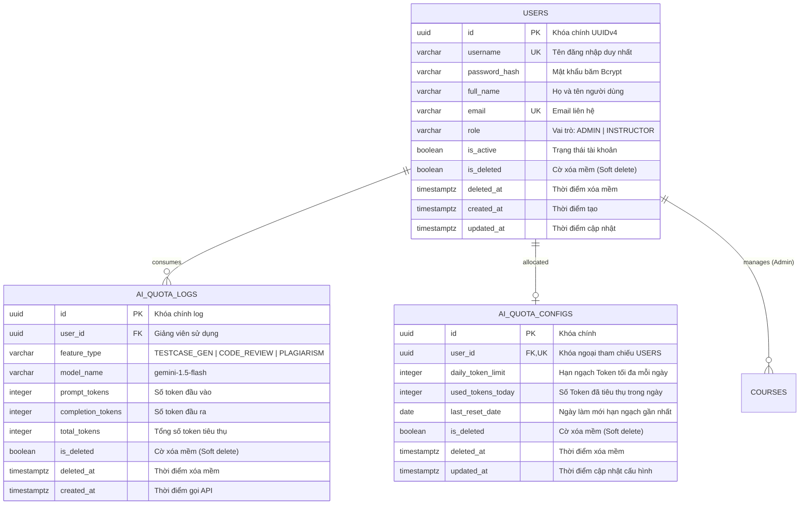
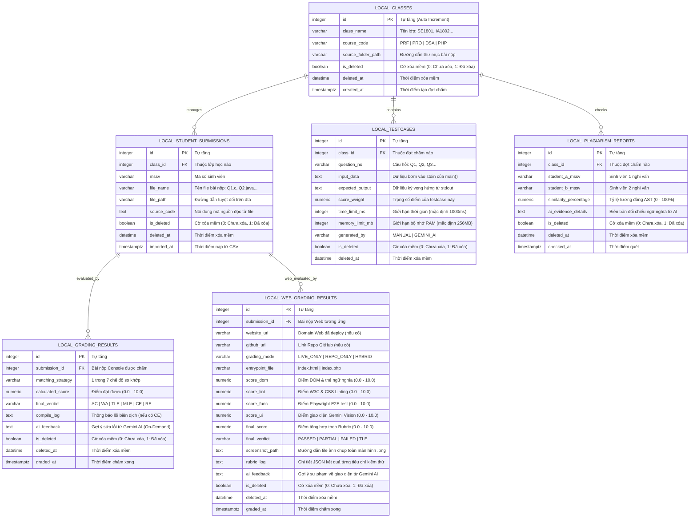

# Thiết Kế Lược Đồ Cơ Sở Dữ Liệu Toàn Hệ Sinh Thái (Database Schema Specification)

## Dự án: AITA - Automated Grading & Assessment Tool for Instructors
## Vị trí lưu trữ: `docs/architecture/database_schema.md`

Tài liệu này đặc tả chi tiết kiến trúc và lược đồ cơ sở dữ liệu (Database Schema) cho toàn bộ hệ sinh thái **AITA**, bao gồm:
1. **Cơ sở dữ liệu Trung tâm (Central Database - PostgreSQL trên Neon Serverless Cloud)**: Phục vụ Web Server Backend (NestJS) và Web Admin Dashboard (Next.js) để quản lý tài khoản, danh mục môn học, cấu hình API Key và giám sát hạn ngạch Token Gemini AI.
2. **Cơ sở dữ liệu Cục bộ (Local Database - SQLite3 Client)**: Nằm trực tiếp trên máy trạm của Giảng viên phục vụ Desktop App (PyQt6) vận hành chấm điểm Offline-first tốc độ cao, lưu trữ toàn bộ dữ liệu lớp học, bài nộp, testcase và kết quả điểm thi **hoàn toàn cục bộ, không tải lên Cloud**.

---

## 1. Sơ Đồ Thực Thể Liên Kết Tổng Thể (Entity Relationship Diagram - ERD)

### 1.1. Sơ đồ ERD Cơ Sở Dữ Liệu Trung Tâm (Central PostgreSQL - Neon Cloud)

---

### 1.2. Sơ đồ ERD Cơ Sở Dữ Liệu Cục Bộ (Local SQLite3 - Desktop App)

---

## 2. Đặc Tả Chi Tiết Cơ Sở Dữ Liệu Trung Tâm (Central Database - PostgreSQL / Neon)

CSDL này được quản lý tập trung trên nền tảng **Neon Serverless PostgreSQL**, tương tác qua **Prisma ORM / TypeORM** trong Web Backend (NestJS).

### 2.1. Bảng `users` (Quản lý tài khoản hệ thống)
* **Mục đích**: Lưu trữ thông tin định danh và phân quyền Role-Based Access Control (RBAC) cho 2 đối tượng duy nhất có tài khoản: `ADMIN` và `INSTRUCTOR`.

| Tên Cột | Kiểu Dữ Liệu | Ràng Buộc | Giá Trị Mặc Định | Ý Nghĩa Nghiệp Vụ |
| :--- | :--- | :--- | :--- | :--- |
| `id` | `UUID` | **PRIMARY KEY** | `gen_random_uuid()` | Khóa chính duy nhất toàn cục. |
| `username` | `VARCHAR(50)` | **UNIQUE, NOT NULL** | | Tên đăng nhập (viết thường, không dấu). |
| `password_hash`| `VARCHAR(255)`| **NOT NULL** | | Chuỗi mật khẩu băm bảo mật chuẩn Bcrypt. |
| `full_name` | `VARCHAR(100)`| **NOT NULL** | | Họ và tên hiển thị của người dùng. |
| `email` | `VARCHAR(120)`| **UNIQUE, NOT NULL** | | Địa chỉ email liên hệ / khôi phục mật khẩu. |
| `role` | `VARCHAR(20)` | **NOT NULL** | `'INSTRUCTOR'` | Vai trò: `ADMIN` (Web) hoặc `INSTRUCTOR` (Desktop). |
| `is_active` | `BOOLEAN` | **NOT NULL** | `TRUE` | Trạng thái tài khoản (khóa/mở). |
| `is_deleted` | `BOOLEAN` | **NOT NULL** | `FALSE` | Cờ xóa mềm (FALSE: Hoạt động, TRUE: Đã xóa). |
| `deleted_at` | `TIMESTAMPTZ` | | `NULL` | Thời điểm xóa mềm tài khoản. |
| `created_at` | `TIMESTAMPTZ` | **NOT NULL** | `CURRENT_TIMESTAMP` | Thời điểm khởi tạo tài khoản. |
| `updated_at` | `TIMESTAMPTZ` | **NOT NULL** | `CURRENT_TIMESTAMP` | Thời điểm cập nhật thông tin gần nhất. |

* **Chỉ mục (Indexes)**:
  - `idx_users_username`: Tìm kiếm nhanh khi xử lý đăng nhập JWT.
  - `idx_users_role`: Lọc danh sách Giảng viên phục vụ giao diện Web Admin.

---

### 2.2. Bảng `ai_quota_configs` (Cấu hình hạn ngạch Gemini AI)
* **Mục đích**: Quản trị viên (Admin) cấu hình trần số Token gọi AI tối đa trong ngày cho từng Giảng viên nhằm kiểm soát chi phí.

| Tên Cột | Kiểu Dữ Liệu | Ràng Buộc | Giá Trị Mặc Định | Ý Nghĩa Nghiệp Vụ |
| :--- | :--- | :--- | :--- | :--- |
| `id` | `UUID` | **PRIMARY KEY** | `gen_random_uuid()` | Khóa chính. |
| `user_id` | `UUID` | **FOREIGN KEY, UNIQUE** | | Tham chiếu `users(id)` ON DELETE CASCADE. |
| `daily_token_limit`| `INTEGER`| **NOT NULL** | `100000` | Giới hạn Token mỗi ngày (mặc định 100k token/ngày).|
| `used_tokens_today`| `INTEGER`| **NOT NULL** | `0` | Tổng token đã tiêu thụ trong ngày hiện tại. |
| `last_reset_date` | `DATE` | **NOT NULL** | `CURRENT_DATE` | Ngày tự động reset hạn ngạch về 0. |
| `is_deleted` | `BOOLEAN` | **NOT NULL** | `FALSE` | Cờ xóa mềm (FALSE: Hoạt động, TRUE: Đã xóa). |
| `deleted_at` | `TIMESTAMPTZ` | | `NULL` | Thời điểm xóa mềm cấu hình. |
| `updated_at` | `TIMESTAMPTZ` | **NOT NULL** | `CURRENT_TIMESTAMP` | Thời điểm Admin cập nhật hạn ngạch. |

---

### 2.3. Bảng `ai_quota_logs` (Nhật ký tiêu thụ tài nguyên AI)
* **Mục đích**: Ghi vết minh bạch từng lượt gọi API Google Gemini 1.5 Flash (sinh testcase, review bài WA, quét đạo văn) để phục vụ báo cáo kiểm toán (Audit Logs).

| Tên Cột | Kiểu Dữ Liệu | Ràng Buộc | Giá Trị Mặc Định | Ý Nghĩa Nghiệp Vụ |
| :--- | :--- | :--- | :--- | :--- |
| `id` | `UUID` | **PRIMARY KEY** | `gen_random_uuid()` | Khóa chính nhật ký. |
| `user_id` | `UUID` | **FOREIGN KEY, NOT NULL**| | Tham chiếu `users(id)`. |
| `feature_type`| `VARCHAR(30)` | **NOT NULL** | | `TESTCASE_GEN`, `CODE_REVIEW`, `PLAGIARISM`. |
| `model_name` | `VARCHAR(50)` | **NOT NULL** | `'gemini-1.5-flash'` | Tên mô hình AI phục vụ yêu cầu. |
| `prompt_tokens` | `INTEGER` | **NOT NULL** | `0` | Số token của prompt gửi đi. |
| `completion_tokens`|`INTEGER` | **NOT NULL** | `0` | Số token phản hồi nhận về từ Gemini. |
| `total_tokens` | `INTEGER` | **NOT NULL** | `0` | Tổng token = prompt + completion. |
| `is_deleted` | `BOOLEAN` | **NOT NULL** | `FALSE` | Cờ xóa mềm (FALSE: Hoạt động, TRUE: Đã xóa). |
| `deleted_at` | `TIMESTAMPTZ` | | `NULL` | Thời điểm xóa mềm nhật ký. |
| `created_at` | `TIMESTAMPTZ` | **NOT NULL** | `CURRENT_TIMESTAMP` | Thời điểm gọi API. |

---

## 3. Đặc Tả Chi Tiết Cơ Sở Dữ Liệu Cục Bộ (Local SQLite3 - Desktop App)

CSDL này nằm dưới dạng file nhị phân **`local_grading.db`** đặt trong thư mục lưu trữ cục bộ của Desktop App (PyQt6). Cơ sở dữ liệu này đảm bảo **ứng dụng hoạt động độc lập 100% khi mất kết nối mạng và toàn bộ dữ liệu bài thi được bảo mật tuyệt đối trên máy tính của Giảng viên**.

### 3.1. Bảng `local_classes` (Quản lý đợt chấm bài tại máy trạm)
* **Mục đích**: Quản lý thông tin lớp học và thư mục bài nộp của đợt thi.

| Tên Cột | Kiểu Dữ Liệu | Ràng Buộc | Ý Nghĩa Nghiệp Vụ |
| :--- | :--- | :--- | :--- |
| `id` | `INTEGER` | **PRIMARY KEY AUTOINCREMENT** | Khóa tự tăng. |
| `class_name` | `TEXT` | **NOT NULL** | Tên lớp học (VD: `SE1801`, `IA1802`). |
| `course_code` | `TEXT` | **NOT NULL** | Mã môn học (`PRF`, `PRO`, `DSA`, `PHP`). |
| `source_folder_path`| `TEXT` | **NOT NULL** | Đường dẫn thư mục chứa toàn bộ bài nộp sinh viên. |
| `is_deleted` | `INTEGER` | **DEFAULT 0** | Cờ xóa mềm (0: Hoạt động, 1: Đã xóa). |
| `deleted_at` | `DATETIME` | | Thời điểm xóa mềm đợt chấm. |
| `created_at` | `DATETIME` | **DEFAULT CURRENT_TIMESTAMP**| Thời điểm khởi tạo đợt chấm. |

### 3.2. Bảng `local_student_submissions` (Danh sách bài nộp nạp từ `students.csv`)
* **Nguyên tắc**: Nạp trực tiếp từ file CSV chuẩn 2 cột (`MSSV,File`).

| Tên Cột | Kiểu Dữ Liệu | Ràng Buộc | Ý Nghĩa Nghiệp Vụ |
| :--- | :--- | :--- | :--- |
| `id` | `INTEGER` | **PRIMARY KEY AUTOINCREMENT** | Khóa tự tăng. |
| `class_id` | `INTEGER` | **FOREIGN KEY** REFERENCES `local_classes(id)` | Thuộc đợt chấm nào. |
| `mssv` | `TEXT` | **NOT NULL** | Mã số sinh viên. |
| `file_name` | `TEXT` | **NOT NULL** | Tên file câu hỏi (`Q1.c`, `Q2.java`...). |
| `file_path` | `TEXT` | **NOT NULL** | Đường dẫn tuyệt đối của file trên đĩa cứng. |
| `source_code` | `TEXT` | | Nội dung mã nguồn đọc sẵn phục vụ quét AST. |
| `is_deleted` | `INTEGER` | **DEFAULT 0** | Cờ xóa mềm (0: Hoạt động, 1: Đã xóa). |
| `deleted_at` | `DATETIME` | | Thời điểm xóa mềm bài nộp. |
| `imported_at`| `DATETIME` | **DEFAULT CURRENT_TIMESTAMP** | Thời điểm nạp file CSV. |

### 3.3. Bảng `local_testcases` (Bộ testcase kiểm thử Black-box)
* **Nguyên tắc**: Chứa các cặp `[INPUT, OUTPUT]` dùng chung cho toàn bộ lớp học, không cần file lời giải mẫu (`solution`).

| Tên Cột | Kiểu Dữ Liệu | Ràng Buộc | Ý Nghĩa Nghiệp Vụ |
| :--- | :--- | :--- | :--- |
| `id` | `INTEGER` | **PRIMARY KEY AUTOINCREMENT** | Khóa tự tăng. |
| `class_id` | `INTEGER` | **FOREIGN KEY** REFERENCES `local_classes(id)` | Thuộc đợt chấm nào. |
| `question_no` | `TEXT` | **NOT NULL** | Định danh câu hỏi (`Q1`, `Q2`, `Q3`). |
| `input_data` | `TEXT` | **NOT NULL** | Chuỗi dữ liệu nạp vào `stdin` của hàm `main()`. |
| `expected_output`|`TEXT`| **NOT NULL** | Chuỗi kết quả chuẩn kỳ vọng từ `stdout`. |
| `score_weight`| `REAL` | **DEFAULT 1.0** | Trọng số điểm câu hỏi. |
| `time_limit_ms`|`INTEGER`| **DEFAULT 1000** | Thời gian chạy tối đa (ms) trước khi gán `TLE`. |
| `memory_limit_mb`|`INTEGER`| **DEFAULT 256** | RAM tối đa (MB) trước khi gán `MLE`. |
| `generated_by`| `TEXT` | **DEFAULT 'MANUAL'** | `MANUAL` (nhập tay) hoặc `GEMINI_AI` (AI sinh). |
| `is_deleted` | `INTEGER` | **DEFAULT 0** | Cờ xóa mềm (0: Hoạt động, 1: Đã xóa). |
| `deleted_at` | `DATETIME` | | Thời điểm xóa mềm testcase. |

### 3.4. Bảng `local_grading_results` (Kết quả chấm bài tập Console C/Java/Python)
| Tên Cột | Kiểu Dữ Liệu | Ràng Buộc | Ý Nghĩa Nghiệp Vụ |
| :--- | :--- | :--- | :--- |
| `id` | `INTEGER` | **PRIMARY KEY AUTOINCREMENT** | Khóa tự tăng. |
| `submission_id`|`INTEGER`| **FOREIGN KEY** REFERENCES `local_student_submissions(id)` | Bài nộp Console tương ứng. |
| `matching_strategy`|`TEXT`| **NOT NULL** | 1 trong 7 chiến lược so khớp đầu ra đã áp dụng. |
| `calculated_score`|`REAL` | **NOT NULL DEFAULT 0.0** | Điểm số tính toán được (0.0 - 10.0). |
| `final_verdict`|`TEXT` | **NOT NULL** | Phán quyết: `AC`, `WA`, `TLE`, `MLE`, `CE`, `RE`. |
| `compile_log` | `TEXT` | | Bắt nội dung `stderr` khi dính lỗi biên dịch `CE`. |
| `ai_feedback` | `TEXT` | | Nhận xét sư phạm ngắn sinh bởi Gemini AI (On-Demand). |
| `is_deleted` | `INTEGER` | **DEFAULT 0** | Cờ xóa mềm (0: Hoạt động, 1: Đã xóa). |
| `deleted_at` | `DATETIME` | | Thời điểm xóa mềm kết quả. |
| `graded_at` | `DATETIME` | **DEFAULT CURRENT_TIMESTAMP** | Thời điểm chấm xong. |

### 3.5. Bảng `local_web_grading_results` (Kết quả chấm bài tập Web HTML/CSS/JS/PHP - UC-19)
* **Mục đích**: Lưu trữ độc lập và chuyên biệt kết quả thẩm định bài tập Web tự động theo Rubric 4 thành phần trên Desktop App, hỗ trợ 3 chế độ chấm: Chỉ chấm Live Website, Chỉ chấm GitHub Repo, hoặc Chấm kết hợp.

| Tên Cột | Kiểu Dữ Liệu | Ràng Buộc | Ý Nghĩa Nghiệp Vụ |
| :--- | :--- | :--- | :--- |
| `id` | `INTEGER` | **PRIMARY KEY AUTOINCREMENT** | Khóa tự tăng. |
| `submission_id`|`INTEGER`| **FOREIGN KEY** REFERENCES `local_student_submissions(id)` | Bài nộp Web tương ứng. |
| `website_url` | `TEXT` | | URL domain website đã deploy (Vercel, Netlify,...) dùng cho chế độ `LIVE_ONLY` hoặc `HYBRID`. |
| `github_url` | `TEXT` | | URL kho mã nguồn GitHub của sinh viên dùng cho chế độ `REPO_ONLY` hoặc `HYBRID`. |
| `grading_mode`| `TEXT` | **NOT NULL DEFAULT 'HYBRID'** | Chế độ chấm: `LIVE_ONLY` (Chỉ chấm domain), `REPO_ONLY` (Chỉ chấm GitHub), `HYBRID` (Chấm kết hợp). |
| `entrypoint_file`|`TEXT` | **NOT NULL DEFAULT 'index.html'** | Tệp khởi nhập (`index.html` hoặc `index.php`). |
| `score_dom` | `REAL` | **NOT NULL DEFAULT 0.0** | Điểm tiêu chí 1: Cấu trúc DOM & thẻ ngữ nghĩa HTML (0.0 - 10.0). |
| `score_lint`| `REAL` | **NOT NULL DEFAULT 0.0** | Điểm tiêu chí 2: Chuẩn cú pháp W3C & CSS Linting (0.0 - 10.0). |
| `score_func`| `REAL` | **NOT NULL DEFAULT 0.0** | Điểm tiêu chí 3: Kịch bản kiểm thử hành vi Playwright E2E (0.0 - 10.0). |
| `score_ui` | `REAL` | **NOT NULL DEFAULT 0.0** | Điểm tiêu chí 4: Đánh giá thẩm mỹ từ Gemini Vision (0.0 - 10.0). |
| `final_score`|`REAL` | **NOT NULL DEFAULT 0.0** | Điểm tổng hợp theo trọng số Rubric (0.0 - 10.0). |
| `final_verdict`|`TEXT` | **NOT NULL** | Phán quyết: `PASSED`, `PARTIAL`, `FAILED`, `TLE`. |
| `screenshot_path`|`TEXT`| | Đường dẫn file ảnh `.png` chụp toàn trang màn hình trên ổ đĩa. |
| `rubric_log`| `TEXT` | | Chuỗi JSON chi tiết danh sách checklist đạt/lỗi từng tiêu chí. |
| `ai_feedback`|`TEXT` | | Lời góp ý sư phạm về giao diện từ Gemini AI. |
| `is_deleted` | `INTEGER` | **DEFAULT 0** | Cờ xóa mềm (0: Hoạt động, 1: Đã xóa). |
| `deleted_at` | `DATETIME` | | Thời điểm xóa mềm kết quả. |
| `graded_at` | `DATETIME` | **DEFAULT CURRENT_TIMESTAMP** | Thời điểm hoàn thành chấm bài Web. |

### 3.6. Bảng `local_plagiarism_reports` (Kết quả kiểm tra gian lận thi cử)
| Tên Cột | Kiểu Dữ Liệu | Ràng Buộc | Ý Nghĩa Nghiệp Vụ |
| :--- | :--- | :--- | :--- |
| `id` | `INTEGER` | **PRIMARY KEY AUTOINCREMENT** | Khóa tự tăng. |
| `class_id` | `INTEGER` | **FOREIGN KEY** REFERENCES `local_classes(id)` | Thuộc đợt chấm nào. |
| `student_a_mssv`|`TEXT` | **NOT NULL** | MSSV sinh viên thứ nhất. |
| `student_b_mssv`|`TEXT` | **NOT NULL** | MSSV sinh viên thứ hai. |
| `similarity_percentage`|`REAL`| **NOT NULL** | Tỷ lệ tương đồng AST từ Vòng 1 (0.00% - 100.00%). |
| `ai_evidence_details`|`TEXT`| | Bằng chứng đối sánh ngữ nghĩa từ AI ở Vòng 2 (> 80%). |
| `is_deleted` | `INTEGER` | **DEFAULT 0** | Cờ xóa mềm (0: Hoạt động, 1: Đã xóa). |
| `deleted_at` | `DATETIME` | | Thời điểm xóa mềm báo cáo. |
| `checked_at` | `DATETIME` | **DEFAULT CURRENT_TIMESTAMP** | Thời điểm quét đạo văn. |

---

## 4. Nguyên Tắc Bảo Mật & Lưu Trữ Cục Bộ (Local-First Data Privacy)

1. **Bảo mật tuyệt đối dữ liệu bài thi (100% Local-First)**: Toàn bộ danh sách sinh viên, file bài nộp, testcase và kết quả điểm số đều được lưu trữ trực tiếp trong CSDL SQLite cục bộ trên máy tính của Giảng viên. Hệ thống **hoàn toàn không tải bài thi hay bảng điểm lên máy chủ đám mây**, đảm bảo quyền riêng tư và bảo mật dữ liệu thi cử của nhà trường.
2. **Xuất bảng điểm độc lập**: Giảng viên xuất kết quả chấm điểm ra file **`results.csv` (7 cột)** hoặc file Excel `.xlsx` trực tiếp từ SQLite cục bộ để phục vụ việc nộp điểm cho phòng đào tạo hoặc công bố điểm cho sinh viên.
3. **Phân định rõ ràng vai trò Web Backend**: Máy chủ Web Backend (NestJS) và Neon Database chỉ phục vụ các chức năng:
   - Xác thực tài khoản Giảng viên và cấp token JWT khi mở Desktop App.
   - Làm cầu nối bảo mật (AI Gateway) để kiểm soát hạn ngạch Token khi Giảng viên dùng tính năng AI (sinh testcase, phân tích lỗi `WA`, quét đạo văn Vòng 2).
   - Quản trị viên (Admin) quản lý tài khoản Giảng viên và giám sát hạn ngạch AI, xem báo cáo thống kê sử dụng hệ thống.
