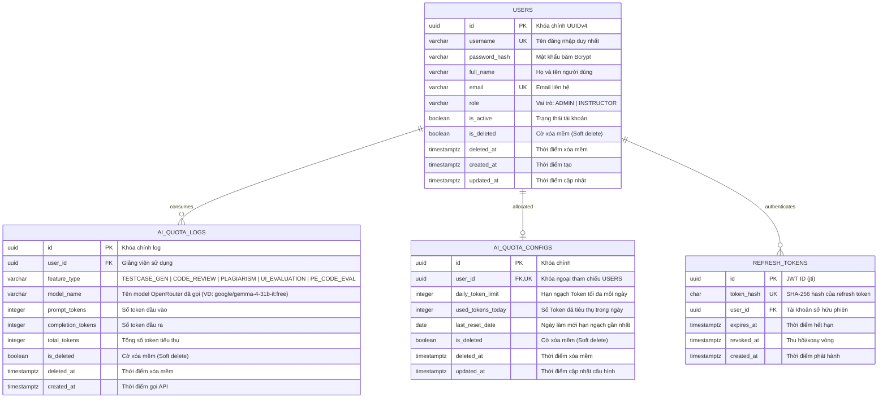
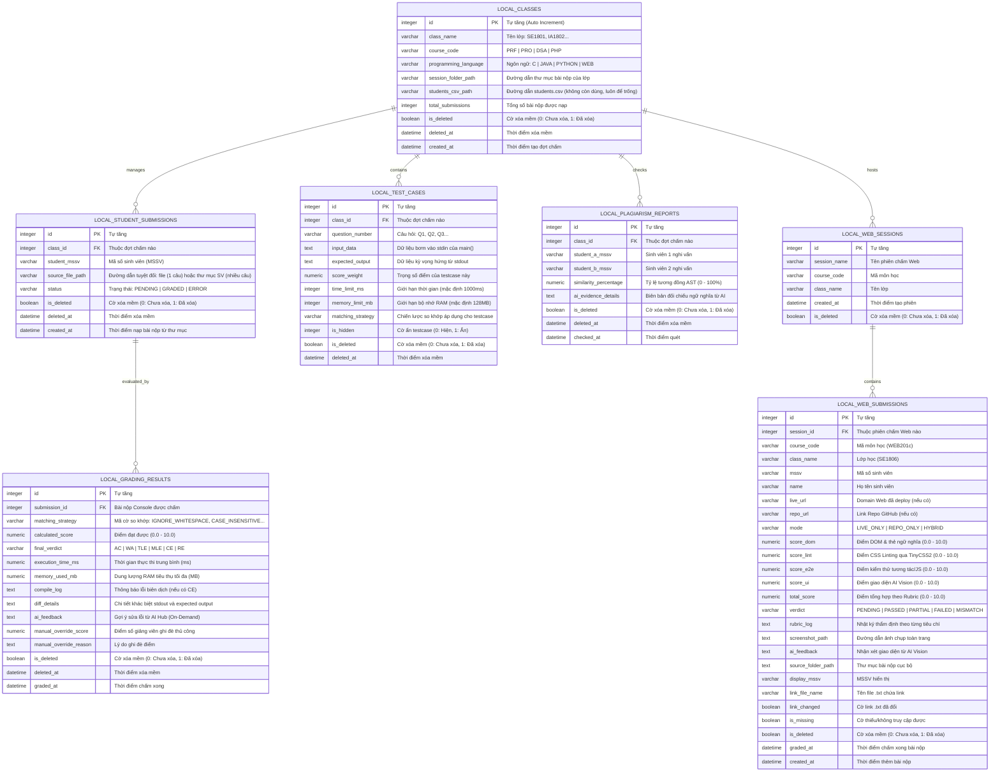

# Thiết Kế Lược Đồ Cơ Sở Dữ Liệu Toàn Hệ Sinh Thái (Database Schema Specification)

## Dự án: AITA - Automated Grading & Assessment Tool for Instructors

## Vị trí lưu trữ: `docs/architecture/database_schema.md`

Tài liệu này đặc tả chi tiết kiến trúc và lược đồ cơ sở dữ liệu (Database Schema) cho toàn bộ hệ sinh thái **AITA**, bao gồm:

1. **Cơ sở dữ liệu Trung tâm (Central Database - PostgreSQL trên Neon Serverless Cloud)**: Phục vụ Web Server Backend (NestJS) và Web Admin Dashboard (Next.js) để quản lý tài khoản, quota và nhật ký sử dụng AI Hub.
2. **Cơ sở dữ liệu Cục bộ (Local Database - SQLite3 Client)**: Nằm trực tiếp trên máy trạm của Giảng viên phục vụ Desktop App (PyQt6) vận hành chấm điểm Offline-first tốc độ cao, lưu trữ toàn bộ dữ liệu lớp học, bài nộp, testcase và kết quả điểm thi **hoàn toàn cục bộ, không tải lên Cloud**.

---

## 1. Sơ Đồ Thực Thể Liên Kết Tổng Thể (Entity Relationship Diagram - ERD)

### 1.1. Sơ đồ ERD Cơ Sở Dữ Liệu Trung Tâm (Central PostgreSQL - Neon Cloud)

---

### 1.2. Sơ đồ ERD Cơ Sở Dữ Liệu Cục Bộ (Local SQLite3 - Desktop App)

---

## 2. Đặc Tả Chi Tiết Cơ Sở Dữ Liệu Trung Tâm (Central Database - PostgreSQL / Neon)

CSDL này được quản lý tập trung trên nền tảng **Neon Serverless PostgreSQL**, tương tác qua **Prisma ORM** trong Web Backend (NestJS).

### 2.1. Bảng `users` (Quản lý tài khoản hệ thống)

* **Mục đích**: Lưu trữ thông tin định danh và phân quyền Role-Based Access Control (RBAC) cho 2 đối tượng duy nhất có tài khoản: `ADMIN` và `INSTRUCTOR`.

| Tên Cột         | Kiểu Dữ Liệu  | Ràng Buộc                | Giá Trị Mặc Định | Ý Nghĩa Nghiệp Vụ                                    |
| :---------------- | :--------------- | :------------------------- | :-------------------- | :------------------------------------------------------- |
| `id`            | `UUID`         | **PRIMARY KEY**      | `gen_random_uuid()` | Khóa chính duy nhất toàn cục.                       |
| `username`      | `VARCHAR(50)`  | **UNIQUE, NOT NULL** |                       | Tên đăng nhập (viết thường, không dấu).         |
| `password_hash` | `VARCHAR(255)` | **NOT NULL**         |                       | Chuỗi mật khẩu băm bảo mật chuẩn Bcrypt.          |
| `full_name`     | `VARCHAR(100)` | **NOT NULL**         |                       | Họ và tên hiển thị của người dùng.              |
| `email`         | `VARCHAR(120)` | **UNIQUE, NOT NULL** |                       | Địa chỉ email liên hệ / khôi phục mật khẩu.     |
| `role`          | `VARCHAR(20)`  | **NOT NULL**         | `'INSTRUCTOR'`      | Vai trò:`ADMIN` (Web) hoặc `INSTRUCTOR` (Desktop). |
| `is_active`     | `BOOLEAN`      | **NOT NULL**         | `TRUE`              | Trạng thái tài khoản (khóa/mở).                    |
| `is_deleted`    | `BOOLEAN`      | **NOT NULL**         | `FALSE`             | Cờ xóa mềm (FALSE: Hoạt động, TRUE: Đã xóa).    |
| `deleted_at`    | `TIMESTAMPTZ`  |                            | `NULL`              | Thời điểm xóa mềm tài khoản.                      |
| `created_at`    | `TIMESTAMPTZ`  | **NOT NULL**         | `CURRENT_TIMESTAMP` | Thời điểm khởi tạo tài khoản.                     |
| `updated_at`    | `TIMESTAMPTZ`  | **NOT NULL**         | `CURRENT_TIMESTAMP` | Thời điểm cập nhật thông tin gần nhất.           |

* **Chỉ mục (Indexes)**:
  - `idx_users_username_trgm`, `idx_users_full_name_trgm`, `idx_users_email_trgm`: Chỉ mục GIN `pg_trgm` tìm kiếm gần đúng (LIKE/ILIKE) khi đăng nhập và tìm kiếm trên Web Admin.
  - `idx_users_role`, `idx_users_role_created`: Lọc và phân trang danh sách theo vai trò, giảm dần theo `created_at`.

---

### 2.2. Bảng `ai_quota_configs` (Cấu hình hạn ngạch AI Hub)

* **Mục đích**: Quản trị viên (Admin) cấu hình trần số Token gọi AI tối đa trong ngày cho từng Giảng viên nhằm kiểm soát chi phí.

| Tên Cột             | Kiểu Dữ Liệu | Ràng Buộc                   | Giá Trị Mặc Định | Ý Nghĩa Nghiệp Vụ                                       |
| :-------------------- | :-------------- | :---------------------------- | :-------------------- | :---------------------------------------------------------- |
| `id`                | `UUID`        | **PRIMARY KEY**         | `gen_random_uuid()` | Khóa chính.                                               |
| `user_id`           | `UUID`        | **FOREIGN KEY, UNIQUE** |                       | Tham chiếu`users(id)` ON DELETE CASCADE.                 |
| `daily_token_limit` | `INTEGER`     | **NOT NULL**            | `50000`             | Giới hạn Token mỗi ngày (mặc định 50k token/ngày). |
| `used_tokens_today` | `INTEGER`     | **NOT NULL**            | `0`                 | Tổng token đã tiêu thụ trong ngày hiện tại.         |
| `last_reset_date`   | `DATE`        | **NOT NULL**            | `CURRENT_DATE`      | Ngày tự động reset hạn ngạch về 0.                   |
| `is_deleted`        | `BOOLEAN`     | **NOT NULL**            | `FALSE`             | Cờ xóa mềm (FALSE: Hoạt động, TRUE: Đã xóa).       |
| `deleted_at`        | `TIMESTAMPTZ` |                               | `NULL`              | Thời điểm xóa mềm cấu hình.                          |
| `updated_at`        | `TIMESTAMPTZ` | **NOT NULL**            | `CURRENT_TIMESTAMP` | Thời điểm Admin cập nhật hạn ngạch.                  |

---

### 2.3. Bảng `ai_quota_logs` (Nhật ký tiêu thụ tài nguyên AI)

* **Mục đích**: Ghi vết minh bạch từng lượt gọi AI Hub (sinh testcase, review bài WA, quét đạo văn, đánh giá UI) để phục vụ báo cáo kiểm toán (Audit Logs).

| Tên Cột             | Kiểu Dữ Liệu | Ràng Buộc                     | Giá Trị Mặc Định  | Ý Nghĩa Nghiệp Vụ                                 |
| :-------------------- | :-------------- | :------------------------------ | :--------------------- | :---------------------------------------------------- |
| `id`                | `UUID`        | **PRIMARY KEY**           | `gen_random_uuid()`  | Khóa chính nhật ký.                               |
| `user_id`           | `UUID`        | **FOREIGN KEY, NOT NULL** |                        | Tham chiếu`users(id)`.                             |
| `feature_type`      | `VARCHAR(30)` | **NOT NULL**              |                        | `TESTCASE_GEN`, `CODE_REVIEW`, `PLAGIARISM`, `UI_EVALUATION`, `PE_CODE_EVAL`. |
| `model_name`        | `VARCHAR(50)` | **NOT NULL**              | `'gemini-3.8-flash'` | Tên model thực tế đã gọi (ghi theo `OPENROUTER_MODEL`, VD: `google/gemma-4-31b-it:free`). |
| `prompt_tokens`     | `INTEGER`     | **NOT NULL**              | `0`                  | Số token của prompt gửi đi.                       |
| `completion_tokens` | `INTEGER`     | **NOT NULL**              | `0`                  | Số token phản hồi nhận về từ AI Hub.            |
| `total_tokens`      | `INTEGER`     | **NOT NULL**              | `0`                  | Tổng token = prompt + completion.                    |
| `is_deleted`        | `BOOLEAN`     | **NOT NULL**              | `FALSE`              | Cờ xóa mềm (FALSE: Hoạt động, TRUE: Đã xóa). |
| `deleted_at`        | `TIMESTAMPTZ` |                                 | `NULL`               | Thời điểm xóa mềm nhật ký.                     |
| `created_at`        | `TIMESTAMPTZ` | **NOT NULL**              | `CURRENT_TIMESTAMP`  | Thời điểm gọi API.                                |

Chỉ mục: `idx_ai_quota_logs_user_created` phục vụ lịch sử theo người dùng; `idx_ai_quota_logs_created_feature` phục vụ báo cáo theo tháng và tính năng.

---

### 2.4. Bảng `refresh_tokens` (Phiên gia hạn JWT)

Backend lưu SHA-256 hash của refresh token để xoay vòng token một lần, thu hồi token cũ sau khi gia hạn và không lưu token dạng rõ.

| Tên cột | Kiểu dữ liệu | Ràng buộc | Ý nghĩa |
| :--- | :--- | :--- | :--- |
| `id` | `UUID` | PRIMARY KEY | JWT ID (`jti`) của refresh token. |
| `token_hash` | `CHAR(64)` | UNIQUE, NOT NULL | SHA-256 hash, không lưu token gốc. |
| `user_id` | `UUID` | FOREIGN KEY, NOT NULL | Tham chiếu `users(id)`, xóa cascade. |
| `expires_at` | `TIMESTAMPTZ` | NOT NULL | Thời điểm hết hạn. |
| `revoked_at` | `TIMESTAMPTZ` | NULL | Thời điểm đã sử dụng/thu hồi; null khi còn hiệu lực. |
| `created_at` | `TIMESTAMPTZ` | NOT NULL | Thời điểm phát hành. |

Chỉ mục: `idx_refresh_tokens_user_expires` trên (`user_id`, `expires_at`).

## 3. Đặc Tả Chi Tiết Cơ Sở Dữ Liệu Cục Bộ (Local SQLite3 - Desktop App)

CSDL này nằm dưới dạng file nhị phân **`local_grading.db`** đặt trong thư mục lưu trữ cục bộ của Desktop App (PyQt6). Cơ sở dữ liệu này đảm bảo **ứng dụng hoạt động độc lập 100% khi mất kết nối mạng và toàn bộ dữ liệu bài thi được bảo mật tuyệt đối trên máy tính của Giảng viên**.

### 3.1. Bảng `local_classes` (Quản lý đợt chấm bài tại máy trạm)

* **Mục đích**: Quản lý thông tin lớp học, môn học, ngôn ngữ và thư mục bài nộp của đợt thi.

| Tên Cột                | Kiểu Dữ Liệu | Ràng Buộc                         | Ý Nghĩa Nghiệp Vụ                                         |
| :----------------------- | :-------------- | :---------------------------------- | :------------------------------------------------------------ |
| `id`                   | `INTEGER`     | **PRIMARY KEY AUTOINCREMENT** | Khóa tự tăng.                                              |
| `class_name`           | `TEXT`        | **NOT NULL**                  | Tên lớp học (VD:`SE1801`, `IA1802`).                   |
| `course_code`          | `TEXT`        | **NOT NULL**                  | Mã môn học (`PRF`, `PRO`, `DSA`, `PHP`).           |
| `programming_language` | `TEXT`        | **NOT NULL DEFAULT 'C'**      | Ngôn ngữ lập trình (`C`, `JAVA`, `PYTHON`, `WEB`). |
| `session_folder_path`  | `TEXT`        | **NOT NULL**                  | Đường dẫn thư mục chứa bài nộp của đợt thi.        |
| `students_csv_path`    | `TEXT`        |                                     | Đường dẫn file `students.csv` — **thuộc tính kế thừa, không còn dùng** (đợt chấm mới luôn để trống vì nạp bài từ thư mục). |
| `total_submissions`    | `INTEGER`     | **DEFAULT 0**                 | Tổng số bài nộp được import vào đợt thi.          |
| `is_deleted`           | `INTEGER`     | **DEFAULT 0**                 | Cờ xóa mềm (0: Hoạt động, 1: Đã xóa).                |
| `deleted_at`           | `DATETIME`    |                                     | Thời điểm xóa mềm đợt chấm.                           |
| `created_at`           | `DATETIME`    | **DEFAULT CURRENT_TIMESTAMP** | Thời điểm khởi tạo đợt chấm.                          |

### 3.2. Bảng `local_student_submissions` (Danh sách bài nộp nạp từ thư mục bài thi)

* **Nguyên tắc**: Nạp bằng cách quét thư mục bài thi (mỗi sinh viên một thư mục con hoặc một file, tự tách MSSV/họ tên bằng regex; mỗi câu một file `Q1`, `Q2`...). Dữ liệu chỉ lưu MSSV — **không còn nạp qua file `students.csv`**.
* **Chế độ chấm (theo `source_file_path`)**:
    * Trỏ vào **FILE mã nguồn** → chấm chuyên sâu (làm refactoring-bounded) một câu.
    * Trỏ vào **THƯ MỤC của sinh viên** → chấm nhiều câu (multi-question): mỗi testcase tự ánh xạ file mã nguồn `Q<nn>.<ext>` trong thư mục sinh viên theo trường `question_number` của nó.

| Tên Cột            | Kiểu Dữ Liệu | Ràng Buộc                                            | Ý Nghĩa Nghiệp Vụ                                   |
| :------------------- | :-------------- | :----------------------------------------------------- | :------------------------------------------------------ |
| `id`               | `INTEGER`     | **PRIMARY KEY AUTOINCREMENT**                    | Khóa tự tăng.                                        |
| `class_id`         | `INTEGER`     | **FOREIGN KEY** REFERENCES `local_classes(id)` | Thuộc đợt chấm nào.                                |
| `student_mssv`     | `TEXT`        | **NOT NULL**                                     | Mã số sinh viên (MSSV) — định danh duy nhất của bài nộp (bảng không lưu họ tên; tên chỉ dùng bộ nhớ phần UI). |
| `source_file_path` | `TEXT`        | **NOT NULL**                                     | Đường dẫn tuyệt đối: file mã nguồn (chấm 1 câu) hoặc thư mục bài làm của sinh viên (chấm nhiều câu). |
| `status`           | `TEXT`        | **NOT NULL DEFAULT 'PENDING'**                   | Trạng thái bài nộp (`PENDING`, `GRADED`, `ERROR`). |
| `is_deleted`       | `INTEGER`     | **DEFAULT 0**                                    | Cờ xóa mềm (0: Hoạt động, 1: Đã xóa).          |
| `deleted_at`       | `DATETIME`    |                                                        | Thời điểm xóa mềm bài nộp.                       |
| `created_at`       | `DATETIME`    | **DEFAULT CURRENT_TIMESTAMP**                    | Thời điểm nạp bài nộp vào CSDL.                   |

### 3.3. Bảng `local_test_cases` (Bộ testcase kiểm thử Black-box)

* **Nguyên tắc**: Chứa các cặp `[INPUT, OUTPUT]` dùng chung cho toàn bộ lớp học, không cần file lời giải mẫu (`solution`).

| Tên Cột             | Kiểu Dữ Liệu | Ràng Buộc                                            | Ý Nghĩa Nghiệp Vụ                                           |
| :-------------------- | :-------------- | :----------------------------------------------------- | :-------------------------------------------------------------- |
| `id`                | `INTEGER`     | **PRIMARY KEY AUTOINCREMENT**                    | Khóa tự tăng.                                                |
| `class_id`          | `INTEGER`     | **FOREIGN KEY** REFERENCES `local_classes(id)` | Thuộc đợt chấm nào.                                        |
| `question_number`   | `TEXT`        | **NOT NULL DEFAULT 'Q1'**                        | Định danh câu hỏi (`Q1`, `Q2`, `Q3`...).                |
| `input_data`        | `TEXT`        | **NOT NULL**                                     | Chuỗi dữ liệu nạp vào `stdin` của hàm `main()`.        |
| `expected_output`   | `TEXT`        | **NOT NULL**                                     | Chuỗi kết quả chuẩn kỳ vọng từ `stdout`.                |
| `score_weight`      | `REAL`        | **DEFAULT 1.0**                                  | Trọng số điểm câu hỏi.                                    |
| `time_limit_ms`     | `INTEGER`     | **DEFAULT 1000**                                 | Thời gian chạy tối đa (ms) trước khi gán `TLE`.         |
| `memory_limit_mb`   | `INTEGER`     | **DEFAULT 128**                                  | RAM tối đa (MB) trước khi gán `MLE`.                      |
| `matching_strategy` | `TEXT`        | **NOT NULL DEFAULT 'EXACT_MATCH'**              | Chiến lược so khớp áp dụng cho testcase này.            |
| `is_hidden`         | `INTEGER`     | **DEFAULT 0**                                    | Cờ ẩn testcase đối với sinh viên (0: Hiện, 1: Ẩn).      |
| `is_deleted`        | `INTEGER`     | **DEFAULT 0**                                    | Cờ xóa mềm (0: Hoạt động, 1: Đã xóa).                  |
| `deleted_at`        | `DATETIME`    |                                                        | Thời điểm xóa mềm testcase.                                |

### 3.4. Bảng `local_grading_results` (Kết quả chấm bài tập Console C/Java/Python)

| Tên Cột                  | Kiểu Dữ Liệu | Ràng Buộc                                                        | Ý Nghĩa Nghiệp Vụ                                          |
| :------------------------- | :-------------- | :----------------------------------------------------------------- | :------------------------------------------------------------- |
| `id`                     | `INTEGER`     | **PRIMARY KEY AUTOINCREMENT**                                | Khóa tự tăng.                                               |
| `submission_id`          | `INTEGER`     | **FOREIGN KEY** REFERENCES `local_student_submissions(id)` | Bài nộp Console tương ứng.                                |
| `matching_strategy`      | `TEXT`        | **NOT NULL**                                                 | Tổ hợp các cờ tiêu chí so khớp đầu ra đã áp dụng. |
| `calculated_score`       | `REAL`        | **NOT NULL DEFAULT 0.0**                                     | Điểm số tính toán được (0.0 - 10.0).                   |
| `final_verdict`          | `TEXT`        | **NOT NULL**                                                 | Phán quyết: `AC`, `WA`, `TLE`, `MLE`, `CE`, `RE`. Với bài nộp nhiều câu, phán quyết tổng là **trọng tài phổ quát nghiêm ngặt nhất** đã gặp (thứ tự nghiêm ngặt `CE > TLE/MLE > RE > WA > AC`) — ví dụ câu 1 `WA` + câu 4 `CE` cho ra `CE`. |
| `execution_time_ms`      | `REAL`        | **DEFAULT 0.0**                                              | Thời gian thực thi trung bình của các testcase (ms).        |
| `memory_used_mb`         | `REAL`        | **DEFAULT 0.0**                                              | Dung lượng bộ nhớ RAM tối đa tiến trình tiêu thụ (MB).      |
| `compile_log`            | `TEXT`        |                                                                    | Bắt nội dung `stderr` khi dính lỗi biên dịch `CE`.          |
| `diff_details`           | `TEXT`        |                                                                    | Chi tiết so sánh sai lệch giữa stdout và expected output.   |
| `ai_feedback`            | `TEXT`        |                                                                    | Nhận xét sư phạm ngắn sinh bởi AI Hub (On-Demand).       |
| `manual_override_score`  | `REAL`        |                                                                    | Điểm số do giảng viên điều chỉnh/ghi đè thủ công.          |
| `manual_override_reason` | `TEXT`        |                                                                    | Lý do giảng viên ghi đè điểm số.                            |
| `is_deleted`             | `INTEGER`     | **DEFAULT 0**                                                | Cờ xóa mềm (0: Hoạt động, 1: Đã xóa).                 |
| `deleted_at`             | `DATETIME`    |                                                                    | Thời điểm xóa mềm kết quả.                              |
| `graded_at`              | `DATETIME`    | **DEFAULT CURRENT_TIMESTAMP**                                | Thời điểm chấm xong.                                       |

### 3.5. Bảng `local_web_sessions` (Phiên chấm bài tập Web)

* **Mục đích**: Quản lý các phiên (session) chấm Web riêng biệt — mỗi phiên thuộc một môn/lớp, chứa danh sách bài nộp liên kết tương ứng. Tạo/truy vấn qua `WebGradingWindow` khi giảng viên chọn hoặc tạo phiên chấm.

| Tên Cột         | Kiểu Dữ Liệu | Ràng Buộc                        | Ý Nghĩa Nghiệp Vụ                                  |
| :-------------- | :----------- | :------------------------------- | :------------------------------------------------- |
| `id`            | `INTEGER`    | **PRIMARY KEY AUTOINCREMENT**    | Khóa tự tăng.                                     |
| `session_name`  | `TEXT`       | **NOT NULL**                     | Tên phiên chấm Web.                                |
| `course_code`   | `TEXT`       | **NOT NULL**                     | Mã môn học của phiên.                              |
| `class_name`    | `TEXT`       | **NOT NULL**                     | Lớp học của phiên.                                 |
| `created_at`    | `DATETIME`   | **DEFAULT CURRENT_TIMESTAMP**    | Thời điểm tạo phiên.                               |
| `is_deleted`    | `INTEGER`    | **DEFAULT 0**                    | Cờ xóa mềm (0: Hoạt động, 1: Đã xóa).             |

---

### 3.6. Bảng `local_web_submissions` (Danh sách & kết quả chấm bài tập Web - UC-19)

* **Mục đích**: Lưu danh sách bài nộp đồ án Web (nhập từ thư mục cục bộ) cùng kết quả thẩm định tự động theo Rubric 4 thành phần, phục vụ phân hệ "Chấm Bài Tập & Đồ Án Web" trên Desktop App. Mỗi bài nộp tương ứng một mã số sinh viên (MSSV) và một thư mục bài nộp.

| Tên Cột              | Kiểu Dữ Liệu | Ràng Buộc                        | Ý Nghĩa Nghiệp Vụ                                                                                     |
| :------------------- | :----------- | :------------------------------- | :---------------------------------------------------------------------------------------------------- |
| `id`                 | `INTEGER`    | **PRIMARY KEY AUTOINCREMENT**    | Khóa tự tăng.                                                                                         |
| `session_id`         | `INTEGER`    | **FOREIGN KEY** REFERENCES `local_web_sessions(id)` | Thuộc phiên chấm Web nào (xóa mềm phiên thì xóa bài nộp kèm theo).                    |
| `course_code`        | `TEXT`       | **NOT NULL DEFAULT 'WEB201c'**   | Mã môn học của đợt chấm Web.                                                                          |
| `class_name`         | `TEXT`       | **NOT NULL DEFAULT 'SE1806'**    | Lớp học của đợt chấm Web.                                                                             |
| `mssv`               | `TEXT`       | **NOT NULL**                     | Mã số sinh viên (định danh bài nộp).                                                                  |
| `name`               | `TEXT`       | **NOT NULL**                     | Họ tên sinh viên (suy ra từ MSSV khi nhập thư mục).                                                   |
| `live_url`           | `TEXT`       |                                  | URL website đã deploy của sinh viên (dùng để render khi chấm).                                        |
| `repo_url`           | `TEXT`       |                                  | URL kho mã nguồn GitHub của sinh viên (lưu để tham chiếu; engine hiện chấm qua Live URL/thư mục).     |
| `mode`               | `TEXT`       | **NOT NULL DEFAULT 'HYBRID'**    | Chế độ chấm: `LIVE_ONLY`, `REPO_ONLY`, `HYBRID`.                                                      |
| `score_dom`          | `REAL`       |                                  | Điểm tiêu chí 1: Cấu trúc DOM & thẻ ngữ nghĩa HTML (0.0 - 10.0).                                      |
| `score_lint`         | `REAL`       |                                  | Điểm tiêu chí 2: Chuẩn cú pháp CSS/HTML qua TinyCSS2 (0.0 - 10.0).                                    |
| `score_e2e`          | `REAL`       |                                  | Điểm tiêu chí 3: Kiểm thử tương tác/JS (0.0 - 10.0).                                                  |
| `score_ui`           | `REAL`       |                                  | Điểm tiêu chí 4: Thẩm định giao diện UI/UX bằng AI Vision (0.0 - 10.0).                               |
| `total_score`        | `REAL`       |                                  | Điểm tổng theo trọng số Rubric DOM 20% / Lint 20% / E2E 30% / UI 30% (0.0 - 10.0).                    |
| `verdict`            | `TEXT`       | **DEFAULT 'PENDING'**            | Phán quyết: `PENDING`, `PASSED`, `PARTIAL`, `FAILED`, `MISMATCH`.                                     |
| `rubric_log`         | `TEXT`       |                                  | Nhật ký thẩm định chi tiết theo từng tiêu chí (sinh bởi `WebRubricEngine`).                           |
| `screenshot_path`    | `TEXT`       |                                  | Đường dẫn ảnh chụp toàn trang trong `data/web_screenshots/`.                                          |
| `ai_feedback`        | `TEXT`       |                                  | Nhận xét sư phạm về giao diện từ AI Vision.                                                           |
| `source_folder_path` | `TEXT`       |                                  | Đường dẫn thư mục bài nộp cục bộ (mỗi thư mục là một MSSV).                                           |
| `display_mssv`       | `TEXT`       |                                  | MSSV hiển thị (có thể khác `mssv` khi tên thư mục chứa hậu tố).                                       |
| `link_file_name`     | `TEXT`       |                                  | Tên file `.txt` chứa link bài nộp trong thư mục sinh viên.                                            |
| `link_changed`       | `INTEGER`    | **DEFAULT 0**                    | Cờ báo link trong file `.txt` đã thay đổi so với lần nhập trước.                                      |
| `is_missing`         | `INTEGER`    | **DEFAULT 0**                    | Cờ báo thư mục/link bài nộp thiếu hoặc không truy cập được.                                           |
| `is_deleted`         | `INTEGER`    | **DEFAULT 0**                    | Cờ xóa mềm (0: Hoạt động, 1: Đã xóa).                                                                 |
| `graded_at`          | `DATETIME`   |                                  | Thời điểm chấm xong bài nộp (NULL nếu chưa thẩm định).                                               |
| `created_at`         | `DATETIME`   | **DEFAULT CURRENT_TIMESTAMP**    | Thời điểm thêm bài nộp vào danh sách.                                                                 |

> **Ghi chú:** Kết quả từng bài được cập nhật trực tiếp vào các cột `score_dom`, `score_lint`, `score_e2e`, `score_ui`, `total_score`, `verdict` cùng bằng chứng thẩm định (`rubric_log`, `screenshot_path`, `ai_feedback`) qua `DatabaseManager.update_web_submission_scores()`. Ảnh chụp màn hình được lưu trên đĩa tại `data/web_screenshots/` và hiển thị lại ở hộp thoại chi tiết.

### 3.7. Bảng `local_plagiarism_reports` (Kết quả kiểm tra gian lận thi cử)

| Tên Cột                 | Kiểu Dữ Liệu | Ràng Buộc                                            | Ý Nghĩa Nghiệp Vụ                                           |
| :------------------------ | :-------------- | :----------------------------------------------------- | :-------------------------------------------------------------- |
| `id`                    | `INTEGER`     | **PRIMARY KEY AUTOINCREMENT**                    | Khóa tự tăng.                                                |
| `class_id`              | `INTEGER`     | **FOREIGN KEY** REFERENCES `local_classes(id)` | Thuộc đợt chấm nào.                                        |
| `student_a_mssv`        | `TEXT`        | **NOT NULL**                                     | MSSV sinh viên thứ nhất.                                     |
| `student_b_mssv`        | `TEXT`        | **NOT NULL**                                     | MSSV sinh viên thứ hai.                                       |
| `similarity_percentage` | `REAL`        | **NOT NULL**                                     | Điểm tương đồng tổng hợp từ Vòng 1 (0.00% - 100.00%) — lấy chỉ số cao hơn giữa Jaccard và độ bao phủ (containment). |
| `question_key`          | `TEXT`        |                                                        | Câu bị trùng khi quét theo từng câu (`Q1`, `Q2`, ...; `Q1, Q2` nếu trùng nhiều câu). `NULL` với báo cáo của bản cũ chỉ so cả bài. |
| `ai_evidence_details`   | `TEXT`        |                                                        | Bằng chứng đối sánh ngữ nghĩa từ AI ở Vòng 2 (> 80%). |
| `is_deleted`            | `INTEGER`     | **DEFAULT 0**                                    | Cờ xóa mềm (0: Hoạt động, 1: Đã xóa).                  |
| `deleted_at`            | `DATETIME`    |                                                        | Thời điểm xóa mềm báo cáo.                               |
| `checked_at`            | `DATETIME`    | **DEFAULT CURRENT_TIMESTAMP**                    | Thời điểm quét đạo văn.                                  |

> **Ghi chú migration:** Cột `question_key` (và mọi cột mở rộng khác của bảng này) được thêm bằng migration nhẹ `DatabaseManager._ensure_plagiarism_columns()`, nên CSDL cục bộ của bản cũ vẫn nâng cấp tại chỗ khi mở app — không cần xoá `local_grading.db`.

---

## 4. Nguyên Tắc Bảo Mật & Lưu Trữ Cục Bộ (Local-First Data Privacy)

1. **Bảo mật tuyệt đối dữ liệu bài thi (100% Local-First)**: Toàn bộ danh sách sinh viên, file bài nộp, testcase và kết quả điểm số đều được lưu trữ trực tiếp trong CSDL SQLite cục bộ trên máy tính của Giảng viên. Hệ thống **hoàn toàn không tải bài thi hay bảng điểm lên máy chủ đám mây**, đảm bảo quyền riêng tư và bảo mật dữ liệu thi cử của nhà trường.
2. **Xuất bảng điểm độc lập**: Giảng viên xuất kết quả chấm điểm ra file **`results.csv` (7 cột)** hoặc file Excel `.xlsx` trực tiếp từ SQLite cục bộ để phục vụ việc nộp điểm cho phòng đào tạo hoặc công bố điểm cho sinh viên.
3. **Phân định rõ ràng vai trò Web Backend**: Máy chủ Web Backend (NestJS) và Neon Database chỉ phục vụ các chức năng:
   - Xác thực tài khoản Giảng viên và cấp token JWT khi mở Desktop App.
   - Làm cầu nối bảo mật (AI Gateway) để kiểm soát hạn ngạch Token khi Giảng viên dùng tính năng AI (sinh testcase, phân tích lỗi `WA`, quét đạo văn Vòng 2).
   - Quản trị viên (Admin) quản lý tài khoản Giảng viên và giám sát hạn ngạch AI, xem báo cáo thống kê sử dụng hệ thống.
