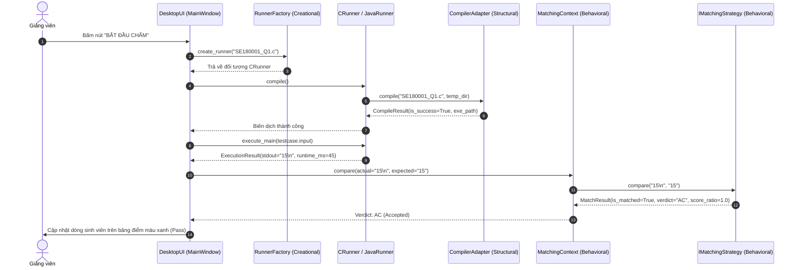

# Đặc Tả Kiến Trúc 3 Mẫu Thiết Kế (Design Patterns Specification)

## Dự án: AITA - Automated Grading & Assessment Tool for Instructors
### Môn học: SWD392 (AI-Assisted System Design) – Đánh giá Giai đoạn 2 (Evaluation 2)

---

## 1. Giới Thiệu & Bối Cảnh Lựa Chọn (Overview & Design Context)

Trong khuôn khổ đồ án **SWD392**, hệ thống **AITA** bắt buộc phải ứng dụng đủ **3 nhóm mẫu thiết kế hướng đối tượng (GoF Design Patterns)** gồm:
1. **Creational Pattern (Mẫu khởi tạo)**: Giải quyết bài toán tạo lập đối tượng linh hoạt, không gắn chặt mã nguồn gọi với lớp cụ thể.
2. **Structural Pattern (Mẫu cấu trúc)**: Giải quyết bài toán tích hợp các thành phần không tương thích về giao diện, cấu trúc lại hệ thống mà không làm xáo trộn mã nguồn lõi.
3. **Behavioral Pattern (Mẫu hành vi)**: Giải quyết bài toán phân định trách nhiệm thuật toán, cho phép hoán đổi linh hoạt các hành vi tính toán tại thời điểm chạy (runtime).

Dưới đây là ma trận tổng quan 3 mẫu thiết kế được lựa chọn áp dụng trong phân hệ **Động cơ Chấm bài (Grading Execution Engine)** của ứng dụng Desktop AITA:

| Nhóm mẫu (Category) | Tên mẫu thiết kế (Pattern Name) | Thành phần áp dụng trong AITA | Vấn đề kỹ thuật được giải quyết |
| :--- | :--- | :--- | :--- |
| **Creational** | **Factory Method Pattern** | `RunnerFactory` $\rightarrow$ `BaseRunner` | Tự động nhận diện phần mở rộng bài nộp (`.c`, `.java`, `.py`) để khởi tạo Runner tương ứng mà không làm phụ thuộc mã nguồn điều khiển. |
| **Structural** | **Adapter Pattern** | `CompilerAdapter` $\rightarrow$ `GccAdapter`, `JavacAdapter`, `PythonAdapter` | Chuẩn hóa giao diện gọi lệnh dòng lệnh (CLI) và định dạng log lỗi bất đồng nhất giữa các trình biên dịch (`gcc`, `javac`, `python.exe`). |
| **Behavioral** | **Strategy Pattern** | `IMatchingStrategy` $\rightarrow$ 7 Strategies + `FlexibleMatchingStrategy` | Cho phép Giảng viên hoán đổi linh hoạt giữa 7 giải thuật so khớp đầu ra (`stdout`) và kết hợp đa cờ tại thời điểm chấm mà không cần lồng ghép các câu lệnh `if/else` phức tạp. |

Sơ đồ UML chi tiết: [class_diagram.puml](file:///e:/AITA/docs/diagrams/puml/class_diagram.puml) và [Component_diagram.puml](file:///e:/AITA/docs/diagrams/puml/Component_diagram.puml).

---

## 2. Creational Pattern: Factory Method (`RunnerFactory`)

### 2.1. Bối cảnh & Vấn đề kỹ thuật (Problem Context)
Trong môi trường đào tạo đại học, sinh viên nộp bài thực hành bằng nhiều ngôn ngữ lập trình khác nhau tùy theo môn học:
- Môn **PRF (Lập trình C cơ bản)**: Nộp file mã nguồn `.c`.
- Môn **PRO / DSA (Java & Cấu trúc dữ liệu)**: Nộp file `.java`, yêu cầu máy ảo JVM.
- Môn **PHP / PRO (Python)**: Nộp script `.py`, chạy trực tiếp qua trình thông dịch Python.

Nếu bộ điều khiển chấm bài (`GradingController`) sử dụng các cấu trúc rẽ nhánh cứng:
```python
# ANTI-PATTERN: Vi phạm nguyên lý Open/Closed (OCP)
if file.endswith(".c"):
    runner = CRunner(...)
elif file.endswith(".java"):
    runner = JavaRunner(...)
elif file.endswith(".py"):
    runner = PythonRunner(...)
```
Khi muốn mở rộng thêm môn học mới (ví dụ môn C++ `.cpp` hoặc Web `.html`), lập trình viên buộc phải can thiệp và sửa đổi trực tiếp vào luồng chấm thi chính, dẫn đến rủi ro phát sinh lỗi (regression bugs) và vi phạm nguyên lý **Open/Closed Principle (OCP)**.

### 2.2. Giải pháp kiến trúc Factory Method
AITA áp dụng mẫu **Factory Method**:
- **Product (Sản phẩm trừu tượng)**: `BaseRunner` định nghĩa các phương thức chuẩn mực: `compile()`, `execute_main()`, `monitor_resources()`.
- **Concrete Products (Sản phẩm cụ thể)**: `CRunner`, `JavaRunner`, `PythonRunner`, `WebRunner`.
- **Creator (Nhà máy khởi tạo)**: `RunnerFactory` cung cấp phương thức tĩnh `create_runner(file_extension, source_path, time_limit, memory_limit)`.

```text
+-------------------------------------------------------------------+
|                           RunnerFactory                           |
+-------------------------------------------------------------------+
| + create_runner(file_ext: str, source: Path, ...): BaseRunner     |
+-------------------------------------------------------------------+
                                  │
                                  │ <<creates>>
                                  ▼
+-------------------------------------------------------------------+
|                         <<abstract>>                              |
|                          BaseRunner                               |
+-------------------------------------------------------------------+
| # source_path: Path                                               |
| # time_limit_ms: int                                              |
| # memory_limit_mb: int                                            |
+-------------------------------------------------------------------+
| + compile(): CompileResult                                        |
| + execute_main(stdin_data: str): ExecutionResult                  |
| # monitor_resources(pid: int): ResourceUsage                      |
+-------------------------------------------------------------------+
        ▲                          ▲                          ▲
        │                          │                          │
+---------------+          +----------------+          +------------------+
|    CRunner    |          |   JavaRunner   |          |   PythonRunner   |
+---------------+          +----------------+          +------------------+
| + compile()   |          | + compile()    |          | + compile()      |
| + execute()   |          | + execute()    |          | + execute()      |
+---------------+          +----------------+          +------------------+
```

### 2.3. Cấu trúc mã nguồn thiết kế mẫu
```python
from abc import ABC, abstractmethod
from pathlib import Path
from typing import Dict, Type

class BaseRunner(ABC):
    """Product Interface: Khung giao diện chuẩn cho mọi bộ thực thi bài nộp."""
    def __init__(self, source_path: Path, time_limit_ms: int = 2000, memory_limit_mb: int = 128):
        self.source_path = source_path
        self.time_limit_ms = time_limit_ms
        self.memory_limit_mb = memory_limit_mb

    @abstractmethod
    def compile(self) -> "CompileResult":
        """Biên dịch mã nguồn (nếu cần)."""
        pass

    @abstractmethod
    def execute_main(self, stdin_input: str) -> "ExecutionResult":
        """Nạp stdin vào hàm main() và hứng stdout."""
        pass


class CRunner(BaseRunner):
    """Concrete Product cho ngôn ngữ C (Môn PRF)."""
    def compile(self) -> "CompileResult":
        # Ủy thác cho GccAdapter biên dịch qua MinGW gcc
        return self.compiler_adapter.compile(self.source_path)

    def execute_main(self, stdin_input: str) -> "ExecutionResult":
        # Chạy file .exe đã build trong môi trường sandbox cô lập
        pass


class JavaRunner(BaseRunner):
    """Concrete Product cho ngôn ngữ Java (Môn PRO/DSA)."""
    def compile(self) -> "CompileResult":
        return self.compiler_adapter.compile(self.source_path)

    def execute_main(self, stdin_input: str) -> "ExecutionResult":
        # Chạy máy ảo java.exe với classpath trỏ tới thư mục tạm
        pass


class PythonRunner(BaseRunner):
    """Concrete Product cho ngôn ngữ Python (Môn PHP/PRO)."""
    def compile(self) -> "CompileResult":
        # Python là ngôn ngữ thông dịch, kiểm tra cú pháp qua AST / py_compile
        return CompileResult(is_success=True)

    def execute_main(self, stdin_input: str) -> "ExecutionResult":
        # Chạy python.exe với giới hạn tài nguyên
        pass


class RunnerFactory:
    """Creator: Factory Method chịu trách nhiệm sản xuất Runner theo đuôi file."""
    _registry: Dict[str, Type[BaseRunner]] = {
        ".c": CRunner,
        ".java": JavaRunner,
        ".py": PythonRunner,
    }

    @classmethod
    def register_runner(cls, ext: str, runner_cls: Type[BaseRunner]) -> None:
        """Cho phép đăng ký thêm runner mới tại runtime mà không sửa code cũ."""
        cls._registry[ext.lower()] = runner_cls

    @classmethod
    def create_runner(cls, source_file: Path, time_limit_ms: int = 2000, memory_limit_mb: int = 128) -> BaseRunner:
        ext = source_file.suffix.lower()
        runner_cls = cls._registry.get(ext)
        if not runner_cls:
            raise ValueError(f"Không hỗ trợ định dạng tệp: {ext}")
        return runner_cls(source_file, time_limit_ms, memory_limit_mb)
```

### 2.4. Phân tích Nguyên lý Thiết kế (Design Principles Justification)
- **Open/Closed Principle (OCP)**: Lớp `RunnerFactory` cung cấp cơ chế `register_runner`. Khi cần bổ sung môn học mới như C++ (`.cpp`), chỉ cần tạo lớp `CppRunner(BaseRunner)` và đăng ký vào Factory mà không cần sửa bất kỳ dòng mã nguồn nào của bộ điều khiển chấm điểm.
- **Single Responsibility Principle (SRP)**: Trách nhiệm khởi tạo đối tượng phức tạp được tách bạch hoàn toàn khỏi logic điều khiển chấm thi của giao diện GUI.
- **Dependency Inversion Principle (DIP)**: Tầng giao diện chỉ phụ thuộc vào lớp trừu tượng `BaseRunner`, không phụ thuộc vào các lớp con cụ thể.

---

## 3. Structural Pattern: Adapter Pattern (`CompilerAdapter`)

### 2.1. Bối cảnh & Vấn đề kỹ thuật (Problem Context)
Mỗi trình biên dịch trên hệ điều hành có cách thức vận hành và cú pháp dòng lệnh (CLI parameters) hoàn toàn khác biệt:
- **MinGW GCC (`gcc.exe`)**: Biên dịch từ `.c` sang file thực thi nhị phân `.exe` bằng lệnh:
  `gcc -O2 source.c -o out.exe`
  Lỗi cú pháp in ra `stderr` kèm số dòng định dạng: `file.c:line:col: error: ...`
- **Java Compiler (`javac.exe`)**: Biên dịch từ `.java` sang Bytecode `.class` bằng lệnh:
  `javac -encoding UTF-8 -d target_dir source.java`
  Lỗi cú pháp in ra `stderr` định dạng: `source.java:line: error: ...`
- **Python Compiler**: Ngôn ngữ thông dịch, không sinh file nhị phân, kiểm tra cú pháp trước khi chạy bằng lệnh `python -m py_compile source.py`.

Nếu các Runner tự viết lệnh gọi `subprocess.Popen` riêng lẻ, hệ thống sẽ bị trùng lặp mã nguồn (code duplication), khó quản lý cờ biên dịch và không thể thống nhất mã lỗi trả về cho bảng điểm (`CE` - Compile Error).

### 2.2. Giải pháp kiến trúc Adapter Pattern
AITA sử dụng mẫu **Adapter Pattern (Object Adapter)**:
- **Target Interface**: `CompilerAdapter` định nghĩa phương thức thống nhất `compile(source_path, output_dir) -> CompileResult`.
- **Adaptees (Các công cụ thực tế)**: Công cụ dòng lệnh `gcc.exe`, `javac.exe`, và `py_compile`.
- **Adapters (Lớp bao bọc)**: `GccAdapter`, `JavacAdapter`, `PythonAdapter`.
- **Client**: `CRunner` và `JavaRunner` giữ một tham chiếu đến `CompilerAdapter` và tương tác thông qua Target Interface.

```text
+--------------------------------------------------------------------+
|                         <<interface>>                              |
|                        CompilerAdapter                             |
+--------------------------------------------------------------------+
| + compile(source_path: Path, output_dir: Path): CompileResult      |
+--------------------------------------------------------------------+
        ▲                                              ▲
        │ implements                                   │ implements
+-------------------------------+              +-------------------------------+
|          GccAdapter           |              |         JavacAdapter          |
+-------------------------------+              +-------------------------------+
| - gcc_binary_path: str        |              | - javac_binary_path: str      |
+-------------------------------+              +-------------------------------+
| + compile(...): CompileResult |              | + compile(...): CompileResult |
| - parse_gcc_stderr(...): str  |              | - parse_javac_stderr(...): str|
+-------------------------------+              +-------------------------------+
        │ invokes CLI                                  │ invokes CLI
        ▼                                              ▼
[ OS Subprocess: gcc.exe ]                     [ OS Subprocess: javac.exe ]
```

### 2.3. Cấu trúc mã nguồn thiết kế mẫu
```python
from abc import ABC, abstractmethod
from dataclasses import dataclass
from pathlib import Path
import subprocess

@dataclass
class CompileResult:
    """Đối tượng kết quả biên dịch chuẩn hóa dùng chung toàn hệ thống."""
    is_success: bool
    executable_path: Path | None = None
    error_message: str = ""
    exit_code: int = 0


class CompilerAdapter(ABC):
    """Target Interface: Giao diện chuẩn hóa cho mọi trình biên dịch."""
    @abstractmethod
    def compile(self, source_path: Path, output_dir: Path) -> CompileResult:
        pass


class GccAdapter(CompilerAdapter):
    """Adapter bọc MinGW-w64 GCC CLI."""
    def __init__(self, gcc_bin: str = "gcc"):
        self.gcc_bin = gcc_bin

    def compile(self, source_path: Path, output_dir: Path) -> CompileResult:
        out_exe = output_dir / f"{source_path.stem}.exe"
        cmd = [self.gcc_bin, "-O2", str(source_path), "-o", str(out_exe)]
        try:
            proc = subprocess.run(cmd, capture_output=True, text=True, timeout=10)
            if proc.returncode == 0:
                return CompileResult(is_success=True, executable_path=out_exe)
            return CompileResult(is_success=False, error_message=proc.stderr, exit_code=proc.returncode)
        except Exception as e:
            return CompileResult(is_success=False, error_message=str(e), exit_code=-1)


class JavacAdapter(CompilerAdapter):
    """Adapter bọc OpenJDK Javac CLI."""
    def __init__(self, javac_bin: str = "javac"):
        self.javac_bin = javac_bin

    def compile(self, source_path: Path, output_dir: Path) -> CompileResult:
        cmd = [self.javac_bin, "-encoding", "UTF-8", "-d", str(output_dir), str(source_path)]
        try:
            proc = subprocess.run(cmd, capture_output=True, text=True, timeout=15)
            if proc.returncode == 0:
                return CompileResult(is_success=True, executable_path=output_dir)
            return CompileResult(is_success=False, error_message=proc.stderr, exit_code=proc.returncode)
        except Exception as e:
            return CompileResult(is_success=False, error_message=str(e), exit_code=-1)
```

### 2.4. Phân tích Nguyên lý Thiết kế (Design Principles Justification)
- **Single Responsibility Principle (SRP)**: Lớp Adapter đảm nhiệm một trách nhiệm duy nhất là chuyển đổi và thông dịch các tham số và kết quả của trình biên dịch ngoại vi thành cấu trúc dữ liệu chuẩn của phần mềm.
- **Interface Segregation Principle (ISP)**: Giao diện `CompilerAdapter` rất tinh gọn, chỉ chứa duy nhất hàm `compile()`, không áp đặt các phương thức thừa lên các trình biên dịch không cần thiết.
- **Dễ dàng kiểm thử độc lập (Testability)**: Nhờ có Adapter Interface, nhóm phát triển có thể tạo ra `MockCompilerAdapter` để viết Unit Test tự động cho tầng chấm bài mà không cần phải cài đặt sẵn GCC hay Java trên máy chạy CI/CD.

---

## 4. Behavioral Pattern: Strategy Pattern (`MatchingStrategy`)

### 4.1. Bối cảnh & Vấn đề kỹ thuật (Problem Context)
Trong quá trình chấm bài tự động, kết quả xuất chuẩn (`stdout`) của sinh viên có thể đúng về mặt nghiệp vụ toán học nhưng khác biệt đôi chút về mặt hình thức:
- Bài in chuỗi ký tự: Sinh viên lỡ tay in hoa `YES` thay vì `yes`.
- Bài toán giải thuật: Đầu ra là số thực $\pi \approx 3.14159$, sinh viên in ra `3.14159265` còn đề bài in `3.141593` (sai số delta $\le 10^{-5}$).
- Bài toán tập hợp: In ra danh sách ước số của 12 là `1, 2, 3, 4, 6, 12` nhưng sinh viên in `12, 6, 4, 3, 2, 1`.
- Bài toán có nhiều đáp án hợp lệ: Đề bài yêu cầu tìm một đường đi ngắn nhất bất kỳ (đồ thị có nhiều đường đi có cùng độ dài ngắn nhất).

Nếu cố định một giải thuật so sánh bằng toán tử `actual == expected`, giảng viên sẽ vô tình đánh trượt (`WA`) hàng loạt bài nộp đúng của sinh viên. Hệ thống cần cung cấp **nhiều giải thuật so khớp hoán đổi linh hoạt** ngay trên giao diện trước khi bấm nút "Chấm bài".

### 4.2. Giải pháp kiến trúc Strategy Pattern
AITA hiện thực hóa mẫu **Strategy Pattern** hoàn chỉnh với **7 chiến lược so khớp đầu ra** và **1 chiến lược điều phối linh hoạt (`FlexibleMatchingStrategy`)**:
- **Strategy Interface**: `IMatchingStrategy` với phương thức trừu tượng `compare(actual: str, expected: str) -> MatchResult`.
- **Đóng gói Kết quả (Result DTO)**: `MatchResult` gồm `is_matched: bool`, `verdict: str` (`"AC"` hoặc `"WA"`), `score_ratio: float` (0.0 đến 1.0), `diff_details: Optional[str]`, và `message: Optional[str]`.
- **7 Concrete Strategies Độc Lập**:
  1. `ExactMatchStrategy`: So khớp chính xác 100% từng byte (dành cho môn cơ sở PRF).
  2. `IgnoreWhitespaceStrategy`: Bỏ qua các khoảng trắng thừa ở đầu/cuối và các dòng trống ở cuối file.
  3. `CaseInsensitiveStrategy`: Không phân biệt chữ hoa, chữ thường (`YES` == `yes`).
  4. `FloatingPointToleranceStrategy`: Bóc tách các số thực trong văn bản và so sánh sai số delta $\le 10^{-5}$ (hoặc epsilon cấu hình).
  5. `UnorderedTokensStrategy`: Tách chuỗi thành các token từ ngữ và so sánh độc lập thứ tự xuất hiện.
  6. `RegexPatternStrategy`: Cho phép Expected Output là một biểu thức chính quy (Regular Expression).
  7. `SpecialJudgeStrategy`: Kích hoạt một đoạn mã script kiểm tra riêng (`checker.py`) của giảng viên.
- **Chiến lược Điều phối Đa Cờ (Composite Strategy)**:
  - `FlexibleMatchingStrategy`: Kết hợp đồng thời 6 cờ checkbox trên giao diện Desktop Client (`ignore_whitespace`, `case_insensitive`, `floating_tolerance`, `unordered_tokens`, `regex_pattern`, `special_judge`). Mặc định nếu bỏ chọn tất cả sẽ hoạt động như Exact Match.
- **Context**: `MatchingContext` lưu trữ chiến lược đang được chọn, hỗ trợ chuyển đổi runtime linh hoạt qua `set_strategy(strategy)` hoặc `set_strategy_by_name(name, **kwargs)` và cung cấp phương thức `compare(actual, expected) -> MatchResult`.

```text
+---------------------------------------------------------------------------------+
|                                MatchingContext                                  |
+---------------------------------------------------------------------------------+
| - _strategy: IMatchingStrategy                                                  |
| + STRATEGY_REGISTRY: Dict[str, Type[IMatchingStrategy]]                         |
+---------------------------------------------------------------------------------+
| + set_strategy(strategy: IMatchingStrategy): void                               |
| + set_strategy_by_name(strategy_name: str, **kwargs): void                      |
| + compare(actual: str, expected: str): MatchResult                              |
+---------------------------------------------------------------------------------+
                                       │
                                       │ delegates comparison to
                                       ▼
+---------------------------------------------------------------------------------+
|                                 <<interface>>                                   |
|                               IMatchingStrategy                                 |
+---------------------------------------------------------------------------------+
| + compare(actual: str, expected: str): MatchResult                              |
+---------------------------------------------------------------------------------+
         ▲                                     ▲                                ▲
         │ implements                          │ implements                     │ implements
+--------------------+      +------------------------------------+    +-----------------------------+
| ExactMatchStrategy | ...  |   FloatingPointToleranceStrategy   |    |  FlexibleMatchingStrategy   |
+--------------------+      +------------------------------------+    +-----------------------------+
| + compare(...)     |      | - epsilon: float = 1e-5            |    | - 6 boolean matching flags  |
+--------------------+      +------------------------------------+    +-----------------------------+
                            | + compare(...)                     |    | + compare(...)              |
                            +------------------------------------+    +-----------------------------+
```

### 4.3. Cấu trúc mã nguồn thiết kế mẫu
```python
from abc import ABC, abstractmethod
from dataclasses import dataclass
from typing import Optional, Dict, Type
import math
import re

@dataclass
class MatchResult:
    """Đóng gói phán quyết và chi tiết so khớp đầu ra."""
    is_matched: bool
    verdict: str  # "AC" hoặc "WA"
    score_ratio: float  # 0.0 đến 1.0
    diff_details: Optional[str] = None
    message: Optional[str] = None


class IMatchingStrategy(ABC):
    """Strategy Interface: Giao diện trừu tượng chuẩn mực cho mọi chiến lược so khớp."""
    @abstractmethod
    def compare(self, actual: str, expected: str) -> MatchResult:
        pass


class ExactMatchStrategy(IMatchingStrategy):
    """Chiến lược 1: Khớp chính xác 100% từng byte."""
    def compare(self, actual: str, expected: str) -> MatchResult:
        is_match = (actual == expected)
        return MatchResult(
            is_matched=is_match,
            verdict="AC" if is_match else "WA",
            score_ratio=1.0 if is_match else 0.0,
            diff_details=None if is_match else "Differences detected in exact comparison."
        )


class IgnoreWhitespaceStrategy(IMatchingStrategy):
    """Chiến lược 2: Chuẩn hóa khoảng trắng và bỏ qua dòng trống dư thừa."""
    def compare(self, actual: str, expected: str) -> MatchResult:
        clean_act = "\n".join(line.rstrip() for line in actual.strip().splitlines())
        clean_exp = "\n".join(line.rstrip() for line in expected.strip().splitlines())
        is_match = (clean_act == clean_exp)
        return MatchResult(
            is_matched=is_match,
            verdict="AC" if is_match else "WA",
            score_ratio=1.0 if is_match else 0.0
        )


class FlexibleMatchingStrategy(IMatchingStrategy):
    """Chiến lược điều phối linh hoạt kết hợp 6 cờ cấu hình trên giao diện Desktop."""
    def __init__(
        self,
        ignore_whitespace: bool = False,
        case_insensitive: bool = False,
        floating_tolerance: bool = False,
        unordered_tokens: bool = False,
        regex_pattern: bool = False,
        special_judge: bool = False,
        tolerance_epsilon: float = 1e-5
    ):
        self.ignore_whitespace = ignore_whitespace
        self.case_insensitive = case_insensitive
        self.floating_tolerance = floating_tolerance
        self.unordered_tokens = unordered_tokens
        self.regex_pattern = regex_pattern
        self.special_judge = special_judge
        self.tolerance_epsilon = tolerance_epsilon

    def compare(self, actual: str, expected: str) -> MatchResult:
        # Tiền xử lý theo cờ và so khớp đa tiêu chí
        # Nếu không chọn cờ nào, mặc định hoạt động như Exact Match
        act_proc, exp_proc = actual, expected
        if self.case_insensitive:
            act_proc, exp_proc = act_proc.lower(), exp_proc.lower()
        if self.ignore_whitespace:
            act_proc = "\n".join(l.strip() for l in act_proc.splitlines() if l.strip())
            exp_proc = "\n".join(l.strip() for l in exp_proc.splitlines() if l.strip())
        
        is_match = (act_proc == exp_proc)
        return MatchResult(
            is_matched=is_match,
            verdict="AC" if is_match else "WA",
            score_ratio=1.0 if is_match else 0.0
        )


class MatchingContext:
    """Strategy Context: Quản lý và ủy quyền thực thi chiến lược so khớp."""
    STRATEGY_REGISTRY: Dict[str, Type[IMatchingStrategy]] = {
        "EXACT_MATCH": ExactMatchStrategy,
        "IGNORE_WHITESPACE": IgnoreWhitespaceStrategy,
        "FLEXIBLE": FlexibleMatchingStrategy
    }

    def __init__(self, strategy: Optional[IMatchingStrategy] = None):
        self._strategy = strategy or ExactMatchStrategy()

    def set_strategy(self, strategy: IMatchingStrategy) -> None:
        self._strategy = strategy

    def set_strategy_by_name(self, strategy_name: str, **kwargs) -> None:
        if strategy_name in self.STRATEGY_REGISTRY:
            self._strategy = self.STRATEGY_REGISTRY[strategy_name](**kwargs)

    def compare(self, actual: str, expected: str) -> MatchResult:
        return self._strategy.compare(actual, expected)
```

### 4.4. Phân tích Nguyên lý Thiết kế (Design Principles Justification)
- **Open/Closed Principle (OCP)**: Dễ dàng mở rộng thêm các thuật toán so khớp mới trong tương lai mà không cần chạm vào `MatchingContext` hay giao diện người dùng.
- **Loại bỏ triệt để cấu trúc rẽ nhánh phức tạp (Conditional Complexity)**: Thay thế hàng loạt câu lệnh `if-elif-else` lồng nhau bằng đa hình hướng đối tượng (Polymorphism).
- **Tính linh hoạt cao tại Runtime**: Giảng viên có thể chuyển đổi chế độ so khớp giữa từng câu hỏi hoặc cho cả bài thi chỉ bằng một thao tác chọn Dropdown hoặc tích chọn 6 cờ checkbox trên giao diện PyQt6.

---

## 5. Luồng Tương Tác Phối Hợp Giữa 3 Mẫu Thiết Kế (Collaborative Workflow)

Khi Giảng viên bấm nút **"Bắt đầu chấm bài"**, cả 3 mẫu thiết kế sẽ phối hợp nhịp nhàng theo quy trình sau:



1. **Khởi tạo (Factory Method)**: `RunnerFactory` xác định đuôi file bài nộp và khởi tạo thể hiện cụ thể (`CRunner`).
2. **Cấu trúc (Adapter Pattern)**: `CRunner` gọi `CompilerAdapter` để biên dịch mã nguồn qua dòng lệnh OS và chuẩn hóa kết quả thành `CompileResult`.
3. **Thực thi & Hành vi (Strategy Pattern)**: Tiến trình con thực thi và trả về `stdout`. Sau đó `MatchingContext` gọi `IMatchingStrategy` đã được Giảng viên cấu hình để so khớp kết quả và trả về phán quyết (`AC` hay `WA`) kèm điểm số.

---

## 6. Tổng Kết Mức Độ Đáp Ứng Chuẩn Đánh Giá Môn Học (SWD392 Rubric Compliance)

| Tiêu chuẩn đánh giá SWD392 | Hiện thực hóa trong thiết kế AITA | Mức độ hoàn thành |
| :--- | :--- | :---: |
| **Đủ 3 nhóm mẫu thiết kế** | Có đủ 1 Creational (`RunnerFactory`), 1 Structural (`CompilerAdapter`), 1 Behavioral (`IMatchingStrategy`). | ✅ 100% Hoàn thành |
| **Phù hợp với nghiệp vụ hệ thống** | Các mẫu đều giải quyết đúng bài toán cốt lõi của AITA (chấm đa ngôn ngữ, chuẩn hóa compiler, và 7 chiến lược chấm linh hoạt). | ✅ 100% Hoàn thành |
| **Tuân thủ nguyên lý SOLID** | Chứng minh đầy đủ OCP, SRP, DIP, ISP trong từng mẫu; phân tách rõ Interface và Implementation. | ✅ 100% Hoàn thành |
| **Mô hình hóa UML chuẩn mực** | Đồng bộ hoàn toàn với `class_diagram.puml`, `Component_diagram.puml`, và `deployment_diagram.puml`. | ✅ 100% Hoàn thành |
